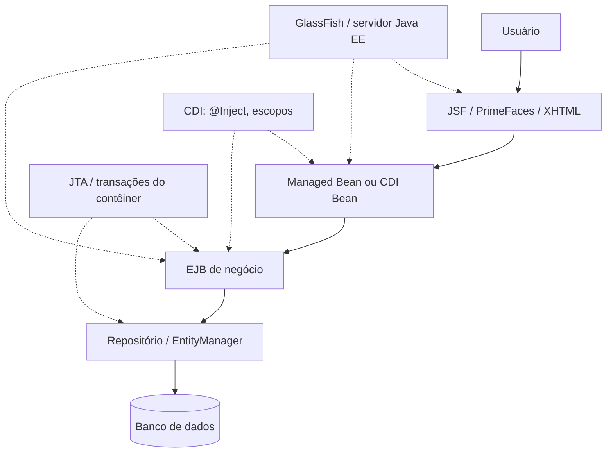
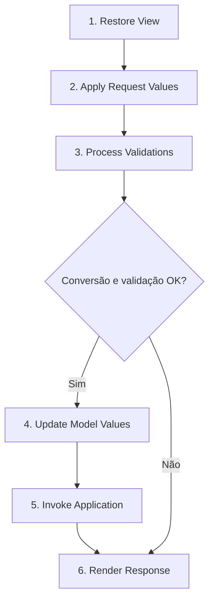
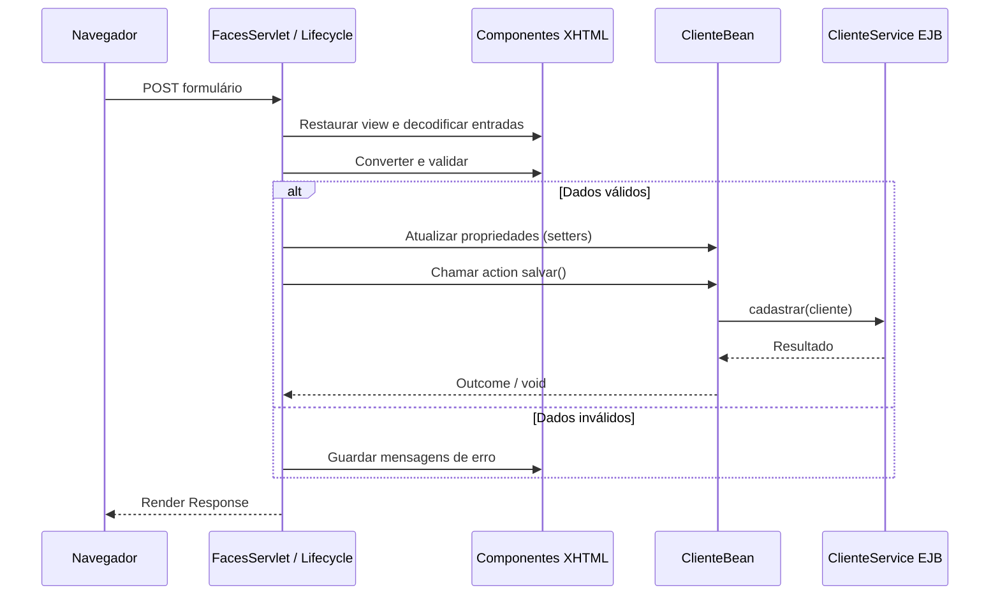
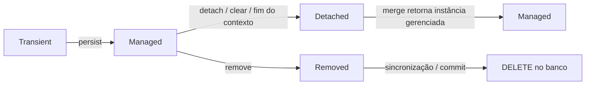
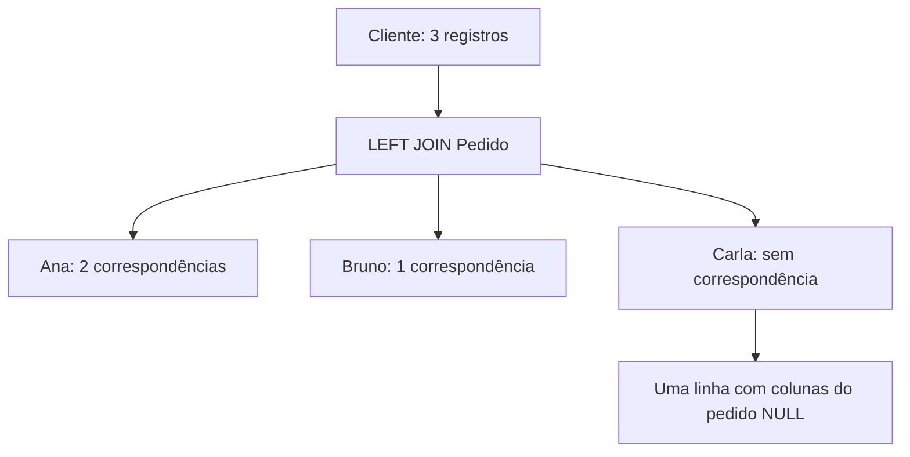
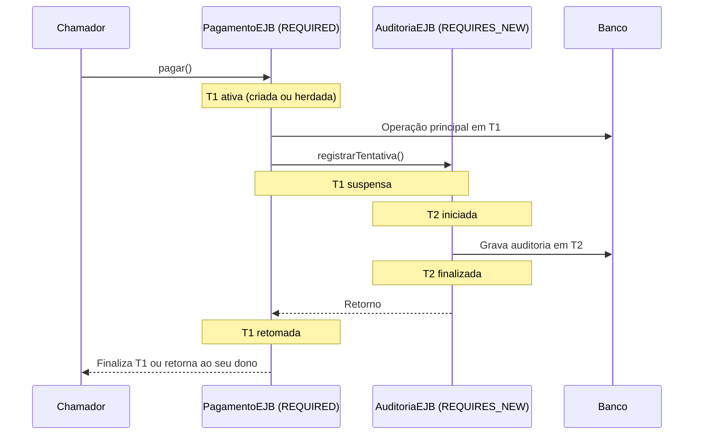
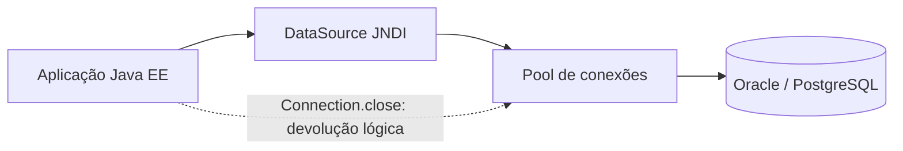
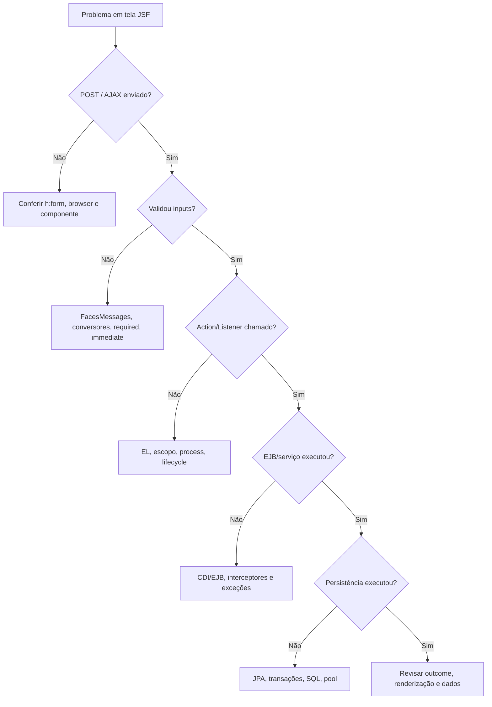
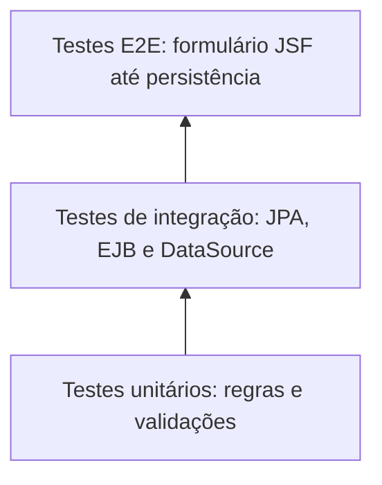

# Guia de estudos — Java EE / Jakarta EE

> **Escopo:** JSF / PrimeFaces, Managed Beans, CDI, EJB, JPA / Hibernate, SQL / JOIN, JDBC, transações, GlassFish, Swing, SVN e análise de sistemas legados.  
> **Formato:** teoria aplicada + leitura de código + pegadinhas + questões de prova + gabarito comentado.  
> **Base:** anotações de estudo previamente fornecidas e imagem `PROVA-PORTUGAL.txt`, com perguntas relatadas por uma pessoa que realizou uma prova.  
> **Convenção dos exemplos:** `jakarta.*` (Jakarta EE 9+). Em Java EE mais antigo, vários imports correspondentes são `javax.*`. Consulte sempre a versão real do servidor e das dependências.

## Como estudar este material

1. **Leia um tema sem olhar o gabarito.** Explique o comportamento com suas próprias palavras.
2. **Execute mentalmente o código.** Identifique a camada responsável (Faces, CDI, EJB, JPA, JDBC ou banco).
3. **Resolva o simulado.** Justifique por que as alternativas incorretas estão erradas.
4. **Pratique no laboratório.** As questões de prova exigem reconhecer código, não apenas decorar definições.

> **Limite da fonte:** a imagem traz anotações de memória e marcações pessoais como “OK”, mas não contém os enunciados completos nem todos os trechos de código da prova. Portanto, **não é possível confirmar o gabarito original**, apenas analisar a plausibilidade das respostas relatadas. Os trechos de prova e alternativas apresentados neste guia são **reconstruções didáticas**, não transcrições da prova.

---

# 1. Mapeamento das perguntas efetivamente relatadas

| # | Assunto observado na imagem | Resposta registrada | Avaliação técnica / estudo prioritário |
|---|---|---|---|
| 1 | O que faltava em código XHTML? | `Form` | **Plausível**, se o objetivo era submeter entradas via componentes JSF: geralmente `<h:form>`. Não há código original para confirmar. |
| 2 | Trazer todos os registros de uma tabela mesmo sem correspondência na outra | `LEFT JOIN` | **Correto**, considerando a tabela preservada posicionada à esquerda. Cuidado com filtros no `WHERE`. |
| 3 | Identificar erros em classe `@Entity` | `@Column` no getter, PK sem `@Id` e `@GeneratedId` | **Parcialmente correto**: `@Id` é essencial para identificar a PK. **`@Column` no getter pode ser válido** com acesso por propriedade. **`@GeneratedValue` é opcional** quando o ID é atribuído manualmente; `@GeneratedId` não é a anotação padrão JPA. |
| 4 | Quais anotações de relacionamento no modelo? | `OneToMany`, `ManyToOne` | **Plausível**, mas só o desenho completo das classes mostraria qual lado recebe cada anotação. |
| 5 | Anotação de Managed Bean JSF | `@ManagedBean`, `@Named` | **Depende da versão**: `@ManagedBean` é abordagem JSF antiga; `@Named` é CDI e é a opção moderna. Em Jakarta Faces 4, o antigo gerenciamento de beans JSF foi removido. |
| 6 | Tipos de transação EJB | Não soube | **Prioridade máxima:** os seis `TransactionAttributeType` e seus efeitos. |
| 7 | Diferença entre `action` e `actionListener` | Não soube | **Prioridade máxima:** retorno, evento, ordem convencional, navegação e fase do lifecycle. |
| 8 | `Statement.close()`, `Connection.close()` e quem gerencia commit | Fechamento de recursos e contêiner | **Plausível**, mas `close()` **não é sinônimo de commit**. Depende de CMT/BMT/JTA, JDBC autocommit e DataSource. |
| 9 | Alternativas com `Session`, `UserTransaction` e uma terceira | `Session` | **Não verificável** sem enunciado. Estude a diferença entre Hibernate `Session`, `EntityManager`, `UserTransaction` e sessão JMS/HTTP. |
| 10 | O que acontece ao submeter formulário JSF? | Bean recebe propriedades | **Correto sob condições:** acontece em `Update Model Values`, depois de conversão e validação bem-sucedidas. |
| 11 | O que acontece ao clicar em Salvar com ou sem `action`? | Com action executa método; sem action não acontece nada | **Primeira metade plausível; segunda excessivamente absoluta:** sem `action` um botão pode ainda submeter o formulário. O que falta é um método de ação definido naquele atributo. |

**Ordem de prioridade:** 1) EJB/transações; 2) JSF lifecycle, `action` e `actionListener`; 3) mapeamentos e acesso JPA; 4) LEFT JOIN; 5) CDI/Managed Bean; 6) JDBC e operação.

---

# 2. Visão arquitetural: como as peças se relacionam



Em uma aplicação Java EE clássica, o XHTML descreve a interface; o FacesServlet coordena a interação com os componentes; o bean relaciona a tela às ações; um EJB ou serviço executa regras de negócio; o JPA gerencia entidades; um DataSource fornece conexões; o contêiner cuida de recursos e, conforme a demarcação escolhida, das transações.

**Pergunta de entrevista:** “Quem está executando esta ação e em qual camada?” Saber responder costuma ser mais útil do que decorar todas as anotações.

## 2.1 Java EE, Jakarta EE, JSF, CDI, EJB e Spring

| Conceito | O que é | Exemplo |
|---|---|---|
| Java EE / Jakarta EE | Plataforma de especificações corporativas | Faces, CDI, Enterprise Beans, Persistence, Transactions |
| JSF (Jakarta Faces) | Framework web baseado em componentes | `<h:form>`, `@ViewScoped` |
| PrimeFaces | Biblioteca de componentes construída sobre Faces | `<p:commandButton>` |
| CDI | Gerenciamento de contextos e injeção de dependências | `@Inject`, `@Named`, `@Qualifier` |
| EJB / Enterprise Beans | Componentes de negócio gerenciados pelo contêiner | `@Stateless`, `@TransactionAttribute` |
| JPA / Jakarta Persistence | Especificação de persistência | `@Entity`, `EntityManager` |
| Hibernate | Implementação de JPA e API ORM própria | Hibernate `Session` |
| GlassFish | Servidor de aplicação | Recursos JTA, EJB, CDI, deploy WAR/EAR |
| Spring Boot | Framework de aplicação com ecossistema próprio | `@Service`, Spring `@Transactional` |

**Compatibilidade:** aplicações Java EE 8 costumam usar `javax.*`. A mudança para `jakarta.*` a partir de Jakarta EE 9 demanda avaliação de bibliotecas, servidor e componentes; não basta alterar imports.

---

# 3. JSF — XHTML, formulário e ciclo de vida

## 3.1 O que significa faltar um `<h:form>`?

Em uma página JSF, os componentes de entrada e os comandos que dependem de submissão convencional devem estar, em regra, dentro de um formulário JSF.

### Trecho didático com problema

```xhtml
<h:body>
    <h:inputText value="#{clienteBean.nome}" />
    <h:commandButton value="Salvar" action="#{clienteBean.salvar}" />
</h:body>
```

### Correção

```xhtml
<h:body>
    <h:form id="formCliente">
        <h:outputLabel for="nome" value="Nome" />
        <h:inputText id="nome" value="#{clienteBean.nome}" required="true" />
        <h:message for="nome" />
        <h:commandButton value="Salvar" action="#{clienteBean.salvar}" />
    </h:form>
</h:body>
```

**O que a banca pode perguntar:** qual elemento permite a submissão de componentes JSF? A resposta esperada nesse tipo de exemplo costuma ser `<h:form>`, não uma tag HTML `<form>` escolhida arbitrariamente.

**Nuance:** nem toda página JSF precisa de um formulário: uma página somente de leitura pode renderizar conteúdo sem submissão. A resposta depende do fluxo mostrado.

## 3.2 As seis fases do lifecycle



| Fase | Responsabilidade | Pegadinha |
|---|---|---|
| Restore View | Construir/restaurar árvore de componentes | Uma requisição inicial pode não percorrer todas as fases como um postback. |
| Apply Request Values | Decodificar valores submetidos nos componentes | Ainda **não significa** que o setter do bean foi chamado. |
| Process Validations | Converter e validar valores | Erros podem impedir as fases posteriores. |
| Update Model Values | Atualizar propriedades associadas ao modelo | Geralmente chama os setters do bean. |
| Invoke Application | Executar ações e lógica de aplicação | Uma action normal é processada aqui, salvo alterações no fluxo. |
| Render Response | Produzir resposta HTML | Mensagens de erro podem ser exibidas aqui. |

### Questão reconstruída da prova

**“Quando o usuário submete um formulário, quando os valores chegam ao Managed Bean?”**

Resposta forte:

> Os parâmetros entram nos componentes em *Apply Request Values*; o JSF faz conversão e validação; se as fases necessárias forem bem-sucedidas, em *Update Model Values* o framework atualiza as propriedades do bean por meio das expressões EL e dos métodos de acesso. Depois executa a action em *Invoke Application*, quando aplicável.

### Experimento mental

1. `nome` está marcado `required="true"`.
2. O usuário clica em salvar sem preencher o campo.
3. A validação falha.
4. Normalmente o JSF renderiza a mesma página com erro; a propriedade do bean **não** é atualizada por aquele input inválido e a action convencional **não** é executada.

**Exceção relevante:** atributos como `immediate="true"` modificam a fase em que determinados componentes são validados e/ou seus eventos são processados. Isso exige análise componente a componente; não significa simplesmente “ignorar todas as validações”.

## 3.3 `action` × `actionListener`

| Item | `action` | `actionListener` |
|---|---|---|
| Papel central | Ação de aplicação e possível navegação | Reagir a evento de ação de um componente |
| Método usual | Sem argumento | Recebe `ActionEvent` (também há formas suportadas pelo framework) |
| Retorno | Outcome de navegação, ou `void` | `void` |
| Responsável por navegação? | Pode devolver outcome | Não retorna outcome |
| Ordem convencional | Depois dos action listeners, no processamento normal | Antes da invocação da action |
| Fase típica | Invoke Application | Invoke Application, exceto alterações como `immediate` |

### Exemplo

```java
@Named
@ViewScoped
public class ClienteBean implements Serializable {
    private String nome;

    public String salvar() {
        // executa regra de aplicação
        return "sucesso?faces-redirect=true";
    }

    public void antesDeSalvar(ActionEvent event) {
        // reage ao evento; não escolhe a navegação por retorno
    }

    public String getNome() { return nome; }
    public void setNome(String nome) { this.nome = nome; }
}
```

```xhtml
<h:commandButton
    value="Salvar"
    action="#{clienteBean.salvar}"
    actionListener="#{clienteBean.antesDeSalvar}" />
```

**Erros de prova a evitar:**

- “Action **sempre** retorna String” — **falso**; pode retornar `void`.
- “ActionListener é usado para navegação pelo retorno” — **falso**.
- “Listener sempre roda, independentemente de validação” — **falso**; depende do lifecycle, configuração e existência de erros.
- “ActionListener sempre é a primeira instrução executada no clique” — **falso**; há fases anteriores e, possivelmente, outros listeners.

## 3.4 Clicar em um botão sem `action`

```xhtml
<h:form>
    <h:inputText value="#{clienteBean.nome}" />
    <h:commandButton value="Enviar" />
</h:form>
```

O botão ainda é um componente de comando e pode submeter o formulário; pode haver processamento de valores e validações. **Não há um método de `action` explicitamente definido no botão**, mas isso não autoriza dizer que “nada acontece”. Outros mecanismos podem responder ao evento.

Compare com:

```xhtml
<h:commandButton value="Salvar" action="#{clienteBean.metodoInexistente}" />
```

Agora existe uma referência EL que pode falhar ao ser avaliada/invocada porque o método não existe, desde que o fluxo alcance a invocação. O tipo e a mensagem exata da exceção dependem da implementação e da versão.

## 3.5 `@ManagedBean` × `@Named`

### Legado (JSF gerencia bean)

```java
// Java EE / JSF antigo: javax.faces.bean.ManagedBean
@ManagedBean(name = "clienteBean")
@javax.faces.bean.ViewScoped
public class ClienteBean implements Serializable { }
```

### Abordagem CDI

```java
@Named("clienteBean")
@jakarta.faces.view.ViewScoped
public class ClienteBean implements Serializable { }
```

`@Named` expõe um bean CDI via EL. O `@ViewScoped` usado no exemplo moderno é o escopo de view associado ao Faces, integrado ao CDI. `@RequestScoped`, `@SessionScoped` e `@ApplicationScoped` também aparecem com frequência, mas pertencem a seus respectivos pacotes/contratos.

**Atenção à versão:** `@ManagedBean` do antigo JSF não é a solução recomendada em novas aplicações e foi removido em Jakarta Faces 4. Não misture anotações/pacotes sem verificar o servidor.

## 3.6 Escopos — perguntas rápidas

| Escopo | Duração principal | Cenário típico | Risco |
|---|---|---|---|
| Request | Uma requisição | Pesquisa simples sem estado | Perder dados entre postbacks. |
| View | Estado de uma view JSF enquanto for válida | Formulário AJAX | View expirada, serialização/passivação. |
| Session | Sessão do usuário | Preferências do usuário | Uso elevado de memória e estado obsoleto. |
| Application | Contexto de aplicação | Serviços/configurações compartilhadas | Estado mutável compartilhado entre usuários. |
| Dependent | Acompanhando dependência/proprietário CDI | Componente auxiliar | Ciclo de vida condicionado ao bean consumidor. |

`@ApplicationScoped` oferece uma instância contextual compartilhada, mas **não é idêntico em todos os detalhes** ao padrão criacional Singleton (há proxies e regras de contêiner).

## 3.7 PrimeFaces: `process` e `update`

```xhtml
<h:form id="cadastro">
    <p:inputText id="nome" value="#{clienteBean.nome}" />
    <p:commandButton value="Salvar"
                     action="#{clienteBean.salvar}"
                     process="@form"
                     update="mensagens" />
    <p:messages id="mensagens" />
</h:form>
```

- `process` define componentes processados no ciclo parcial da requisição AJAX.
- `update` define componentes que serão renderizados novamente na resposta parcial.
- Se o botão “não faz nada”, verifique: validação, escopo, IDs da árvore (`NamingContainer`), JS no navegador, logs e presença no `process`.

### Diagrama de sequência — fluxo de salvar



---

# 4. CDI — injeção, escopos e anotações

CDI (*Contexts and Dependency Injection*) implementa um modelo padronizado para resolver e gerenciar objetos, seu contexto de vida e a injeção de dependências. Inversão de Controle (IoC) é o princípio mais geral; injeção de dependências é uma das técnicas para realizá-lo.

```java
@ApplicationScoped
public class ClienteRepository {
    public void salvar(String nome) { /* ... */ }
}

@Named
@RequestScoped
public class ClienteBean {
    @Inject
    ClienteRepository repository;
}
```

## 4.1 Anotações essenciais

| Anotação | Significado |
|---|---|
| `@Inject` | Solicita injeção de dependência resolvida pelo CDI. |
| `@Named` | Nome para resolução em expressões EL. |
| `@Qualifier` | Distingue implementações candidatas. |
| `@Produces` | Declara método/campo produtor de objetos injetáveis. |
| `@Interceptor` + `@InterceptorBinding` | Define interceptação transversal. |
| `@RequestScoped`, `@ApplicationScoped` etc. | Contexto de vida de beans. |

### `@Qualifier` em modernização de legado

```java
@Qualifier
@Retention(RUNTIME)
@Target({TYPE, FIELD, PARAMETER, METHOD})
public @interface Legado {}

@Legado
@ApplicationScoped
public class ClienteLegadoGateway implements ClienteGateway { /* ... */ }

@Inject
@Legado
ClienteGateway gateway;
```

Isso deixa explícito qual implementação da interface será utilizada quando há opções de backend legado e novo.

## 4.2 Diagnóstico de falhas CDI

- **Unsatisfied dependency:** não há bean elegível para a injeção.
- **Ambiguous dependency:** há vários candidatos e faltam qualifiers/prioridade apropriada.
- **Bean não descoberto:** verificar configuração e modo de descoberta do bean archive.
- **Problema de serialização do escopo de view/session:** verificar beans, proxies e objetos armazenados.

---

# 5. JPA e Hibernate — identificar erros reais em `@Entity`

Este tema é especialmente importante porque a resposta registrada na imagem mistura um erro verdadeiro com **duas generalizações incorretas**.

## 5.1 O que realmente é obrigatório na entidade?

Uma entidade JPA precisa de identificação primária adequada (por exemplo, `@Id` em uma PK simples; há regras para chaves compostas). Já a geração automática é **uma opção**, não obrigação.

### Entidade com ID gerado

```java
@Entity
@Table(name = "CLIENTE")
public class Cliente {
    @Id
    @GeneratedValue(strategy = GenerationType.IDENTITY)
    private Long id;

    @Column(name = "NOME", nullable = false)
    private String nome;
}
```

### Entidade com ID definido pela aplicação — também válida

```java
@Entity
public class Documento {
    @Id
    private String codigoExterno;
}
```

Aqui, a aplicação deve preencher `codigoExterno` apropriadamente. Não existe obrigatoriedade universal de `@GeneratedValue`.

> **Pegadinha:** a anotação padronizada é `@GeneratedValue`, não `@GeneratedId`. Em uma prova, observe exatamente qual anotação aparece na alternativa.

## 5.2 `@Column` no getter está errado? Depende!

JPA admite **FIELD access** e **PROPERTY access**.

### FIELD access (mapeamento nos atributos)

```java
@Entity
@Access(AccessType.FIELD)
public class Cliente {
    @Id
    private Long id;

    @Column(name = "NOME")
    private String nome;

    public String getNome() { return nome; }
}
```

### PROPERTY access (mapeamento nos getters)

```java
@Entity
@Access(AccessType.PROPERTY)
public class Cliente {
    private Long id;
    private String nome;

    @Id
    public Long getId() { return id; }
    public void setId(Long id) { this.id = id; }

    @Column(name = "NOME")
    public String getNome() { return nome; }
    public void setNome(String nome) { this.nome = nome; }
}
```

**Ambos são válidos.** Em geral, a posição do `@Id` influencia o tipo de acesso implícito quando `@Access` não está explícito. Misturar o mapeamento dos atributos e getters arbitrariamente pode gerar comportamento indefinido ou mapeamento inesperado. Misturas intencionais devem usar `@Access` de forma apropriada.

**Regra mental para a prova:**

1. Onde está o `@Id`?
2. Há `@Access(FIELD)` ou `@Access(PROPERTY)` explícito?
3. Os demais mapeamentos estão consistentes com esse modo?
4. O ID é gerado pelo banco/provedor ou atribuído pelo sistema?

## 5.3 Encontre os problemas do exemplo

```java
@Entity
public class Pedido {
    private Long id;

    @Column(name = "TOTAL")
    public BigDecimal getTotal() { return total; }

    private BigDecimal total;
}
```

**Problema principal verificável:** não há atributo/propriedade identificada com `@Id` (nem outra estratégia de PK demonstrada). A presença de `@Column` no getter, isoladamente, não é um erro: pode ser o início de uma estratégia válida de propriedade, depois de completar a entidade e definir consistentemente o mapeamento.

**Correção possível:** adicionar `@Id` a um getter e completar os accessors, ou adotar consistentemente mapeamento por campos. A prova original não mostra o código completo; não se deve atribuir todos os erros a esse exemplo reconstruído.

## 5.4 Principais anotações de relacionamento

| Relacionamento | Exemplo | Em geral |
|---|---|---|
| `@OneToOne` | Usuário — Perfil | Uma entidade para outra. |
| `@OneToMany` | Cliente — Pedidos | Coleção de pedidos no cliente. |
| `@ManyToOne` | Pedido — Cliente | Referência ao cliente em cada pedido. |
| `@ManyToMany` | Aluno — Curso | Muitos de ambos os lados. |

### Bidirecional Cliente × Pedido

```java
@Entity
public class Cliente {
    @Id
    private Long id;

    @OneToMany(mappedBy = "cliente")
    private List<Pedido> pedidos = new ArrayList<>();
}
```

```java
@Entity
public class Pedido {
    @Id
    private Long id;

    @ManyToOne(fetch = FetchType.LAZY)
    @JoinColumn(name = "CLIENTE_ID")
    private Cliente cliente;
}
```

Aqui, `Pedido.cliente` é o lado dono dessa relação através da chave estrangeira `CLIENTE_ID`. O `mappedBy="cliente"` aponta para o atributo de relacionamento no lado dono.

**Perguntas comuns:**

- **Onde fica `@ManyToOne`?** No lado com muitos pedidos, que referencia um cliente.
- **Onde fica `@OneToMany`?** No cliente que possui uma coleção de pedidos.
- **`mappedBy` é nome da coluna?** **Não**, é o nome do atributo Java do outro lado da associação.
- **`@JoinColumn` e `mappedBy` são intercambiáveis?** **Não**; expressam papéis diferentes no mapeamento.

## 5.5 `EntityManager` × Hibernate `Session`

| EntityManager (JPA) | Session (Hibernate) |
|---|---|
| API padronizada | API própria do Hibernate |
| `persist`, `find`, `merge`, `remove` | Operações equivalentes e extras da API Hibernate |
| Contexto de persistência JPA | Contexto/sessão ORM Hibernate |
| Mais portável entre provedores | Acopla a implementação Hibernate |

Exemplo com JPA:

```java
@Stateless
public class ClienteRepository {
    @PersistenceContext
    private EntityManager em;

    public Cliente buscar(Long id) {
        return em.find(Cliente.class, id);
    }
}
```

**`Session` é palavra ambígua.** Pode se referir à sessão Hibernate, sessão HTTP, sessão JMS ou até ao conceito conversacional de Stateful EJB. Sem o enunciado completo da questão, não se pode dizer por que “Session” teria sido a resposta correta.

## 5.6 Estados de entidades e `flush`



- **Transient:** objeto ainda fora do contexto de persistência.
- **Managed:** acompanhado pelo contexto de persistência; alterações podem ser detectadas (*dirty checking*).
- **Detached:** existiu no contexto, mas não é mais gerenciado naquele contexto.
- **Removed:** marcado para remoção.
- **`flush`:** sincroniza alterações com o banco; **não implica commit**.
- **`merge`:** não é simplesmente “executar UPDATE”; copia estado para uma instância gerenciada e a retorna.

## 5.7 Lazy, Eager e N+1

```java
@ManyToOne(fetch = FetchType.LAZY)
private Cliente cliente;
```

`LAZY` adia carregamento de relacionamento. `EAGER` exige carregamento antecipado, mas não garante que tudo seja feito em um único `JOIN` SQL.

**N+1:** uma consulta traz N entidades e outras N consultas são realizadas para carregar seus relacionamentos, conforme o acesso e a estratégia do provedor.

```java
List<Cliente> clientes = em.createQuery(
    "SELECT c FROM Cliente c", Cliente.class).getResultList();
for (Cliente c : clientes) {
    c.getPedidos().size(); // pode disparar SQL adicional
}
```

Possíveis soluções: `JOIN FETCH`, `EntityGraph`, batch fetching ou projeções DTO; sempre avaliar efeito sobre paginação e cardinalidade.

---

# 6. SQL — LEFT JOIN e armadilhas de filtro

A pergunta relatada mencionava uma consulta que deveria trazer **todos os registros de uma tabela independentemente da existência de relacionamentos** com a outra.

## 6.1 Dados de exemplo

**Cliente**

| id | nome |
|---|---|
| 1 | Ana |
| 2 | Bruno |
| 3 | Carla |

**Pedido**

| id | cliente_id | status |
|---|---|---|
| 10 | 1 | PAGO |
| 11 | 1 | PENDENTE |
| 12 | 2 | PAGO |

### INNER JOIN

```sql
SELECT c.id, c.nome, p.id AS pedido_id
FROM cliente c
INNER JOIN pedido p ON p.cliente_id = c.id;
```

Retorna somente linhas com correspondência: Ana aparece duas vezes, Bruno uma vez, Carla não aparece.

### LEFT JOIN

```sql
SELECT c.id, c.nome, p.id AS pedido_id
FROM cliente c
LEFT JOIN pedido p ON p.cliente_id = c.id;
```

Retorna Ana (duas linhas), Bruno (uma) e Carla (uma linha com `pedido_id = NULL`).

> **Pegadinha:** LEFT JOIN **não garante uma linha por cliente**. Se houver dois pedidos, o cliente aparece duas vezes. E a tabela preservada é **a da esquerda**.

## 6.2 WHERE pode anular o efeito esperado do LEFT JOIN

```sql
-- Cuidado: linhas sem pedido têm p.status = NULL,
-- então WHERE as elimina.
SELECT c.nome, p.id
FROM cliente c
LEFT JOIN pedido p ON p.cliente_id = c.id
WHERE p.status = 'PAGO';
```

Se você pretende preservar **todos os clientes** e trazer somente seus pedidos pagos, a condição normalmente deve estar em `ON`:

```sql
SELECT c.nome, p.id
FROM cliente c
LEFT JOIN pedido p
    ON p.cliente_id = c.id
   AND p.status = 'PAGO';
```

### Diagrama lógico



## 6.3 SQL sem relacionamento ORM mapeado

No SQL relacional, duas tabelas podem ser combinadas com um `JOIN ... ON` mesmo sem um relacionamento definido por anotações Java; é necessário formular a condição de junção adequada. **SQL não exige `@OneToMany` ou `@ManyToOne`.**

Em JPQL, a sintaxe e a disponibilidade de joins entre entidades sem associação mapeada dependem da versão da especificação e do provedor. Uma questão que menciona “query” precisa ser lida com atenção: é SQL nativo ou JPQL?

## 6.4 Resumo comparativo

| JOIN | Efeito |
|---|---|
| INNER | Apenas combinações correspondentes. |
| LEFT | Todas as linhas da esquerda; `NULL` à direita quando não houver match. |
| RIGHT | Todas as linhas da direita; `NULL` à esquerda quando não houver match. |
| FULL OUTER | Linhas correspondentes e não correspondentes de ambos os lados. |

---

# 7. EJB — serviços e transações (prioridade máxima)

## 7.1 Tipos de Session Bean

| Tipo | Anotação | Ideia central |
|---|---|---|
| Stateless | `@Stateless` | Não guarda estado conversacional por cliente entre chamadas. |
| Stateful | `@Stateful` | Preserva estado conversacional associado a um cliente. |
| Singleton | `@Singleton` | Uma instância EJB compartilhada pelo aplicativo/módulo conforme regras do contêiner. |

**`@Stateless` não quer dizer “sem campos Java”**; significa que os clientes não podem depender de um estado conversacional específico entre invocações.

### Interfaces de negócio

- `@Local`: invocação no ambiente local do contêiner.
- `@Remote`: interface de negócio remotamente acessível conforme configuração.

Não confunda `@Remote` com uma API REST; são modelos de integração diferentes.

## 7.2 Container-Managed Transactions (CMT)

A transação é demarcada pelo contêiner conforme os atributos transacionais. O padrão, na ausência de configuração/override, costuma ser `REQUIRED` para métodos de negócio com CMT.

```java
@Stateless
public class PagamentoService {
    @TransactionAttribute(TransactionAttributeType.REQUIRED)
    public void pagar(Pagamento pagamento) {
        // processamento transacional
    }
}
```

### Tabela indispensável: os seis atributos

| Atributo | Chamador COM T1 | Chamador SEM transação | Como memorizar |
|---|---|---|---|
| `REQUIRED` | Usa T1 | Cria T2 | Preciso de transação; aceito a existente. |
| `REQUIRES_NEW` | Suspende T1 e cria T2 | Cria T2 | Quero sempre outra. |
| `MANDATORY` | Usa T1 | **Erro** | Exijo que o chamador traga uma. |
| `SUPPORTS` | Usa T1 | Executa sem uma transação do contêiner | Aceito ambos os modos. |
| `NOT_SUPPORTED` | Suspende T1, executa sem ela | Executa sem | Não participo de transação. |
| `NEVER` | **Erro** | Executa sem | Proíbo transação no chamador. |

> **Os nomes parecidos são uma pegadinha clássica:** `MANDATORY` requer uma transação *pré-existente*. `REQUIRED` cria uma quando necessário. `NEVER` falha se houver transação, enquanto `NOT_SUPPORTED` apenas a suspende.

### Diagrama de propagação



Se T2 confirmar a auditoria, um rollback posterior de T1 **não desfaz automaticamente** a auditoria confirmada em T2.

### Miniquestões diretas

1. Um método `MANDATORY` é chamado sem transação. **Resultado:** exceção de transação requerida.
2. Um método `REQUIRES_NEW` é chamado com T1. **Resultado:** T1 é suspensa e surge T2.
3. Um método `SUPPORTS` sem transação. **Resultado:** executa sem transação CMT.
4. Um método `NEVER` com T1. **Resultado:** falha.
5. Um método `NOT_SUPPORTED` com T1. **Resultado:** executa fora de T1 e depois o contexto anterior é retomado.

## 7.3 Rollback não é sinônimo de qualquer exceção

- Uma **system exception** normalmente ocasiona rollback da transação CMT, conforme a especificação.
- Uma **application exception** não leva automaticamente a rollback, a menos que esteja configurada para isso ou que a transação seja marcada para rollback.
- A lógica pode chamar `EJBContext.setRollbackOnly()` em um contexto permitido.

```java
@ApplicationException(rollback = true)
public class RegraNegocioException extends RuntimeException {
    public RegraNegocioException(String mensagem) {
        super(mensagem);
    }
}
```

**Cuidado:** não se pode inferir o rollback só pela presença de `throw` em um trecho de código. Verifique o tipo de exceção, sua configuração e o contexto transacional.

## 7.4 Bean-Managed Transactions (BMT) e `UserTransaction`

Em CMT, **o contêiner** controla os limites de transação. Em BMT, a aplicação pode coordenar a demarcação, tipicamente através de `UserTransaction` no contexto permitido pela plataforma.

```java
@Stateless
@TransactionManagement(TransactionManagementType.BEAN)
public class ImportacaoService {
    @Resource
    private UserTransaction tx;

    public void importar() throws Exception {
        tx.begin();
        try {
            executarImportacao();
            tx.commit();
        } catch (Exception e) {
            tx.rollback();
            throw e;
        }
    }

    private void executarImportacao() { /* ... */ }
}
```

**Código didático:** para produção é necessário tratar cuidadosamente o estado da transação, falhas durante `begin/commit/rollback` e exceções encadeadas. Não use `UserTransaction` manualmente dentro de um EJB com demarcação CMT.

### Quem dá `commit`?

| Cenário | Responsável típico |
|---|---|
| EJB com CMT | Contêiner transacional. |
| EJB com BMT | Aplicação (`UserTransaction`) sob as regras do ambiente. |
| JDBC local com `autoCommit=true` | Driver/banco confirmam cada unidade de execução de acordo com autocommit. |
| JDBC local com `autoCommit=false` | Aplicação chama `commit()` / `rollback()` quando gerencia essa transação. |
| JPA gerenciado pelo contêiner | Gerenciamento da transação envolvente (por exemplo, JTA/CMT). |

**Não confunda** `Connection.close()` com `commit()` — fechar um recurso não equivale a confirmar corretamente uma transação pendente.

## 7.5 Limites de interceptação e invocação

Para recursos do contêiner, a forma de invocação importa. Uma chamada ao método por uma referência EJB gerenciada pode ter comportamento diferente de uma invocação direta por `this`. Não assuma que anotações transacionais necessariamente serão reaplicadas a chamadas internas sem conferir as regras da especificação e o desenho do sistema.

## 7.6 EJB versus Spring — equivalências apenas aproximadas

| Java EE / EJB | Ecossistema Spring | Observação |
|---|---|---|
| `@Stateless` | `@Service` | Escopo, pooling e ciclo de vida não são iguais. |
| `@EJB` / `@Inject` | Injeção por construtor / `@Autowired` | Dependem de contêineres diferentes. |
| `@TransactionAttribute` | Spring `@Transactional` | Modelos e semânticas devem ser comparados, não presumidos iguais. |
| JTA / CMT | Gerenciadores de transação Spring ou JTA | A infraestrutura determina a transação real. |

---

# 8. JDBC — `Statement`, `Connection`, pool e commit

## 8.1 Responsabilidade dos recursos

| Recurso | Método | Efeito típico |
|---|---|---|
| `Statement` / `PreparedStatement` | `close()` | Libera recursos associados ao comando. |
| `ResultSet` | `close()` | Libera recursos do conjunto de resultados. |
| `Connection` | `close()` | Em pool, normalmente devolve a conexão lógica; fora de pool, fecha a conexão física. |
| `Connection` | `commit()` | Confirma a transação JDBC local quando aplicável. |
| `Connection` | `rollback()` | Desfaz a transação JDBC local pendente quando aplicável. |

### Exemplo com fechamento automático

```java
String sql = "SELECT ID, NOME FROM CLIENTE WHERE ID = ?";

try (Connection c = dataSource.getConnection();
     PreparedStatement ps = c.prepareStatement(sql)) {
    ps.setLong(1, 10L);
    try (ResultSet rs = ps.executeQuery()) {
        while (rs.next()) {
            System.out.println(rs.getString("NOME"));
        }
    }
}
```

**Observações:**

- `PreparedStatement` usa parâmetros vinculados, ajudando a evitar SQL injection em valores parametrizados; a efetiva pré-compilação/cache depende de driver e banco.
- `Statement` não é “sempre vulnerável” por definição; o risco surge sobretudo ao concatenar entradas não confiáveis em SQL.
- O encerramento dos recursos é diferente da demarcação transacional.

## 8.2 Pool de conexões em GlassFish



Sintomas de pool esgotado: timeout para obter conexão, aumento de latência, threads bloqueadas, crescimento de sessões no banco e possíveis erros de recurso. Investigue leak de conexão, consultas lentas, transações longas, configuração do pool e limites do SGBD.

**Nota operacional:** mensagens de erro variam conforme servidor, driver e banco. Não associe um código de erro específico a todos os casos de pool esgotado.

---

# 9. A questão misteriosa: `Session` versus `UserTransaction`

A imagem não mostra o enunciado completo da questão nem a terceira opção. Estas são distinções importantes para não confundir conceitos de camadas diferentes:

| Termo | Camada | Para que serve |
|---|---|---|
| `org.hibernate.Session` | Hibernate | Sessão de persistência e operações ORM. |
| `jakarta.persistence.EntityManager` | JPA | API de contexto de persistência e operações em entidades. |
| `jakarta.transaction.UserTransaction` | Jakarta Transactions | Demarcação programática de transações em contextos permitidos. |
| `jakarta.ejb.SessionContext` | EJB | Contexto de execução de um Session Bean. |
| `jakarta.servlet.http.HttpSession` | Web | Estado associado à sessão HTTP de usuário. |
| `jakarta.jms.Session` | JMS | Contexto de produção/consumo de mensagens (com regras de transação próprias). |

**Cenários de reconhecimento:**

- “Qual API do Hibernate permite consultar/persistir entidades?” → `Session` é candidata plausível.
- “Qual API permite iniciar uma transação manualmente com `begin()` e `commit()` em BMT?” → `UserTransaction`.
- “Qual API JPA opera sobre entidades?” → `EntityManager`.
- “Quem é responsável pelo commit na CMT?” → contêiner, não `Session` ou `UserTransaction` usados arbitrariamente.

Não é possível cravar a resposta daquela prova sem visualizar o enunciado original.

---

# 10. Ferramentas e sistemas legados

## 10.1 GlassFish

Servidor de aplicação Java EE/Jakarta EE com suporte a recursos como EJB, CDI, JPA/JTA, DataSources e deploy.

```bash
asadmin list-domains
asadmin start-domain domain1
asadmin deploy sistema.war
asadmin list-applications
asadmin undeploy sistema
```

Ao estudar uma aplicação, verifique: versão do Java, Java EE/Jakarta EE, módulos WAR/EAR, pools JNDI, logs de deploy, configurações transacionais e bibliotecas compartilhadas.

## 10.2 Java Swing

Swing é uma biblioteca **desktop** Java SE, não a mesma tecnologia de JSF, que é **web**. Componentes frequentes: `JFrame`, `JPanel`, `JButton`, `JTable`, `JOptionPane`.

```java
SwingUtilities.invokeLater(() -> {
    JFrame frame = new JFrame("Consulta");
    frame.add(new JButton("Consultar"));
    frame.setSize(320, 160);
    frame.setDefaultCloseOperation(JFrame.EXIT_ON_CLOSE);
    frame.setVisible(true);
});
```

A interface Swing utiliza a *Event Dispatch Thread*; operações demoradas não devem bloqueá-la.

## 10.3 SVN

SVN é um controle de versões centralizado; comandos que costumam aparecer em entrevistas:

```bash
svn checkout URL
svn update
svn status
svn diff
svn log
svn add arquivo.java
svn commit -m "Corrige validação"
svn revert arquivo.java
```

Ao investigar mudança que provocou regressão, compare revisões, consulte histórico, execute testes e mantenha rastreabilidade do commit.

## 10.4 Singleton em Java versus escopos do contêiner

O padrão Singleton busca controlar a quantidade de instâncias criadas e oferecer acesso à instância. Um `@ApplicationScoped` CDI ou um `@Singleton` EJB tem **semelhanças**, mas é gerenciado segundo o contrato próprio do contêiner (incluindo proxies, concorrência e ciclo de vida). Não use “são exatamente a mesma coisa” como resposta.

---

# 11. Como diagnosticar uma falha em Java EE (brownfield)



**Checklist de atendimento de incidente:**

1. Identificar contexto e versão (JSF antigo versus Jakarta Faces novo).
2. Reproduzir com inputs e logs controlados.
3. Localizar o componente que deveria processar a requisição.
4. Identificar o bean, o escopo e o método acionado.
5. Traçar transações entre EJBs e chamadas externas.
6. Inspecionar entidades, SQL, flush e commit.
7. Validar DataSource e conexões disponíveis.
8. Fazer mudança mínima e executar testes de regressão.

---

# 12. Simulado de prova — 30 questões de leitura de código

> **Instrução:** marque uma alternativa por questão. O gabarito está separado no fim; tente primeiro sem consultar. Todos os exemplos são reconstruídos para fins de estudo.

## JSF (1–8)

**1.** Uma tela tem `<h:inputText>` e `<h:commandButton>` que devem fazer postback JSF. Qual componente normalmente está faltando quando não há formulário?

- A) `<h:head>`
- B) `<h:form>`
- C) `<f:viewParam>`
- D) `<p:dialog>`

**2.** Em um postback JSF convencional, em qual fase o modelo do bean é atualizado após validações?

- A) Render Response
- B) Restore View
- C) Update Model Values
- D) Invoke Application

**3.** O campo é `required="true"`, está vazio e o botão possui action comum. Qual comportamento é o esperado?

- A) A action executa obrigatoriamente.
- B) O JSF sinaliza falha de validação e normalmente não invoca a action comum.
- C) O setter recebe a String vazia sem validação.
- D) O sistema dá commit antes de validar.

**4.** Qual afirmação é verdadeira?

- A) `action` precisa obrigatoriamente retornar String.
- B) `actionListener` é a única maneira de navegar entre páginas.
- C) `action` pode retornar `void` quando não define um outcome de navegação.
- D) `actionListener` sempre executa antes das fases de validação.

**5.** Um `<h:commandButton value="Enviar" />` dentro de `<h:form>` não declara action. O que podemos concluir com segurança?

- A) O botão não pode submeter um formulário.
- B) Um método de action não foi definido nesse atributo, embora ainda possa haver postback/processamento.
- C) Uma exceção EL é obrigatória.
- D) Todas as fases JSF são sempre ignoradas.

**6.** No modelo CDI + JSF, qual anotação normalmente expõe o bean para a EL?

- A) `@Named`
- B) `@Table`
- C) `@GeneratedValue`
- D) `@TransactionAttribute`

**7.** Um formulário AJAX perde o estado da tela entre requisições. O que vale verificar primeiro?

- A) Se a classe tem `@Table`.
- B) Escopo do bean e restauração do view state.
- C) Se o JOIN é INNER.
- D) Se o banco usa índices únicos.

**8.** No PrimeFaces, qual opção está correta?

- A) `process` determina os componentes processados e `update` os rerenderizados.
- B) `update` sempre executa um SQL UPDATE.
- C) `process` é sinônimo de `commit`.
- D) Ambas as propriedades são exclusivas de bancos de dados.

## JPA e SQL (9–17)

**9.** Uma entidade tem `@Id private String codigo;` e o valor é fornecido pela aplicação. Precisa necessariamente de `@GeneratedValue`?

- A) Sim.
- B) Não.
- C) Só em JSF.
- D) Apenas se usar EJB remoto.

**10.** A anotação `@Column` num getter de uma entidade é sempre inválida?

- A) Sim, JPA só aceita atributos.
- B) Não, pode ser válida em PROPERTY access.
- C) Só é válida em EJB Stateful.
- D) Só é válida com SQL nativo.

**11.** Qual anotação padrão JPA define a chave primária simples de uma entidade?

- A) `@GeneratedId`
- B) `@PrimaryKey`
- C) `@Id`
- D) `@PK`

**12.** Em `Cliente` com `List<Pedido> pedidos`, e `Pedido` com `Cliente cliente`, qual mapeamento bidirecional usual faz sentido?

- A) Cliente `@ManyToOne` e Pedido `@OneToMany`.
- B) Cliente `@OneToMany(mappedBy="cliente")` e Pedido `@ManyToOne`.
- C) Ambos `@OneToOne`.
- D) Ambos `@ElementCollection`.

**13.** O valor de `mappedBy="cliente"` significa:

- A) Nome da coluna SQL obrigatória.
- B) Nome de tabela física.
- C) Nome de atributo Java que referencia a associação no outro lado.
- D) Nome do DataSource.

**14.** A query deve trazer todos os clientes, inclusive sem pedidos. Qual a abordagem apropriada?

- A) INNER JOIN pedido.
- B) LEFT JOIN de cliente para pedido.
- C) CROSS JOIN com filtro obrigatório de correspondência.
- D) WHERE pedido.id IS NOT NULL sem JOIN.

**15.** Dado `LEFT JOIN pedido p ON ... WHERE p.status = 'PAGO'`, o que pode ocorrer?

- A) Não é possível filtrar uma tabela associada.
- B) Clientes sem pedidos podem ser removidos pelo `WHERE`.
- C) O SQL executa rollback.
- D) Sempre duplica exatamente duas linhas por cliente.

**16.** JPA `flush()` significa necessariamente `commit()`?

- A) Sim.
- B) Não.
- C) Apenas com CDI.
- D) Apenas com LEFT JOIN.

**17.** O problema N+1 em ORM geralmente se refere a:

- A) Uma consulta principal seguida de N consultas adicionais por relacionamentos.
- B) Chaves geradas automaticamente.
- C) Um método com N parâmetros.
- D) Um servidor com N instâncias de JSF.

## EJB e transações (18–26)

**18.** Um EJB com `REQUIRED` é chamado sem transação. O contêiner normalmente:

- A) Lança exceção de transação obrigatória.
- B) Cria nova transação.
- C) Executa necessariamente sem transação.
- D) Suspende uma transação que não existe e falha.

**19.** `MANDATORY` é invocado sem transação. Resultado esperado:

- A) Cria uma nova.
- B) Executa sem transação.
- C) Lança exceção.
- D) Faz autocommit de todas as conexões.

**20.** `REQUIRES_NEW` com T1 ativa:

- A) Usa sempre T1.
- B) Suspende T1 e cria outra transação.
- C) Executa sempre sem transação.
- D) Lança exceção em qualquer situação.

**21.** `SUPPORTS` sem transação existente:

- A) Exige transação do chamador.
- B) Executa sem transação CMT.
- C) Cria sempre nova transação.
- D) Invoca automaticamente `UserTransaction.begin()`.

**22.** `NOT_SUPPORTED` com transação existente:

- A) Executa na atual.
- B) Suspende a atual e executa sem ela.
- C) Inicia obrigatoriamente outra.
- D) Sempre lança exceção.

**23.** `NEVER` com transação existente:

- A) Suspende e continua.
- B) Participa da transação.
- C) Lança exceção.
- D) Cria T2.

**24.** Em um EJB com CMT, quem normalmente demarca o commit de uma transação iniciada pelo contêiner?

- A) O `<h:form>`.
- B) O contêiner transacional.
- C) Um getter da entidade.
- D) O `Statement.close()`.

**25.** `UserTransaction` é especialmente associado a:

- A) Conversão de datas JSF.
- B) Demarcação programática de transações em contexto permitido, como EJB BMT.
- C) Injeção de `@Named`.
- D) Mapeamento `@OneToMany`.

**26.** Um serviço T1 chama auditoria com `REQUIRES_NEW`, que confirma T2. Depois T1 sofre rollback. Em geral:

- A) O rollback T1 desfaz obrigatoriamente T2 já confirmada.
- B) T2 confirmada não é revertida automaticamente pelo rollback de T1.
- C) Nenhuma das duas pode ter transação.
- D) `REQUIRES_NEW` é sinônimo de `SUPPORTS`.

## JDBC, CDI e ambiente (27–30)

**27.** O que `PreparedStatement.close()` normalmente realiza?

- A) Confirma obrigatoriamente a transação.
- B) Libera recursos do comando SQL.
- C) Encerra todas as sessões do banco.
- D) Faz deploy do EAR.

**28.** Em um DataSource com pool, `Connection.close()` normalmente:

- A) Devolve a conexão lógica ao pool.
- B) Faz sempre um commit explícito da aplicação.
- C) Reinicia o GlassFish.
- D) Apaga a tabela.

**29.** Há duas implementações de `ClienteGateway` injetáveis por CDI; como escolher explicitamente uma delas?

- A) `@Qualifier`.
- B) `@Entity`.
- C) `@Id`.
- D) `<h:form>`.

**30.** Qual associação é conceitualmente adequada?

- A) JSF = interface web; Swing = interface desktop; GlassFish = servidor de aplicação.
- B) JSF = banco de dados; Swing = EJB remoto; GlassFish = framework ORM.
- C) JSF = servidor SSH; Swing = ORM; GlassFish = controle de versões.
- D) Todos são sinônimos de React.

---

# 13. Gabarito comentado

| Questão | Resposta | Justificativa curta |
|---|---|---|
| 1 | **B** | `<h:form>` envolve comandos/entradas de postback JSF. |
| 2 | **C** | `Update Model Values` transfere valores válidos ao modelo. |
| 3 | **B** | Validação inválida normalmente impede a action convencional. |
| 4 | **C** | Action pode ter retorno `void`. |
| 5 | **B** | Ausência de `action` não equivale a ausência de postback. |
| 6 | **A** | `@Named` expõe bean CDI à EL. |
| 7 | **B** | Verificar escopo e view state em postbacks/AJAX. |
| 8 | **A** | `process` determina processamento; `update`, rerender. |
| 9 | **B** | A PK pode ser atribuída pela aplicação; `@GeneratedValue` é opcional. |
| 10 | **B** | PROPERTY access permite anotação no getter. |
| 11 | **C** | A anotação JPA padrão é `@Id`. |
| 12 | **B** | Cliente tem coleção `@OneToMany`; pedido referencia cliente via `@ManyToOne`. |
| 13 | **C** | `mappedBy` referencia atributo Java do lado proprietário. |
| 14 | **B** | LEFT JOIN preserva todas as linhas da esquerda. |
| 15 | **B** | Predicado no `WHERE` pode eliminar linhas sem correspondência. |
| 16 | **B** | Flush e commit são operações diferentes. |
| 17 | **A** | N+1 descreve consultas extras para carregar relacionamentos. |
| 18 | **B** | REQUIRED cria transação quando não há uma ativa. |
| 19 | **C** | MANDATORY exige transação prévia. |
| 20 | **B** | REQUIRES_NEW suspende T1 e começa T2. |
| 21 | **B** | SUPPORTS sem transação roda sem uma transação CMT. |
| 22 | **B** | NOT_SUPPORTED suspende a atual. |
| 23 | **C** | NEVER rejeita chamada com transação. |
| 24 | **B** | CMT é demarcada pelo contêiner. |
| 25 | **B** | UserTransaction serve à demarcação programática permitida. |
| 26 | **B** | Uma transação T2 independente e confirmada não é revertida por T1. |
| 27 | **B** | Close do statement fecha recursos do comando. |
| 28 | **A** | Pool reaproveita conexão física após devolução lógica. |
| 29 | **A** | Qualifier seleciona bean entre candidatos. |
| 30 | **A** | Cada tecnologia está associada à sua camada correta. |

## Roteiro de revisão conforme pontuação

| Acertos | Próxima ação |
|---|---|
| 0–14 | Revisar lifecycle JSF, mapeamento básico JPA e tabela de transações EJB. |
| 15–23 | Repetir questões com trechos de código e reproduzir exemplos. |
| 24–27 | Investigar pegadinhas: PROPERTY access, `immediate`, `WHERE` × `ON`, rollback. |
| 28–30 | Treinar explicações orais e troubleshooting de ponta a ponta. |

---

# 14. Laboratório de estudo orientado às perguntas

## Caso de uso: cadastro de clientes com pedidos

```text
java-ee-prova-lab/
├── pom.xml
├── src/main/java/com/exemplo/
│   ├── web/ClienteBean.java
│   ├── service/ClienteService.java
│   ├── service/AuditoriaService.java
│   ├── model/Cliente.java
│   ├── model/Pedido.java
│   └── repository/ClienteRepository.java
├── src/main/resources/META-INF/persistence.xml
├── src/main/webapp/
│   ├── cliente.xhtml
│   └── WEB-INF/web.xml
└── README.md
```

### Etapas recomendadas

- [ ] Criar XHTML com `h:form`, input obrigatório e botão `action`.
- [ ] Criar Managed Bean CDI com `@Named` e `@ViewScoped` e observar setters no debug.
- [ ] Introduzir validação inválida e verificar que action comum não é executada.
- [ ] Acrescentar `actionListener` e registrar a ordem dos eventos.
- [ ] Fazer a experiência com botão sem `action` e observar o POST.
- [ ] Criar `Cliente` e `Pedido` com `@OneToMany`/`@ManyToOne`.
- [ ] Comparar `@Access(FIELD)` e `@Access(PROPERTY)` em exemplos separados.
- [ ] Utilizar PK atribuída manualmente e outra com `@GeneratedValue`.
- [ ] Executar SQL `INNER JOIN` e `LEFT JOIN` com clientes sem pedidos.
- [ ] Comparar filtro de status do pedido em `WHERE` versus `ON`.
- [ ] Criar EJB `@Stateless` com `REQUIRED` e auditoria com `REQUIRES_NEW`.
- [ ] Provocar rollback na transação principal e observar o registro da auditoria independente.
- [ ] Configurar DataSource com pool e usar `try-with-resources` em JDBC.
- [ ] Reproduzir um erro N+1 e solucionar com estratégia apropriada.
- [ ] Executar testes de regressão e documentar resultados.

### Estratégia de teste



Para testar a semântica real do EJB/JTA, execute em um runtime compatível: um teste unitário com chamada direta a `new PagamentoService()` **não** exercita interceptores nem gerenciamento transacional do contêiner. Testcontainers ajuda a provisionar dependências, mas sozinho não substitui o servidor Jakarta EE.

---

# 15. Revisão final: respostas curtas de entrevista

**O que é JSF?** Framework Java web orientado a componentes que gerencia árvore de componentes, lifecycle, validação, atualização de modelos e renderização.

**O que faltou no XHTML?** Se o código pretende enviar campos e comandos JSF, normalmente `<h:form>`; ver o trecho completo para confirmar.

**Como o bean recebe dados?** O JSF decodifica inputs, converte, valida e depois atualiza as propriedades em `Update Model Values`, desde que o fluxo alcance a fase.

**Action x ActionListener?** Action é uma operação que pode retornar outcome de navegação ou `void`; actionListener reage ao evento do comando, normalmente antes da action e sem retorno de navegação.

**Se não existir action no botão, o que acontece?** Não há uma action explícita a chamar nesse atributo, mas pode haver submissão e processamento JSF.

**`@ManagedBean` ou `@Named`?** Depende da versão. Em JSF legado, `@ManagedBean`; com CDI, `@Named`. Em Jakarta Faces 4, o antigo modelo de managed beans JSF foi removido.

**`@Column` no getter está errado?** Não necessariamente: está correto em mapeamento PROPERTY access. Verificar posição do `@Id` e eventual `@Access`.

**Precisa de `@GeneratedValue` em toda entidade?** Não. Precisa de identificação primária; a geração automática só é usada quando desejada/suportada.

**`@OneToMany` versus `@ManyToOne`?** Cliente com muitos pedidos pode ter `@OneToMany`; cada pedido referenciando um cliente pode ter `@ManyToOne`.

**Como listar todos os clientes, mesmo sem pedido?** `LEFT JOIN` a partir de `cliente`, cuidando dos filtros na tabela à direita.

**REQUIRED versus REQUIRES_NEW?** REQUIRED utiliza transação atual ou cria uma; REQUIRES_NEW sempre executa em transação nova, suspendendo a existente.

**MANDATORY versus NEVER?** MANDATORY falha se não há transação; NEVER falha se há transação.

**Quem controla commit de EJB CMT?** O contêiner. `Statement.close()` e `Connection.close()` não representam esse commit.

**O que é `UserTransaction`?** API para demarcação programática em contextos permitidos, como EJB BMT. Não confundir com Hibernate `Session`.

**O que significa `Connection.close()` com pool?** Devolução lógica ao pool, normalmente sem fechar a conexão física imediatamente.

---

# 16. Documentação oficial para aprofundamento

Fontes públicas verificadas para reforçar e corrigir as anotações, acessadas em outubro de 2026:

1. [Jakarta EE Tutorial — Faces e seu ciclo de vida](https://jakarta.ee/learn/docs/jakartaee-tutorial/current/web/faces-intro/faces-intro.html).
2. [Jakarta EE Tutorial — Transações, atributos e demarcação](https://jakarta.ee/learn/docs/jakartaee-tutorial/current/supporttechs/transactions/transactions.html).
3. [Jakarta Enterprise Beans — Core Specification](https://jakarta.ee/specifications/enterprise-beans/4.0/jakarta-enterprise-beans-spec-core-4.0.html).
4. [Jakarta Persistence — Especificação 3.2](https://jakarta.ee/specifications/persistence/3.2/jakarta-persistence-spec-3.2.html).
5. [Jakarta Persistence API — `@GeneratedValue`](https://jakarta.ee/specifications/persistence/3.1/apidocs/jakarta.persistence/jakarta/persistence/generatedvalue).
6. [Jakarta Persistence API — `@Access`](https://jakartaee.github.io/persistence/latest-nightly/api/jakarta.persistence/jakarta/persistence/Access.html).
7. [Jakarta Faces — especificações e versões](https://jakarta.ee/specifications/faces/).
8. [Jakarta CDI — especificações](https://jakarta.ee/specifications/cdi/).
9. [Eclipse GlassFish](https://glassfish.org/).
10. [PrimeFaces](https://primefaces.org/).
11. [Version Control with Subversion](https://svnbook.red-bean.com/).

## Orientação importante para projetos legados

Este guia usa `jakarta.*` para facilitar a leitura contemporânea. Se a vaga trabalhar com Java EE 6/7/8, JSF 2.x, EJB 3.x ou versões antigas do GlassFish, confirme nomes de pacotes e disponibilidade de recursos na versão instalada. Algumas questões de múltipla escolha podem exigir a resposta **da versão da plataforma cobrada**, e não a resposta de Jakarta EE mais recente.

---

**Síntese:** a prova relatada parece cobrar sobretudo **leitura e diagnóstico de código em Java Enterprise**, e não apenas definições. Para aumentar a segurança nas respostas, concentre a revisão em **JSF lifecycle e eventos**, **mapeamento JPA e tipos de acesso**, **LEFT JOIN com dados ausentes** e os **seis atributos transacionais de EJB**, sempre justificando quando uma afirmação depende do código ou da versão utilizada.
