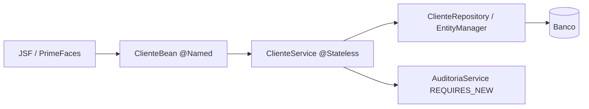

# Plano prático — Laboratório Java EE / Jakarta EE

**Situação atual:** o código e o ambiente GlassFish/PostgreSQL com Docker Compose estão versionados em [laboratorio/](./laboratorio/README.md). Os itens abaixo continuam como roteiro de validação e aprofundamento: a existência da implementação não equivale a testes E2E aprovados.

Este era o **plano inicial de exercícios**. Os artefatos principais agora existem, mas a execução em contêiner ainda precisa ser confirmada. Consulte o [guia principal](./GUIA_ESTUDOS_PROVA_PORTUGAL.md) para a teoria e o simulado. O objetivo é transformar as questões da prova em tarefas reproduzíveis e verificáveis.

## Caso de uso

Criar uma aplicação de **cadastro e consulta de clientes e pedidos** com uma interface JSF/PrimeFaces, serviço de negócio EJB, CDI, JPA e banco relacional. Depois, exercitar falhas controladas e interpretar o resultado.

## Pré-requisitos de laboratório

- Definir **antes da implementação** uma combinação compatível de JDK, Jakarta EE, GlassFish e PrimeFaces.
- Para experimentar uma aplicação **Java EE legada**, criar um perfil separado que utilize versões compatíveis com `javax.*`; não misturar dependências `javax.*` e `jakarta.*` indiscriminadamente.
- Utilizar Maven, um banco de dados de desenvolvimento e uma ferramenta de inspeção SQL.
- Evitar credenciais reais ou dados bancários de produção.

## Backlog por etapa

### 1. Inicialização e deployment

- [ ] Criar aplicação Maven com empacotamento `war`.
- [ ] Configurar servidor GlassFish e um DataSource com pool.
- [ ] Preparar `persistence.xml` e deploy local.
- [ ] Documentar comando de build/deploy e logs relevantes **depois de validar na versão adotada**.

**Critério de aceite:** aplicação sobe sem erros de CDI, JSF ou persistência; o pool permite conexão ao banco.

### 2. JSF e estado da tela

- [ ] Criar `cliente.xhtml` com `<h:form>`, entradas `required` e botão Salvar.
- [ ] Criar `ClienteBean` com `@Named`, `@ViewScoped`, getters e setters.
- [ ] Implementar `action` e `actionListener` demonstrando seus papéis distintos.
- [ ] Comparar `@RequestScoped` e `@ViewScoped` sob interação AJAX.
- [ ] Usar PrimeFaces `process` e `update` com componentes identificados.

**Cenários Given/When/Then:**
- **Given** formulário válido, **when** clicar em Salvar, **then** os valores devem chegar ao bean e o serviço deve ser invocado.
- **Given** campo obrigatório vazio, **when** submeter, **then** a validação deve impedir a atualização do modelo conforme o fluxo normal.
- **Given** botão sem atributo `action`, **when** submeter o formulário, **then** verificar o postback e comprovar que a ausência de `action` não significa necessariamente ausência de processamento.

### 3. CDI — resolução de dependências

- [ ] Injetar um serviço no bean com `@Inject`.
- [ ] Criar duas implementações de interface e escolher uma com `@Qualifier`.
- [ ] Demonstrar comportamento de `@ApplicationScoped` e o risco de guardar estado de usuário.
- [ ] Registrar e investigar um erro proposital de dependência ambígua.

**Critério de aceite:** dependência resolvida pelo contêiner, com escopo e implementação justificados.

### 4. JPA / Hibernate + SQL

- [ ] Criar entidades `Cliente` e `Pedido` com `@Id` e relacionamentos corretos.
- [ ] Comparar ID gerado (`@GeneratedValue`) versus atribuído pela aplicação.
- [ ] Criar exemplos válidos de acesso `FIELD` e `PROPERTY` (`@Column` no getter).
- [ ] Executar `persist`, `find`, `merge` e `remove` e documentar os estados.
- [ ] Registrar o SQL produzido por um caso N+1 e testar `JOIN FETCH` ou outra estratégia adequada.
- [ ] Demonstrar `LEFT JOIN` preservando clientes sem pedidos, com atenção aos filtros em `WHERE`.

**Critério de aceite:** explicar quando houve `flush`, `commit` e qual foi o SQL executado.

### 5. EJB e transações

- [ ] Implementar `ClienteService @Stateless`.
- [ ] Exercitar `REQUIRED`, `REQUIRES_NEW`, `MANDATORY`, `SUPPORTS`, `NOT_SUPPORTED` e `NEVER`.
- [ ] Criar `AuditoriaService` com `REQUIRES_NEW`, invocado através de referência gerenciada.
- [ ] Produzir uma falha que leve ao rollback do serviço principal e verificar se a auditoria independente foi confirmada.
- [ ] Comparar transações gerenciadas pelo contêiner (CMT) e demarcação programática permitida (BMT/`UserTransaction`).

**Cenários Given/When/Then:**
- **Given** transação ativa, **when** invocar um método `REQUIRES_NEW`, **then** a transação anterior deve ser suspensa para a nova.
- **Given** ausência de transação, **when** invocar `MANDATORY`, **then** a chamada deve falhar conforme o contrato da especificação.
- **Given** transação ativa, **when** invocar `NEVER`, **then** a chamada deve falhar.
- **Given** `REQUIRES_NEW` confirmado, **when** a transação externa sofrer rollback, **then** o commit independente não deve ser automaticamente desfeito.

### 6. JDBC e operação

- [ ] Implementar consulta com `PreparedStatement` e `try-with-resources`.
- [ ] Inspecionar uso e devolução de conexões ao pool.
- [ ] Provocar falha de obtenção de conexão em ambiente controlado.
- [ ] Distinguir fechamento de recursos de demarcação de transações.
- [ ] Fazer troubleshooting de erro de deploy e registrar causa raiz.

## Pirâmide de testes recomendada

| Nível | Alvo | Exemplos |
|---|---|---|
| Unitário | Regras Java isoladas | Validação de cliente, regra de negócio, mocks |
| Integração | Contêiner + persistência | EJB/CMT, CDI, JPA, conexões, rollback |
| E2E | Fluxo web completo | XHTML → Managed Bean → EJB → banco |

**Testcontainers** pode ajudar na subida de banco e dependências suportadas, mas **não substitui o runtime de aplicação** necessário para verificar JSF, CDI e EJB.

## Definition of Done

- [ ] Código compila e testes relevantes passam.
- [ ] Existe instrução reproduzível de execução.
- [ ] Consultas e transações importantes são verificadas por logs ou assertivas.
- [ ] Cada exercício possui comportamento esperado e cenário negativo.
- [ ] Diferenças entre versões legadas `javax.*` e modernas `jakarta.*` são registradas.
- [ ] Há link para documentação oficial das decisões de comportamento.

## Próximo passo sugerido

O código foi criado em [`javaee/laboratorio/`](./laboratorio/README.md). Próximo passo: executar `docker compose up --build`, validar os cenários manuais e automatizar testes em contêiner de aplicação.
