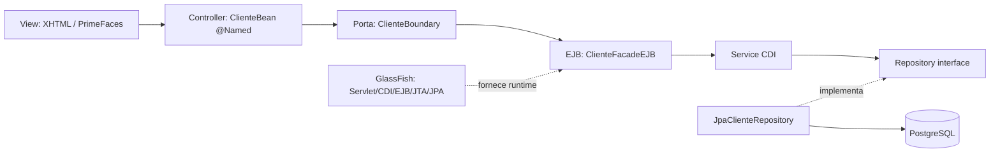

# Java EE / Jakarta EE — Trilha técnica e laboratório

**Estude Java Enterprise comparando com Spring Framework e Spring Boot**, a partir do fluxo MVC e chegando até os detalhes das especificações, do servidor de aplicação e do empacotamento WAR/EAR.

A proposta é construir um **modelo mental de execução**: a requisição chega ao servidor, o JSF recebe e valida o formulário, o bean chama o caso de uso, o EJB coordena a transação e o JPA persiste dados. Cada capítulo mostra os paralelos e as diferenças com Spring.

## Comece por esta distinção

**[CDI × EJB × JTA: quando usar cada um e quando uma transação começa](./guia/11-cdi-ejb-transacoes-sem-confusao.md)**

Não precisa adicionar `@Stateless` para criar um service com injeção de dependências. Um CDI bean pode usar `@Transactional` Jakarta para operações atômicas. Se a aplicação escolhe uma fachada EJB com CMT, a transação pode ser definida nela e o service CDI apenas executa as regras.

**Regra de leitura:** `@ApplicationScoped` = ciclo de vida; `@Inject` = dependência; `@Stateless` = Enterprise Bean; `@TransactionAttribute` (EJB) ou `jakarta.transaction.Transactional` (CDI) = demarcação transacional.

## Comece pela nova trilha

**[→ Abrir a trilha de dez capítulos: Spring × Java EE / Jakarta EE](./guia/README.md)**

| Etapa | O que estudar | Documento |
|---|---|---|
| 1 | Plataforma, especificações e contêiner: Jakarta EE × Spring Framework × Boot | [Fundamentos](./guia/01-fundamentos-spring-jakarta.md) |
| 2 | MVC, fluxo HTTP e `FacesServlet` × `DispatcherServlet` | [MVC na prática](./guia/02-mvc-fluxo-requisicao.md) |
| 3 | Formulários XHTML, lifecycle, state, `action` e AJAX | [JSF e PrimeFaces](./guia/03-jsf-primefaces.md) |
| 4 | Injeção por construtor, qualifiers, producers, escopos e IoC | [CDI](./guia/04-cdi-injecao.md) |
| 5 | `@Stateless`, `@Stateful`, transações CMT/BMT e seis atributos | [EJB e JTA](./guia/05-ejb-transacoes.md) |
| 6 | Persistência, `EntityManager`, SQL, JDBC, DataSource e N+1 | [JPA/JDBC](./guia/06-persistencia-jpa-jdbc.md) |
| 7 | Maven, `provided`, estrutura WAR/EAR, GlassFish e deploy | [WAR/EAR](./guia/07-glassfish-war-ear.md) |
| 8 | Executar, investigar falhas e testar ponta a ponta | [Laboratório guiado](./guia/08-laboratorio-troubleshooting.md) |
| 9 | Servlet, REST, Validation, Security, JMS, JSON-B/P, Concurrency e Batch | [Outras especificações](./guia/09-especificacoes-complementares.md) |
| 10 | A mesma feature implementada conceitualmente em Spring e Jakarta EE | [Comparativo completo](./guia/10-mesma-feature-spring-jakarta.md) |
| **11** | **Quando CDI basta, quando EJB faz sentido e o efeito das transações** | **[Guia decisório CDI/EJB/JTA](./guia/11-cdi-ejb-transacoes-sem-confusao.md)** |

## Fluxo MVC de referência



**Comparação:** no Spring MVC, normalmente a sequência equivalente envolve `DispatcherServlet → @Controller → @Service → @Repository/JPA`; [veja os dois fluxos](./guia/02-mvc-fluxo-requisicao.md).

## Como colocar em prática

- [Laboratório MVC no GlassFish](./laboratorio/README.md) — Java 17, Jakarta EE 10, PrimeFaces, PostgreSQL e Docker Compose.
- [Executar GlassFish](./laboratorio/docs/03-como-executar-glassfish.md) — build, pool JDBC, JNDI, deploy, logs e limpeza do banco.
- [Estrutura de pacotes, SRP e DIP](./laboratorio/docs/02-arquitetura-mvc-srp-dip.md) — interfaces, adaptadores, injeção por construtor e responsabilidades.
- [Plano de exercícios](./PLANO_PRATICO.md) — backlog/roteiro de validação.

```bash
cd javaee/laboratorio
cp .env.example .env
docker compose up --build
```

**Aplicação:** `http://localhost:8080/javaee-laboratorio/cliente.xhtml`.

> **Atenção:** ambiente de estudo: o `persistence.xml` usa geração de schema que pode recriar tabelas no deploy. Não use com dados importantes.

## Revisar as questões da prova de Portugal

O material original foi **preservado** em [GUIA_ESTUDOS.md](./GUIA_ESTUDOS.md), com as 11 perguntas relatadas, pegadinhas técnicas, exemplos de código e simulado de 30 questões com gabarito. As questões reconstruídas não são transcrições de uma prova oficial.

**Priorize:** lifecycle do JSF, `action` × `actionListener`, `@Named`, `@Id`/FIELD × PROPERTY, `LEFT JOIN`, transações EJB e fechamento de recursos JDBC.

## Java EE legado × Jakarta EE

| Tema | Código legado | Atual |
|---|---|---|
| Faces | `javax.faces.*` | `jakarta.faces.*` |
| CDI/Inject | `javax.inject.*` | `jakarta.inject.*` |
| Enterprise Beans | `javax.ejb.*` | `jakarta.ejb.*` |
| Persistence | `javax.persistence.*` | `jakarta.persistence.*` |

Sistemas Java EE 6/7/8 não são compatíveis automaticamente com Jakarta EE 10; verifique versão do servidor, bibliotecas JSF, APIs, drivers e dependências.

## Complementos já existentes no repositório

[ORM](../orm/README.md) · [JDBC](../jdbc/README.md) · [SQL](../sql_fundamentos/README.md) · [Design Patterns](../design_patterns/README.md) · [Swing](../projeto01_crud_swing/README.md)

## Fontes técnicas

[Jakarta EE Tutorial](https://jakarta.ee/learn/docs/jakartaee-tutorial/current/) · [Especificações Jakarta](https://jakarta.ee/specifications/) · [Spring Reference](https://docs.spring.io/spring-framework/reference/) · [GlassFish](https://glassfish.org/)
