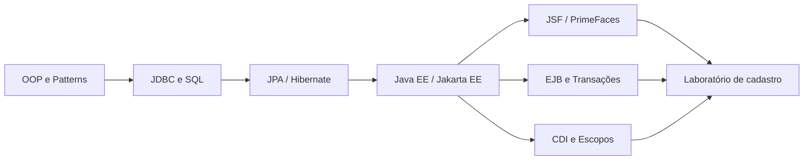

# Java EE / Jakarta EE — Estudos práticos

> Módulo dedicado a **Java Enterprise**, com foco em **JSF / PrimeFaces, CDI, EJB, JPA / Hibernate, SQL, JDBC, GlassFish e sistemas legados**.

Este módulo complementa os estudos já existentes de [ORM](../orm/README.md), [JDBC](../jdbc/README.md), [SQL](../sql_fundamentos/README.md), [Design Patterns](../design_patterns/README.md) e [Swing](../projeto01_crud_swing/README.md). Não duplica a implementação desses módulos: aqui o foco é o **comportamento integrado das especificações Java EE/Jakarta EE e do contêiner**.

## Comece aqui

| Documento | Conteúdo | Uso recomendado |
|---|---|---|
| [Guia de estudos — Prova Portugal](./GUIA_ESTUDOS_PROVA_PORTUGAL.md) | Teoria, diagramas Mermaid, análise de código, 11 questões relatadas, simulado com 30 questões, gabarito comentado e referências oficiais | **Leitura principal** |
| [Plano prático de laboratório](./PLANO_PRATICO.md) | Backlog, entregáveis e testes Given/When/Then | **Consolidar os conceitos na prática** |
| [Laboratório MVC com GlassFish](./laboratorio/README.md) | Código JSF, CDI, EJB, JPA, PostgreSQL e servidor GlassFish | **Executar localmente** |
| [Explicação das tecnologias (dummy)](./laboratorio/docs/01-glossario-jakarta-ee-dummy.md) | O que é cada peça e por que ela existe | **Começar do zero** |
| [Arquitetura e pacotes MVC/DIP](./laboratorio/docs/02-arquitetura-mvc-srp-dip.md) | Estrutura das dependências e SRP | **Entender o código** |
| [GlassFish com Docker Compose](./laboratorio/docs/03-como-executar-glassfish.md) | Ambiente completo e JNDI/DataSource | **Rodar o laboratório** |

## Roteiro sugerido

1. **Entenda o fluxo ponta a ponta:** XHTML → JSF/Managed Bean → CDI/EJB → JPA/JDBC → banco de dados.
2. **Estude JSF:** `<h:form>`, seis fases do lifecycle, `action`, `actionListener`, `@Named` e escopos.
3. **Revise JPA e SQL:** `@Id`, `@GeneratedValue`, acesso FIELD/PROPERTY, relacionamentos, `LEFT JOIN`, `LAZY` e N+1.
4. **Aprofunde EJB e transações:** `@Stateless`, `@Stateful`, CMT/BMT e os seis atributos de `@TransactionAttribute`.
5. **Pratique troubleshooting:** closing de recursos JDBC, pool, deploy no GlassFish, transações e beans.
6. **Resolva o simulado**, explicando por que as demais alternativas estão incorretas.
7. **Faça o laboratório** mantendo um registro das decisões, erros encontrados e soluções.

## Atenção: legado versus moderno

| Java EE legado | Jakarta EE 9+ |
|---|---|
| `javax.faces.*` | `jakarta.faces.*` |
| `javax.ejb.*` | `jakarta.ejb.*` |
| `javax.persistence.*` | `jakarta.persistence.*` |
| `javax.inject.*` | `jakarta.inject.*` |

Os exemplos do guia usam `jakarta.*`; ao estudar aplicações Java EE 6/7/8, confira as versões do servidor, da API e das bibliotecas antes de transpor os exemplos.

> **Status:** documentação de estudo e plano de implementação. **Existe implementação Maven/WAR e `compose.yaml` em `laboratorio/`, com GlassFish e PostgreSQL. Build, deploy e página JSF foram validados em smoke test de CI; ações de negócio e transações ponta a ponta ainda exigem testes adicionais.** Os comandos e testes descritos no plano são atividades futuras e não representam funcionalidades já implementadas.

## Relação com a evolução do repositório

## Fontes oficiais

- [Jakarta EE Tutorial](https://jakarta.ee/learn/docs/jakartaee-tutorial/current/)
- [Jakarta Faces](https://jakarta.ee/specifications/faces/)
- [Jakarta Enterprise Beans](https://jakarta.ee/specifications/enterprise-beans/)
- [Jakarta Persistence](https://jakarta.ee/specifications/persistence/)
- [Jakarta CDI](https://jakarta.ee/specifications/cdi/)
- [Eclipse GlassFish](https://glassfish.org/)
