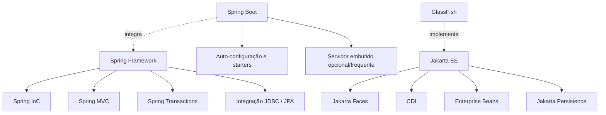

# 01 — Java SE, Java EE, Jakarta EE e Spring: quem faz o quê?

[← Índice](README.md) · [Próximo: MVC →](02-mvc-fluxo-requisicao.md)

## 1. Comece pela distinção mais importante

**Explicação simples:** Java é a linguagem e a plataforma-base. **Jakarta EE** é um conjunto de *contratos padronizados* para construir sistemas corporativos. **GlassFish** é uma implementação de runtime que executa esses contratos. **Spring Framework** é um ecossistema próprio de frameworks que oferece contêiner de objetos, web MVC, transações e integração.

**Analogia:** uma especificação é a regra que define como uma tomada deve funcionar; a implementação é o fabricante da tomada. Spring tem suas próprias abstrações e implementações, além de integrar padrões Jakarta como Servlet, Validation e Persistence.

- **Java SE (JDK/JVM):** código Java, coleções, streams, threads, JDBC API e runtime.
- **Java EE:** nome histórico da plataforma corporativa antes da transferência para a Eclipse Foundation.
- **Jakarta EE:** evolução da plataforma; Jakarta EE 9 passou a utilizar `jakarta.*` em lugar de muitos `javax.*`.
- **Especificação:** descreve interfaces e comportamentos esperados; ex.: Jakarta Persistence.
- **Implementação (provider):** executa o contrato; ex.: Hibernate ou EclipseLink implementando JPA.
- **Servidor de aplicações:** fornece runtime e serviços integrados (GlassFish, WildFly, Payara, Open Liberty).
- **Spring Framework:** módulos e contêiner Spring; **Spring Boot** simplifica configuração, dependências e inicialização do Spring.

## 2. Componentes comparados sem equivalências falsas

| Problema | Jakarta EE | Spring Framework / Boot | Observação |
|---|---|---|---|
| Receber HTTP | Servlet e contêiner web | Spring MVC/DispatcherServlet sobre Servlet | Ambos podem usar a Servlet API |
| Interface de componentes server-side | Jakarta Faces (JSF), Facelets | Spring MVC + Thymeleaf (por exemplo) | JSF mantém árvore/estado dos componentes; Thymeleaf não é JSF |
| REST | Jakarta REST (JAX-RS) | `@RestController` Spring MVC | Abstrações diferentes |
| Injeção de dependências | CDI (`@Inject`) | Spring IoC (injeção por construtor) | Escopos e resolução diferem |
| Serviços gerenciados | CDI bean, EJB | `@Service`, `@Component` | EJB oferece semântica própria do contêiner |
| Transações | JTA, EJB CMT ou `jakarta.transaction.Transactional` | `org.springframework.transaction.annotation.Transactional` | Anotações com mesmo nome podem ter pacotes/semânticas distintos |
| Persistência ORM | Jakarta Persistence + provider | JPA via Spring Data JPA/EntityManager | Spring Data é camada de produtividade, não provider ORM |
| SQL direto | JDBC | JDBC / JdbcTemplate | JdbcTemplate abstrai repetição de boilerplate |
| Servidor | GlassFish/Jakarta EE runtime (exemplo) | Spring Boot frequentemente com servidor embutido | Spring também permite WAR em servidor externo |
| Empacotamento | WAR, EAR, EJB JAR conforme aplicação | Executable JAR, WAR, outros | Nem todo projeto Jakarta EE exige EAR |

## 3. Spring Framework não é sinônimo de Spring Boot



**Exemplo de comparação de responsabilidades:**

Spring:
```java
@Service
public class ClienteService {
    private final ClienteRepository repository;

    public ClienteService(ClienteRepository repository) {
        this.repository = repository;
    }
}
```

CDI:
```java
@ApplicationScoped
public class ClienteService {
    private final ClienteRepository repository;

    @Inject
    public ClienteService(ClienteRepository repository) {
        this.repository = repository;
    }
}
```

O primeiro contêiner é o **Spring IoC**; o segundo, **CDI**. Ambos podem injetar abstrações, mas descoberta de componentes, proxies, escopos e integrações devem ser estudados separadamente.

## 4. O que o GlassFish entrega sem o aplicativo implementar?

No laboratório, o servidor disponibiliza:
1. **Servlet container:** ciclo HTTP e execução do FacesServlet.
2. **CDI:** descoberta, criação e associação de beans a escopos.
3. **EJB container:** `@Stateless`, interceptação, `@EJB`, serviços transacionais.
4. **JTA:** coordenação de transações.
5. **JPA provider integrado:** criação de EntityManagers conforme a unidade de persistência.
6. **JNDI + JDBC pool:** recurso `jdbc/EstudosDS` acessível à aplicação.

O projeto fornece **regras de negócio e páginas**, além da configuração que liga esses recursos.

**Importante:** uma aplicação Jakarta EE moderna pode preferir beans CDI em vez de EJB, quando não precisar de capacidades específicas de EJB. O laboratório usa EJB propositalmente para aprender suas particularidades.

## 5. Onde cada coisa está no repositório?

| Arquivo | Onde olhar |
|---|---|
| `laboratorio/pom.xml` | Dependência Jakarta EE com `provided`, PrimeFaces e empacotamento `war` |
| `laboratorio/src/main/webapp/cliente.xhtml` | Interface JSF |
| `laboratorio/src/main/java/.../adapters/inbound/ejb/ClienteFacadeEJB.java` | Fachada EJB e transação |
| `laboratorio/src/main/java/.../application/service/ClienteApplicationService.java` | Regra do caso de uso via CDI |
| `laboratorio/src/main/resources/META-INF/persistence.xml` | Configuração JPA/JTA |
| `laboratorio/compose.yaml` | Banco e servidor |
| `laboratorio/Dockerfile` | Build Maven e cópia do WAR para GlassFish |

Os caminhos completos podem ser encontrados no [README do laboratório](../laboratorio/README.md).

## 6. Perguntas para fixar

**Pergunta:** JPA é Hibernate?  
**Resposta:** Não. JPA é a especificação; Hibernate é uma implementação. O GlassFish normalmente integra EclipseLink.

**Pergunta:** É obrigatório usar EJB para trabalhar com Jakarta EE?  
**Resposta:** Não. É uma opção conforme as necessidades de transação, segurança, acesso remoto e outras capacidades.

**Pergunta:** Spring Boot sempre roda como JAR?  
**Resposta:** Não. Executable JAR é comum; também há empacotamento WAR.

**Pergunta:** Uma classe com `@Inject` cria suas dependências com `new`?  
**Resposta:** Não: o contêiner resolve o bean adequado e gerencia sua criação conforme suas regras.

## Fontes oficiais

- [Jakarta EE — Overview](https://jakarta.ee/learn/docs/jakartaee-tutorial/current/intro/overview/overview.html)
- [Spring Framework — Core / IoC](https://docs.spring.io/spring-framework/reference/core/beans.html)
- [Spring MVC](https://docs.spring.io/spring-framework/reference/web/webmvc.html)
- [Jakarta EE Specifications](https://jakarta.ee/specifications/)
