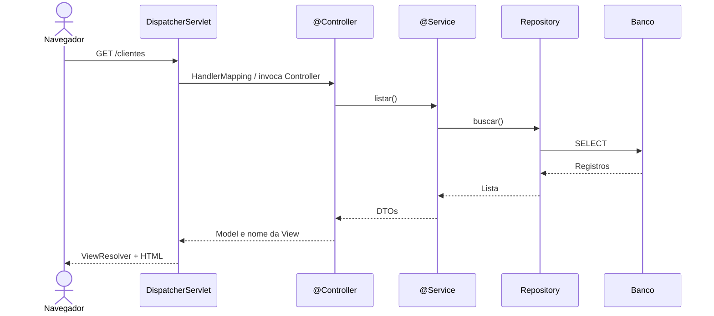
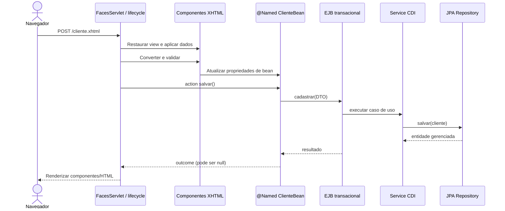
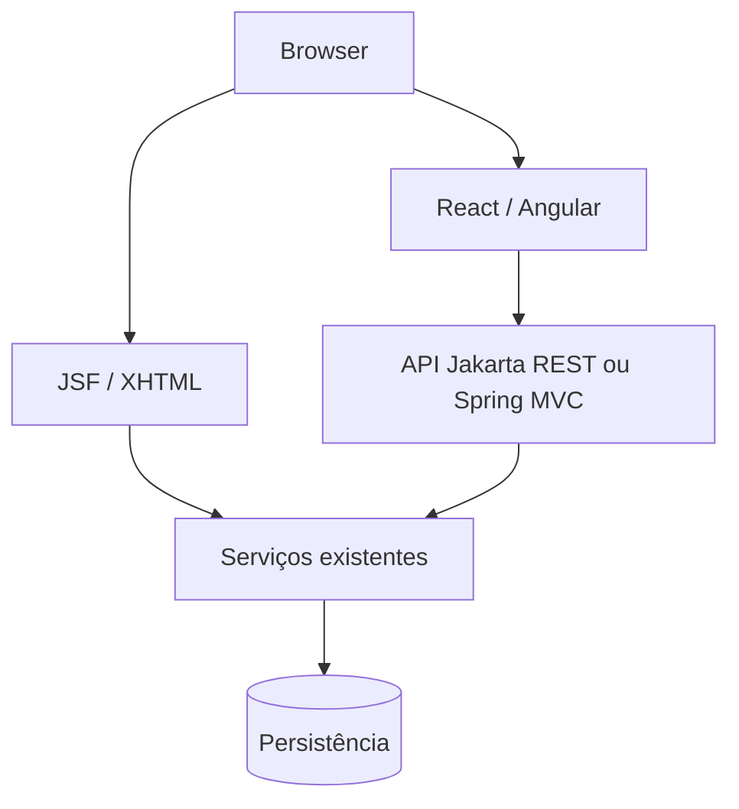

# 02 — MVC na prática: Spring MVC versus JSF/Jakarta EE

[← Índice](README.md) · [← Fundamentos](01-fundamentos-spring-jakarta.md) · [JSF →](03-jsf-primefaces.md)

## 1. Qual é a ideia de MVC?

**Model** é a representação do estado e das regras; **View** apresenta a interface; **Controller** recebe uma intenção e coordena uma ação sobre o model.

Não confunda MVC com **arquitetura em camadas**: Controller não deve conter SQL, View não deve conter regras de negócio e a entidade JPA não deveria decidir como responder HTTP.

### MVC que usamos no laboratório

| Papel | Tecnologia | Classe/arquivo |
|---|---|---|
| View | JSF + PrimeFaces | `cliente.xhtml` |
| Controller de cliente | CDI/JSF `@Named @ViewScoped` | `ClienteBean` |
| Controller de pedido | CDI/JSF `@Named @ViewScoped` | `PedidoBean` |
| Model: casos de uso | Interfaces + serviço | `ClienteBoundary`, `ClienteApplicationService` |
| Fronteira transacional | EJB | `ClienteFacadeEJB` |
| Persistência | JPA | `JpaClienteRepository`, `EntityManager` |

A separação de ports/adapters complementa MVC: o serviço conhece a interface do repositório, não a classe JPA concreta.

## 2. Spring MVC tradicional: fluxo HTTP → Controller → Service → Repository → View



Exemplo Spring MVC com template:
```java
@Controller
@RequestMapping("/clientes")
class ClienteController {
    private final ClienteConsulta consulta;

    ClienteController(ClienteConsulta consulta) {
        this.consulta = consulta;
    }

    @GetMapping
    String listar(Model model) {
        model.addAttribute("clientes", consulta.listar());
        return "clientes"; // resolvido por mecanismo de View
    }
}
```

**Se for `@RestController`**, o retorno geralmente vira corpo HTTP (por conversores de mensagem), **sem** resolver uma View HTML.

## 3. JSF: fluxo HTTP → FacesServlet → árvore de componentes → Bean → Service → renderização



**O que muda:** no JSF, a **View é componente server-side**, e o framework coordena fases de conversão, validação, model update e renderização. `FacesServlet` é o *front controller* que orquestra o lifecycle; `ClienteBean` é o controlador específico da tela/ação.

Em Spring MVC, o `DispatcherServlet` orquestra mappings, resolvers e adaptadores; um método `@Controller` costuma receber parâmetros de requisição já convertidos e validados via binding e Bean Validation, sem árvore de componentes JSF.

## 4. Dois exemplos da mesma operação

**Jakarta Faces:**
```xml
<h:form id="cadastro">
    <h:inputText id="nome" value="#{clienteBean.nome}" required="true"/>
    <h:commandButton value="Salvar" action="#{clienteBean.salvar}"/>
</h:form>
```

```java
@Named
@ViewScoped
public class ClienteBean implements Serializable {
    private String nome;
    @Inject
    private ClienteBoundary cliente; // interface exposta pela fachada EJB

    public String salvar() {
        cliente.cadastrar(new NovoCliente(nome, "exemplo@site.com"));
        return null; // mesma view
    }
    // getters/setters omitidos neste trecho didático
}
```

**Spring MVC com Thymeleaf (forma equivalente em intenção, não em lifecycle):**
```java
@Controller
@RequestMapping("/clientes")
class ClienteController {
    private final ClienteUseCase casoDeUso;

    ClienteController(ClienteUseCase casoDeUso) { this.casoDeUso = casoDeUso; }

    @PostMapping
    String salvar(@Valid @ModelAttribute ClienteForm form, BindingResult erros) {
        if (erros.hasErrors()) return "clientes-form";
        casoDeUso.cadastrar(form.toCommand());
        return "redirect:/clientes";
    }
}
```

Os trechos são **pseudocódigo pedagógico abreviado**; imports, métodos de modelo e templates precisam ser completados para execução.

## 5. REST e SPA não são a mesma coisa que JSF

- **JSF:** mantém contexto de view/componentes do lado servidor; `action`, `ViewScoped`, AJAX parcial.
- **Spring REST:** fornece endpoints HTTP que devolvem JSON; o React/Angular administra a interface.
- **Jakarta REST:** também fornece endpoints HTTP JSON sem obrigar uso de JSF.
- **Composição brownfield:** uma aplicação Java EE pode manter telas JSF e expor uma nova API para outra interface.



## 6. Exercício: descubra a camada do problema

Se um formulário não chama a action, **investigue primeiro JSF**: `h:form`, conversão, validação e `process`, antes de modificar Repository. Se action executa mas não há INSERT, **investigue service/JPA/transação**. Se SQL executa e a tela não atualiza, **investigue renderização e escopo do bean**.

## Fontes

- [Spring MVC — DispatcherServlet](https://docs.spring.io/spring-framework/reference/web/webmvc/mvc-servlet.html)
- [Spring MVC — Controllers](https://docs.spring.io/spring-framework/reference/web/webmvc/mvc-controller.html)
- [Jakarta Faces — Lifecycle](https://jakarta.ee/learn/docs/jakartaee-tutorial/current/web/faces-intro/faces-intro.html)
- [Jakarta EE — Web Applications](https://jakarta.ee/learn/docs/jakartaee-tutorial/current/web/webapp/webapp.html)
