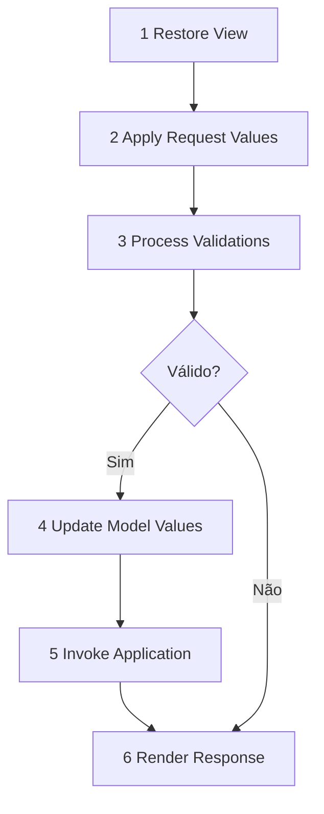

# 03 — JSF e PrimeFaces: a interface web Java Enterprise

[← Índice](README.md) · [← MVC](02-mvc-fluxo-requisicao.md) · [CDI →](04-cdi-injecao.md)

## 1. O problema resolvido pelo JSF

**Explicação simples:** o JSF (atualmente **Jakarta Faces**) permite criar interfaces web usando componentes declarados em XHTML. O servidor mantém uma árvore dos componentes, recebe valores enviados pelo navegador, valida e atualiza objetos Java antes de executar ações.

No Spring MVC + Thymeleaf, normalmente um método de `@Controller` atende uma rota e entrega os atributos do model para o template renderizar. **JSF não é simplesmente outro template engine:** ele oferece eventos, árvore de componentes, conversores, validações e estado de view.

| Conceito | JSF | Spring MVC / Thymeleaf |
|---|---|---|
| Entrada HTTP | `FacesServlet` | `DispatcherServlet` |
| View | XHTML / Facelets | Template HTML |
| Bean de tela | `@Named @ViewScoped` | `@Controller` + Model/Form |
| Chamada de ação | `action="#{clienteBean.salvar}"` | `@PostMapping` |
| Validação | Fases JSF, `required`, `f:validate*` | Binding + `@Valid`, `BindingResult` |
| Atualização parcial | Componentes AJAX: `process`/`update` | Resposta HTTP/JSON e JS do cliente |
| Estado entre postbacks | View State + escopo da view | Requisição/sessão/model conforme desenho |

## 2. Quem são as peças?

- **FacesServlet:** recebe as requisições JSF e orquestra o ciclo de vida.
- **Facelets:** tecnologia de composição da view XHTML (templates `ui:composition`, `ui:insert`, `ui:define`).
- **UIComponent:** objeto do lado servidor para um elemento JSF; não se confunde com o elemento HTML gerado.
- **Expression Language (EL):** resolve expressões como `#{clienteBean.nome}`.
- **Managed Bean CDI:** classe `@Named` que fornece propriedades/ações à página.
- **FacesContext:** contexto por requisição usado, por exemplo, para mostrar mensagens.
- **PrimeFaces:** biblioteca de componentes JSF adicionais; usa o lifecycle do JSF, não o substitui.

### Formulário XHTML

```xml
<html xmlns="http://www.w3.org/1999/xhtml"
      xmlns:h="jakarta.faces.html"
      xmlns:f="jakarta.faces.core"
      xmlns:p="http://primefaces.org/ui">
<h:head><title>Clientes</title></h:head>
<h:body>
  <h:form id="cadastro">
    <p:messages id="msgs"/>
    <p:outputLabel for="nome" value="Nome"/>
    <p:inputText id="nome" value="#{clienteBean.nome}" required="true"/>
    <p:commandButton value="Salvar" action="#{clienteBean.salvar}"
                     process="@form" update="@form"/>
  </h:form>
</h:body>
</html>
```

- `h:form` organiza a submissão JSF e os dados necessários ao postback.
- `value` vincula a propriedade Java: o setter não precisa ser chamado na fase inicial.
- `action` indica o método usado na operação de aplicação.
- `process` indica o subconjunto processado; `update` o que é redesenhado na resposta AJAX.

> **No laboratório real:** [cliente.xhtml](../laboratorio/src/main/webapp/cliente.xhtml), com duas seções e `ClienteBean`/`PedidoBean`.

## 3. As seis fases do JSF: passo a passo



1. **Restore View:** reconstruir ou criar a árvore de componentes e associá-la ao contexto.
2. **Apply Request Values:** decodificar parâmetros HTTP e manter valores submetidos nos componentes.
3. **Process Validations:** converter para tipos Java, validar campos e registrar mensagens.
4. **Update Model Values:** gravar valores convertidos nas propriedades do bean.
5. **Invoke Application:** disparar eventos de aplicação, chamar actions e calcular navegação.
6. **Render Response:** gerar HTML/fragmentos AJAX e salvar o estado da view quando necessário.

**Exercício:** um `required="true"` vazio dispara falha na validação. A action convencional não é executada; isso não significa que a requisição não chegou ao servidor.

### O que significa View State?

O JSF mantém informações para reconhecer a view entre requisições. Dependendo da configuração, partes do estado podem estar no servidor ou ser serializadas no cliente de forma protegida. **ViewScoped** não equivale automaticamente a uma sessão HTTP completa.

## 4. `action` versus `actionListener`

```java
public String salvar() {
    clienteService.cadastrar();
    return null; // mantém a mesma view
}

public void antesDeSalvar(ActionEvent event) {
    log.info("Botão acionado");
}
```

```xml
<h:commandButton value="Salvar"
                 action="#{clienteBean.salvar}"
                 actionListener="#{clienteBean.antesDeSalvar}"/>
```

| | `action` | `actionListener` |
|---|---|---|
| Propósito | Ação de aplicação e potencial navegação | Ouvir evento de ação do componente |
| Assinatura usual | Sem argumento, retorna outcome ou `void` | `void` com `ActionEvent` ou assinatura compatível |
| Retorno `String` obrigatório? | **Não** | Não |
| Bom uso | Salvar e navegar | Telemetria/reação ao clique |

**Pegadinha de prova:** um botão sem `action` pode submeter/processar um formulário; não existe exceção EL automática apenas pela ausência desse atributo.

## 5. `@ManagedBean` legado versus CDI `@Named`

Em JSF antigo, `@ManagedBean` fazia parte do gerenciamento próprio de beans da implementação Faces. Nas versões modernas (Jakarta Faces 4), prefira **CDI + `@Named`**; o modelo antigo de managed beans do JSF foi removido.

```java
@Named("clienteBean")
@ViewScoped // jakarta.faces.view.ViewScoped
public class ClienteBean implements Serializable {
    private String nome;
    public String getNome() { return nome; }
    public void setNome(String nome) { this.nome = nome; }
}
```

**Atenção aos imports:** `jakarta.faces.view.ViewScoped` não é igual ao antigo `javax.faces.bean.ViewScoped`.

### Escopos e seus efeitos

| Escopo | Duração | Quando usar | Risco |
|---|---|---|---|
| `@RequestScoped` | Uma requisição | Consulta pontual | Perder estado entre postbacks |
| `@ViewScoped` | View em funcionamento | Formulário AJAX | Dependência de view state/serialização |
| `@SessionScoped` | Sessão do usuário | Dados de sessão | Consumo de memória e concorrência |
| `@ApplicationScoped` | Aplicação | Configuração stateless | Vazamento de dados se guardar estado por usuário |
| `@Dependent` | Ciclo vinculado ao bean dono | Componente auxiliar | Uso incorreto do ciclo de vida |

## 6. AJAX com PrimeFaces

```xml
<p:commandButton value="Consultar" action="#{clienteBean.consultar}"
                 process="@this" update="resultado"/>
<p:outputPanel id="resultado">
    <h:outputText value="#{clienteBean.resultado}"/>
</p:outputPanel>
```

**Duas perguntas diferentes:** o que será **executado/processado** (`process`)? O que precisa ser **redesenhado** (`update`)?

Erros comuns: ID relativo diferente do esperado, validação em outro campo do formulário, bean `@RequestScoped` perdendo estado, `NamingContainer`, `ViewExpiredException`.

## 7. Converters, Validators e navegação

```xml
<h:inputText value="#{pedidoBean.quantidade}">
    <f:convertNumber integerOnly="true"/>
    <f:validateLongRange minimum="1" maximum="100"/>
</h:inputText>
```

Navegação pode usar outcome de action (como `"lista?faces-redirect=true"`), navegação implícita e regras no `faces-config.xml`. Ao usar redirect, uma **nova requisição** será realizada. Em telas legadas, investigue a navegação e o escopo antes de corrigir sintomas de dados sumindo.

## 8. Exercício guiado no repositório

1. Localize `cliente.xhtml` e identifique os dois `h:form`.
2. No `ClienteBean`, encontre `salvar()` e `antesDeSalvar()`.
3. Informe em qual fase o bean recebe as propriedades submetidas.
4. Retire `required` mentalmente: o que muda no lifecycle?
5. Explique por que `process="@this"` não processa automaticamente todos os inputs.

### Checklist de entrevista

- Consigo citar as seis fases na ordem?
- Sei diferenciar action, listener, validation e update do model?
- Sei explicar o que é JSF server-side versus React/Angular?
- Sei encontrar `FacesServlet` no `web.xml`?

## Fontes oficiais

- [Jakarta Faces](https://jakarta.ee/specifications/faces/)
- [Jakarta EE Tutorial — Faces](https://jakarta.ee/learn/docs/jakartaee-tutorial/current/web/faces-intro/faces-intro.html)
- [PrimeFaces](https://primefaces.org/)
