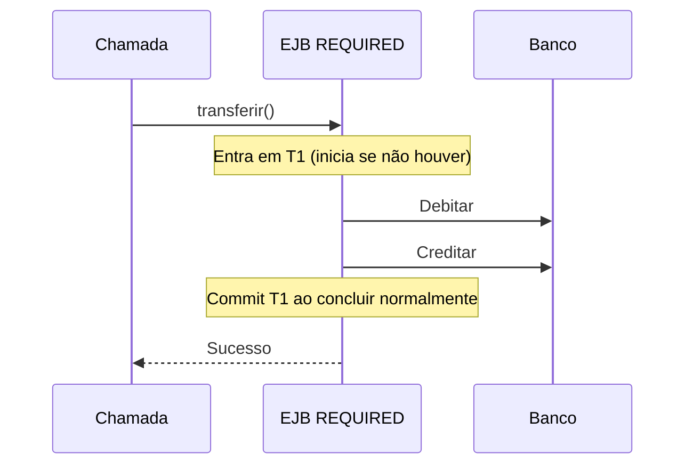

# 05 — EJB, serviços corporativos e JTA: transações em profundidade

[← Índice](README.md) · [← CDI](04-cdi-injecao.md) · [Persistência →](06-persistencia-jpa-jdbc.md)

## 1. Por que EJB existe?

**Explicação simples:** um EJB (*Enterprise JavaBean*) é um componente de negócio que o **servidor de aplicações gerencia**. Além de chamar métodos Java, o servidor pode controlar transações, acesso local/remoto, segurança, concorrência e ciclo de vida do componente.

**Comparativo:** no Spring, você frequentemente coloca `@Service` em um bean e `@Transactional` em métodos. No EJB, `@Stateless` e `@TransactionAttribute` fazem a chamada passar pelos serviços do **contêiner EJB**. Há diferenças de ciclo de vida e semântica.

| Conceito | EJB / Jakarta EE | Spring |
|---|---|---|
| Serviço sem estado conversacional | `@Stateless` | `@Service` (normalmente singleton) |
| Serviço com estado por cliente | `@Stateful` | Scope customizado/session-scoped, conforme projeto |
| Singleton gerenciado | `@Singleton` EJB | Singleton scope do Spring |
| Interface de negócio | `@Local`, `@Remote` | Interface Java + protocolo escolhido |
| Transação declarativa EJB | `@TransactionAttribute` | `@Transactional` Spring |
| Transação declarativa CDI | `jakarta.transaction.Transactional` | `@Transactional` Spring (pacote diferente) |
| Transação programática | `UserTransaction` em cenários BMT | `TransactionTemplate` / `PlatformTransactionManager` |
| Runtime | Contêiner EJB | Contêiner Spring e TransactionManager |

**Não se engane:** `@Stateless` não é exatamente `@Service`; um bean Spring singleton pode guardar campos mutáveis, mas isso costuma ser perigoso para serviços concorrentes.

## 2. Tipos de Enterprise Session Beans

### Stateless Session Bean

```java
@Stateless
@Local(TransferenciaPort.class)
public class TransferenciaEJB implements TransferenciaPort {
    @Override
    public void transferir(Long origem, Long destino, BigDecimal valor) {
        // invocar regras, repositórios, integração ...
    }
}
```

A instância EJB pode ser reutilizada pelo contêiner para chamadas de clientes diferentes; **não conte com a conservação do estado da conversa** entre invocações.

### Stateful Session Bean

```java
@Stateful
public class AssistenteCadastroEJB {
    private final List<String> etapas = new ArrayList<>();

    public void adicionarEtapa(String etapa) { etapas.add(etapa); }
    public List<String> getEtapas() { return List.copyOf(etapas); }
}
```

A instância mantém estado conversacional de um cliente, o que exige atenção a passivação, memória e escalabilidade. Trecho didático, não parte do laboratório.

### Singleton Session Bean

```java
@Singleton
@Startup
public class CacheConfiguracaoEJB {
    private Map<String, String> config = Map.of();

    @PostConstruct
    public void iniciar() { config = Map.of("ambiente", "dev"); }
    public String consultar(String chave) { return config.get(chave); }
}
```

O contêiner administra a instância, podendo oferecer controles de concorrência por `@Lock`. Não confunda `@Singleton` EJB com `@ApplicationScoped` CDI.

## 3. Local, Remote, no-interface

- **`@Local`**: interface de negócio destinada a chamadas locais no contexto de execução suportado.
- **`@Remote`**: interface de negócio acessível remotamente conforme infraestrutura/protocolo do servidor; não é sinônimo de REST.
- **No-interface view**: EJB pode expor métodos públicos de negócio sem uma interface dedicada, quando as regras da especificação permitem.

```java
@Local
public interface TransferenciaPort {
    void transferir(Long origem, Long destino, BigDecimal valor);
}
```

**Exemplo de chamada gerenciada:** injetar `@EJB TransferenciaPort transferencia;` numa classe gerenciada, sem chamar `new TransferenciaEJB()`.

## 4. O que é uma transação?

**Transação:** um limite em que operações de banco precisam respeitar atomicidade e regras de confirmação/reversão. Em uma transferência simples, débito e crédito devem participar da **mesma transação local**.

- **Commit:** confirma alterações transacionais.
- **Rollback:** desfaz alterações ainda não confirmadas daquela transação.
- **JTA:** especificação Jakarta Transactions, utilizada para gerenciar transações e coordenação de recursos.
- **CMT:** *Container-Managed Transactions*, em que o contêiner demarca a transação.
- **BMT:** *Bean-Managed Transactions*, em que o código faz a demarcação permitida.

**Atenção:** chamar HTTP ou publicar Kafka dentro de transação JPA não garante por si só atomicidade distribuída. Para integrar recursos diferentes, avalie outbox, idempotência e contratos adequados.

## 5. Seis atributos CMT — principal tema da prova

```java
@Stateless
public class SaldoEJB {
    @TransactionAttribute(TransactionAttributeType.REQUIRED)
    public void atualizar() { /* operações */ }
}
```

| Atributo | Já existe T1 | Não existe transação |
|---|---|---|
| `REQUIRED` | Participa de T1 | Abre nova T1 |
| `REQUIRES_NEW` | Suspende T1, abre T2 | Abre T2 |
| `MANDATORY` | Participa de T1 | Erro |
| `SUPPORTS` | Participa de T1 | Executa sem transação |
| `NOT_SUPPORTED` | Suspende T1 | Executa sem transação |
| `NEVER` | Erro | Executa sem transação |

Esse quadro é para **CMT** e invocações gerenciadas do EJB. As regras de disponibilidade de anotação, transações propagadas remotamente e recursos externos precisam ser verificadas conforme contêiner e modo de acesso.

### Exemplo: REQUIRED



### Exemplo: REQUIRES_NEW na auditoria

```java
@Stateless
public class AuditoriaEJB {
    @PersistenceContext
    private EntityManager em;

    @TransactionAttribute(TransactionAttributeType.REQUIRES_NEW)
    public void registrar(String descricao) {
        em.persist(new RegistroAuditoria(descricao));
    }
}
```

```java
@Stateless
public class OperacaoEJB {
    @EJB private AuditoriaEJB auditoria;

    @TransactionAttribute(TransactionAttributeType.REQUIRED)
    public void executar() {
        atualizarBanco();
        auditoria.registrar("Tentativa de operação");
        throw new IllegalStateException("Falha de negócio simulada");
    }
}
```

```mermaid
sequenceDiagram
    participant U as Cliente
    participant O as OperacaoEJB T1
    participant A as AuditoriaEJB T2
    participant DB as Banco
    U->>O: executar()
    Note over O: T1 REQUIRED
    O->>DB: Atualizar estado (T1)
    O->>A: registrar()
    Note over O,A: Suspende T1 / abre T2
    A->>DB: Gravar auditoria (T2)
    Note over A: Commit T2
    A-->>O: Retorna / retoma T1
    O--x U: Exceção não tratada
    Note over O,DB: Rollback de T1; T2 não é revertida automaticamente
```

> O código real está em [ClienteFacadeEJB](../laboratorio/src/main/java/br/com/murilo/javaee/adapters/inbound/ejb/ClienteFacadeEJB.java) e [AuditoriaEJB](../laboratorio/src/main/java/br/com/murilo/javaee/adapters/inbound/ejb/AuditoriaEJB.java). Os trechos acima são simplificações didáticas. Ambos requerem passagem pelo proxy de um bean gerenciado.

## 6. Exceptions: quando ocorre rollback?

Em CMT, **system exceptions** (como certas RuntimeExceptions não marcadas como application exceptions) normalmente causam rollback e são tratadas pelo contêiner conforme as regras EJB. Já **application exceptions** não causam rollback automaticamente por padrão, salvo configuração (`@ApplicationException(rollback=true)`) ou marcação da transação para rollback.

```java
@ApplicationException(rollback = true)
public class SaldoInsuficienteException extends Exception {
    public SaldoInsuficienteException(String mensagem) { super(mensagem); }
}
```

```java
@Stateless
public class ContaEJB {
    @Resource private SessionContext context;
    public void executar() {
        // Pode marcar a transação CMT atual para rollback:
        context.setRollbackOnly();
    }
}
```

**Pegadinha:** "Qualquer exception gera rollback" é falso. Também é perigoso capturar uma exceção antes que alcance o contêiner sem avaliar a marcação transacional. Uma transação já marcada rollback-only não se torna confirmável apenas por capturar a exceção.

## 7. BMT: quando você mesmo gerencia

```java
@Stateless
@TransactionManagement(TransactionManagementType.BEAN)
public class ImportacaoEJB {
    @Resource private UserTransaction tx;

    public void importar() throws Exception {
        tx.begin();
        try {
            executarImportacao();
            tx.commit();
        } catch (Exception ex) {
            tx.rollback();
            throw ex;
        }
    }
}
```

Esse exemplo ilustra a demarcação em BMT. Em projeto real, verificar estado da transação e erros de commit/rollback, além dos limites da especificação. **Em CMT não se deve usar `UserTransaction` para gerir diretamente a transação da mesma operação.**

Spring paralelo:
```java
transactionTemplate.execute(status -> {
    importarRegistros();
    return null;
});
```

## 8. EJB `@TransactionAttribute` x `@Transactional`

```java
// EJB
@TransactionAttribute(TransactionAttributeType.REQUIRES_NEW)

// Jakarta Transactions (CDI, sem necessidade de EJB)
@jakarta.transaction.Transactional(
    jakarta.transaction.Transactional.TxType.REQUIRES_NEW
)

// Spring
@org.springframework.transaction.annotation.Transactional(
    propagation = Propagation.REQUIRES_NEW
)
```

Os três exemplos expressam intenção de criar transação independente, mas **os mecanismos, interceptores e regras específicas não são automaticamente iguais**. Identifique o import antes de analisar código legado.

## 9. Pergunta sênior: por que `this.metodo()` não é igual à chamada via contêiner?

Mecanismos transacionais gerenciados normalmente dependem de uma invocação que atravesse um proxy ou fronteira do contêiner. Em chamadas internas diretas à mesma instância, **não presuma que anotações de serviços serão reaplicadas**. A forma correta de testar esse comportamento é por uma referência gerenciada e logs/asserções transacionais.

**Não confunda:** EJB, CDI e Spring possuem regras de interceptação específicas; evite generalizar todos os casos de self-invocation como uma única regra universal.

## 10. Exercícios

1. Uma operação precisa obrigatoriamente participar de uma transação pré-existente. Qual atributo usar? **MANDATORY**.
2. Uma operação de leitura não deve executar sob transação mesmo quando o chamador está em T1. **NOT_SUPPORTED**.
3. Quero gravar uma auditoria persistente mesmo se a operação externa falhar. **REQUIRES_NEW** (com invocação e commit independentes), embora a decisão arquitetural exija cuidado.
4. Tenho `@Transactional` em um método. Isso comprova que estou usando Spring? **Não:** verifique o pacote.
5. Uma `IllegalStateException` não tratada na fachada EJB é capturada pela JSF. A transação já foi revertida? **O contêiner trata a exceção e os efeitos transacionais na fronteira EJB, conforme regras CMT; capturar depois não recupera T1.**

## Fontes oficiais

- [Jakarta Enterprise Beans](https://jakarta.ee/specifications/enterprise-beans/)
- [Jakarta Transactions](https://jakarta.ee/specifications/transactions/)
- [Jakarta EE Tutorial — Enterprise Beans](https://jakarta.ee/learn/docs/jakartaee-tutorial/current/ejb/ejb-intro/ejb-intro.html)
- [Spring Transaction Management](https://docs.spring.io/spring-framework/reference/data-access/transaction.html)
