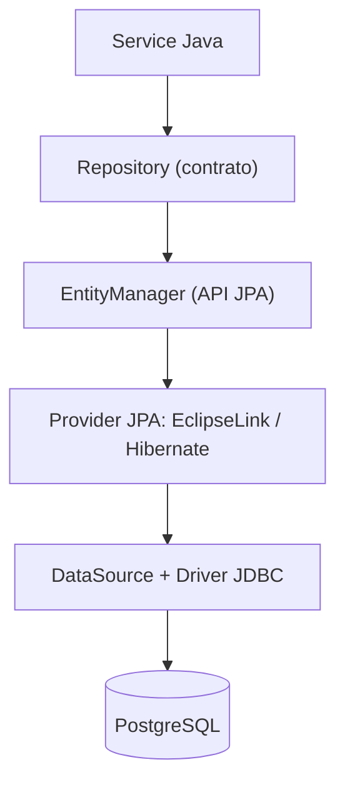
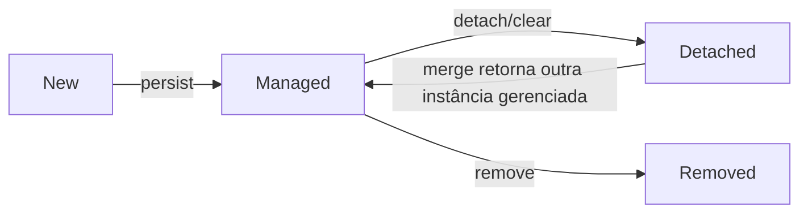
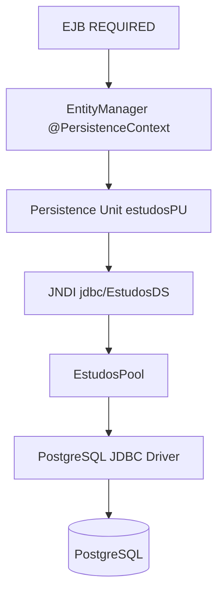

# 06 — JPA, Hibernate, JDBC e bancos relacionais

[← Índice](README.md) · [← EJB](05-ejb-transacoes.md) · [WAR/EAR →](07-glassfish-war-ear.md)

## 1. Entenda os níveis: SQL, JDBC, JPA, provider e repositório

**Explicação simples:** o banco guarda linhas. **JDBC** comunica Java com o banco. **JPA/Jakarta Persistence** permite representar linhas como objetos Java. **Hibernate** e **EclipseLink** são implementações JPA que criam comandos SQL e gerenciam o estado dos objetos.



No **laboratório**, o GlassFish fornece EclipseLink/JPA e DataSource JTA; para testes integrados no Maven, o projeto utiliza **Hibernate + H2** (RESOURCE_LOCAL). Esse segundo teste não reproduz 100% o runtime GlassFish.

**Spring Data JPA** é uma camada extra de repositórios/instrumentação, não um provider JPA:

```java
// Spring Data (exemplo, não faz parte do laboratório)
public interface ClienteRepositorySpring extends JpaRepository<Cliente, Long> {}
```

```java
// Jakarta EE (exemplo semelhante ao laboratório)
@ApplicationScoped
public class JpaClienteRepository implements ClienteRepository {
    private final EntityManager em;
    @Inject
    public JpaClienteRepository(EntityManager em) { this.em = em; }
    public Cliente salvar(Cliente cliente) {
        em.persist(cliente);
        return cliente;
    }
}
```

Não confunda **Spring Data Repository** com a **interface própria de porta** do projeto. O laboratório declara interfaces para aplicar DIP e as implementa em adaptadores JPA.

## 2. Mapeamento de entidades e identificadores

```java
@Entity
@Table(name = "clientes")
public class Cliente {
    @Id
    @GeneratedValue(strategy = GenerationType.IDENTITY)
    private Long id;

    @Column(name = "nome", nullable = false)
    private String nome;

    protected Cliente() {}
}
```

- **`@Entity`:** indica classe persistente.
- **`@Table`:** nome da tabela (pode ser omitido conforme convenção).
- **`@Id`:** identifica a chave primária.
- **`@GeneratedValue`:** mecanismo de geração de ID; **não obrigatório** se a aplicação fornecer chave.
- **`@Column`:** configura mapeamento de propriedade para coluna.
- **Construtor sem argumentos:** exigência JPA, público ou protegido.

### FIELD vs PROPERTY — uma das pegadinhas da prova

**Field access:** marcações no campo:
```java
@Entity
public class Cliente {
    @Id private Long id;
    @Column private String nome;
    protected Cliente() {}
}
```

**Property access:** marcações nos getters:
```java
@Entity
@Access(AccessType.PROPERTY)
public class ClienteExterno {
    private String codigo;
    protected ClienteExterno() {}

    @Id
    @Column(name = "codigo_externo")
    public String getCodigo() { return codigo; }

    public void setCodigo(String codigo) { this.codigo = codigo; }
}
```

**Conclusão:** `@Column` no getter *pode ser correto*, e `@GeneratedValue` *pode estar ausente*. O posicionamento deve respeitar o tipo de acesso escolhido.

## 3. Relacionamentos: traduzindo o modelo relacional

Um cliente pode possuir vários pedidos; cada pedido aponta para um cliente:

```java
// Lado Cliente
@OneToMany(mappedBy = "cliente", fetch = FetchType.LAZY)
private List<Pedido> pedidos = new ArrayList<>();
```

```java
// Lado Pedido — normalmente dono da chave estrangeira
@ManyToOne(fetch = FetchType.LAZY, optional = false)
@JoinColumn(name = "cliente_id")
private Cliente cliente;
```

| Anotação | Cardinalidade | Exemplo |
|---|---|---|
| `@OneToOne` | 1:1 | Pessoa ↔ Documento |
| `@OneToMany` | 1:N | Cliente → Pedidos |
| `@ManyToOne` | N:1 | Pedido → Cliente |
| `@ManyToMany` | N:N | Aluno ↔ Cursos |

`mappedBy` informa que **a outra ponta é proprietária do relacionamento** no mapeamento bidirecional. **`cascade` e `orphanRemoval` devem ser escolhidos segundo a regra de domínio**; não adote `CascadeType.ALL` indiscriminadamente.

## 4. EntityManager e ciclo de vida

| Estado | O que significa |
|---|---|
| New/transient | Objeto Java novo, não associado ao contexto |
| Managed | JPA acompanha o objeto e suas mudanças |
| Detached | Estava gerenciado, mas saiu do contexto |
| Removed | Marcado para exclusão durante sincronização |



Métodos:
```java
em.persist(cliente);                    // novo → managed
Cliente encontrado = em.find(Cliente.class, id);
Cliente gerenciado = em.merge(detached); // USE o objeto retornado
em.remove(gerenciado);                   // marca exclusão
em.flush();                              // sincroniza SQL; NÃO é commit
```

**Dirty checking:** alterações numa entidade managed podem ser sincronizadas com o banco sem chamar manualmente `update()`. A emissão de SQL depende do provider, estratégias de ID, flush mode e transação.

## 5. LAZY, EAGER e o N+1

- **LAZY:** relacionamento pode ser carregado só quando necessário.
- **EAGER:** relacionamento deve estar disponível conforme contrato do provider e forma da consulta.
- **N+1:** uma consulta traz N entidades, e leituras posteriores disparam mais consultas para seus relacionamentos.

Exemplo de problema:
```java
List<Cliente> clientes = em.createQuery("select c from Cliente c", Cliente.class)
                           .getResultList();
for (Cliente c : clientes) {
    System.out.println(c.getPedidos().size()); // pode disparar N consultas
}
```

Soluções possíveis, a serem avaliadas por caso: `JOIN FETCH`, `EntityGraph`, projeção DTO, batch fetching e desenho correto de consultas. **Não aplique `EAGER` em tudo:** pode causar resultados excessivos e piorar performance.

## 6. SQL: o que acontece com LEFT JOIN?

```sql
SELECT c.id, c.nome, p.id AS pedido_id
FROM clientes c
LEFT JOIN pedidos p ON p.cliente_id = c.id;
```

Clientes **sem pedidos** permanecem no resultado, com `pedido_id` nulo.

**Pegadinha:** este filtro pode excluir clientes sem pedido:
```sql
SELECT c.id, p.id
FROM clientes c LEFT JOIN pedidos p ON p.cliente_id = c.id
WHERE p.status = 'PAGO';
```

Se é necessário preservar também clientes sem correspondência, considere a condição na cláusula `ON`, conforme o significado da consulta:
```sql
SELECT c.id, p.id
FROM clientes c
LEFT JOIN pedidos p ON p.cliente_id = c.id AND p.status = 'PAGO';
```

## 7. JDBC sem ORM

```java
String sql = "select nome from clientes where id = ?";
try (Connection conn = dataSource.getConnection();
     PreparedStatement ps = conn.prepareStatement(sql)) {
    ps.setLong(1, id);
    try (ResultSet rs = ps.executeQuery()) {
        if (rs.next()) return rs.getString("nome");
    }
}
return null;
```

**PreparedStatement:** faz binding de dados (não concatene valores de usuário no SQL) e pode permitir preparação/cache conforme driver e SGBD.

**`close()`:** em conexão obtida de pool, normalmente devolve a conexão lógica ao pool; não significa que ocorreu `commit`. SQL executado num contexto JTA segue as regras de transação gerenciada pelo servidor.

## 8. Datasource, JNDI, pool e JTA em GlassFish



O [persistence.xml](../laboratorio/src/main/resources/META-INF/persistence.xml) define `transaction-type="JTA"` e `jta-data-source`. No [docker/glassfish/init.sh](../laboratorio/docker/glassfish/init.sh), o servidor cria o pool e registra o recurso JNDI.

**Comparativo Spring Boot:** frequentemente configura-se `spring.datasource.*` e `spring.jpa.*` em `application.yml`, com DataSource e `JpaTransactionManager` (ou outro TransactionManager) no contexto Spring. Jakarta EE delega essas ligações ao servidor e à configuração JTA/JNDI.

## 9. Exercícios práticos

1. Qual classe implementa `ClienteRepository` no laboratório?
2. Por que um `@Id` no getter de `ClienteExterno` é válido?
3. Qual SQL preserva clientes sem pedidos?
4. O que diferencia `flush` e `commit`?
5. Quais consultas podem disparar N+1 e como medir?
6. O teste H2/JPA garante idêntico comportamento no PostgreSQL/EclipseLink? **Não.**

## Fontes oficiais

- [Jakarta Persistence](https://jakarta.ee/specifications/persistence/)
- [Jakarta EE Tutorial — Persistence](https://jakarta.ee/learn/docs/jakartaee-tutorial/current/persist/persistence-intro/persistence-intro.html)
- [Spring Data JPA](https://docs.spring.io/spring-data/jpa/reference/)
- [JDBC Tutorial](https://docs.oracle.com/javase/tutorial/jdbc/)
