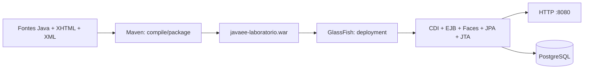
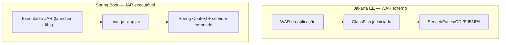
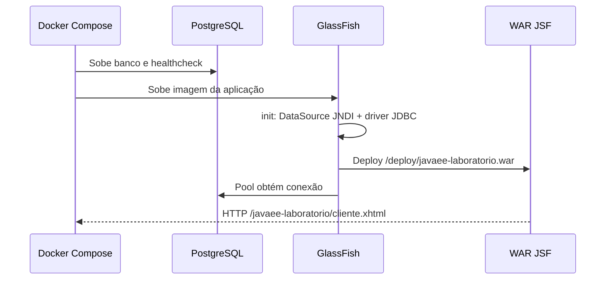

# 07 — Como o Java EE roda: GlassFish, Maven, WAR, JAR e EAR

[← Índice](README.md) · [← Persistência](06-persistencia-jpa-jdbc.md) · [Laboratório →](08-laboratorio-troubleshooting.md)

## 1. A visão que costuma faltar: da classe Java até a página web

**Explicação simples:** você escreve código Java e XHTML no projeto. **Maven compila e empacota** esses arquivos em um artefato. **GlassFish lê o pacote, identifica seus módulos, registra os componentes e publica a aplicação** na rede. Banco e servidor de aplicação são processos diferentes.



**Comparação Spring Boot:** com executable JAR, é comum executar `java -jar app.jar` e inicializar o contêiner Spring + servidor web embutido. Com Java EE clássico, frequentemente se executa o **servidor de aplicações primeiro** e depois se publica o WAR/EAR nele. **Ambas as plataformas admitem variações**; não trate isso como uma regra universal.

## 2. A diferença entre biblioteca, aplicação e servidor

| Elemento | É o quê? | Exemplo |
|---|---|---|
| `.class` | Código Java compilado | `ClienteBean.class` |
| JAR | Arquivo Java contendo classes e recursos | Biblioteca do domínio; módulo EJB |
| WAR | Arquivo de aplicação web | `javaee-laboratorio.war` |
| EAR | Arquivo empresarial que agrupa módulos | `sistema-bancario.ear` |
| JVM | Processo que executa bytecode | Processo do GlassFish |
| Servidor de aplicação | Runtime que integra serviços Jakarta EE | GlassFish |
| Driver JDBC | Biblioteca que conversa com o SGBD | Driver PostgreSQL |
| DataSource JNDI | Recurso configurado no runtime | `jdbc/EstudosDS` |
| Deploy | Instalação/publicação do artefato | `asadmin deploy app.war` |

**Dúvida frequente:** WAR e EAR **não são servidores**. São ZIPs com convenções de diretório/metadata. O **servidor** é quem carrega e executa esses artefatos.

## 3. O que existe dentro de um WAR?

Um WAR segue o layout de aplicações Servlet:

```text
javaee-laboratorio.war
├── cliente.xhtml                      # View JSF
├── assets/                            # Recursos públicos opcionais
└── WEB-INF/
    ├── web.xml                        # Configuração web (pode ser opcional)
    ├── beans.xml                      # Descoberta CDI conforme modo
    ├── classes/                       # Classes e recursos compilados
    │   ├── br/com/murilo/javaee/...
    │   └── META-INF/persistence.xml   # Unidade JPA deste laboratório
    └── lib/
        ├── primefaces-14.*-jakarta.jar
        └── outras-dependencias-app.jar
```

**Regra prática:** conteúdo em `WEB-INF` não é disponibilizado diretamente como recurso HTTP estático. XHTML fora dele pode ser solicitado por URL (a partir do caminho do contexto). Há proteções e particularidades de JSF para recursos Facelets.

### Como a árvore do Maven vira WAR

```text
src/main/java/                         → WEB-INF/classes/ (*.class)
src/main/resources/                    → WEB-INF/classes/ (recursos e META-INF)
src/main/webapp/cliente.xhtml          → /cliente.xhtml
src/main/webapp/WEB-INF/web.xml        → /WEB-INF/web.xml
dependências Maven runtime/compile     → WEB-INF/lib/
jakartaee-api (scope provided)         → fornecida pelo GlassFish
```

**Por que `provided`?** A API Jakarta EE (Servlet, Faces, CDI, EJB etc.) já deve ser disponibilizada pelo servidor. Empacotar uma cópia incompatível dessas APIs no WAR pode produzir conflito de classes.

Do [pom.xml do laboratório](../laboratorio/pom.xml):
```xml
<packaging>war</packaging>
<dependency>
  <groupId>jakarta.platform</groupId>
  <artifactId>jakarta.jakartaee-api</artifactId>
  <version>10.0.0</version>
  <scope>provided</scope>
</dependency>
<dependency>
  <groupId>org.primefaces</groupId>
  <artifactId>primefaces</artifactId>
  <version>14.0.12</version>
  <classifier>jakarta</classifier>
</dependency>
```

O `maven-war-plugin` empacota o WAR. Como um WAR pode conter classes EJB em `WEB-INF/classes`, **não é necessário criar um EAR só porque há `@Stateless`**.

## 4. O que existe dentro de um EAR?

**EAR (Enterprise Archive)** agrupa **múltiplos módulos Jakarta EE** que são implantados como uma unidade empresarial:

```text
sistema-bancario.ear
├── META-INF/
│   └── application.xml           # Descriptor empresarial (pode ser opcional)
├── portal-web.war                # JSF / Servlets / APIs web
├── negocio-ejb.jar               # Enterprise Beans
├── integracao-ejb.jar            # Outro módulo EJB (se necessário)
└── lib/
    └── contratos-compartilhados.jar
```

No EAR, as estruturas dos módulos continuam existindo:
- `portal-web.war` tem `WEB-INF/classes`, `WEB-INF/lib` e `web.xml` (quando utilizado).
- `negocio-ejb.jar` tem classes de EJB; pode ter `META-INF/ejb-jar.xml` conforme configuração e versão.
- `META-INF/application.xml` pode declarar módulos/context roots ou outras definições.
- `lib/` costuma agrupar bibliotecas compartilhadas entre módulos, respeitando regras de class loading.

### Exemplo de application.xml (didático)

```xml
<?xml version="1.0" encoding="UTF-8"?>
<application xmlns="https://jakarta.ee/xml/ns/jakartaee" version="10">
    <display-name>Sistema Bancário</display-name>
    <module>
        <web>
            <web-uri>portal-web.war</web-uri>
            <context-root>/portal</context-root>
        </web>
    </module>
    <module>
        <ejb>negocio-ejb.jar</ejb>
    </module>
</application>
```

> **Nota:** verifique o schema/versionamento do descriptor na versão Jakarta EE adotada. Este é um **exemplo ilustrativo**, não um arquivo existente no laboratório.

### Projeto Maven multimódulo para EAR

```text
sistema-bancario/
├── pom.xml                      # <packaging>pom</packaging>
├── contratos/                   # JAR de interfaces/DTOs
│   └── pom.xml                  # <packaging>jar</packaging>
├── negocio-ejb/
│   └── pom.xml                  # <packaging>ejb</packaging> / JAR apropriado
├── portal-web/
│   └── pom.xml                  # <packaging>war</packaging>
└── distribuicao-ear/
    └── pom.xml                  # <packaging>ear</packaging>
```

O módulo EAR usa o **maven-ear-plugin** para montar WAR, JARs EJB e bibliotecas. Configurar os módulos, dependências e versões coerentemente evita cópias conflitantes de classes.

**Atenção:** um JAR de biblioteca comum e um **JAR de módulo EJB** podem ser arquivos .jar fisicamente, mas têm papéis diferentes dentro do EAR.

## 5. WAR ou EAR? Critérios técnicos

| Situação | WAR | EAR |
|---|---|---|
| Aplicação web única com JSF + EJBs locais | **Geralmente suficiente** | Costuma ser desnecessário |
| Vários módulos EJB e web publicados como unidade | Possível reorganizar, mas mais trabalhoso | **Opção natural** |
| Compartilhamento de contratos entre módulos | WEB-INF/lib ou módulo separado | EAR/lib e dependências de módulos |
| Legado modular fortemente dependente de EJB remoto | Precisa avaliar arquitetura | Frequente em sistemas Java EE históricos |
| Spring Boot REST simples | Executable JAR geralmente comum | EAR em geral não faz parte do fluxo típico |

**Não escolha EAR por “ser mais enterprise”.** Ele agrega complexidade de montagem, classloading, configuração e operação. Use quando houver necessidade concreta de módulo empresarial.

## 6. WAR em GlassFish versus JAR em Spring Boot



```bash
# Jakarta EE / GlassFish
mvn clean package
asadmin start-domain domain1
asadmin deploy target/javaee-laboratorio.war

# Spring Boot executable JAR (outro projeto)
mvn clean package
java -jar target/spring-app.jar
```

Spring Boot **também pode empacotar WAR para deploy externo**, desde que dependências e inicialização estejam configuradas para isso. Em Java EE também existem formas de embutir/automatizar servidores, mas o laboratório escolheu explicitamente o modelo clássico para estudar deploy.

## 7. O que acontece durante o deploy de um WAR?

1. GlassFish identifica o arquivo e o context root.
2. O runtime cria os ambientes de classloading e módulos necessários.
3. Faz descoberta das classes elegíveis de CDI e EJB.
4. Valida pontos de injeção (por exemplo, `@Inject` e qualifiers).
5. Registra Servlet/Faces e recursos de aplicação.
6. Prepara a unidade de persistência JPA e a integração transacional.
7. Publica endpoints e páginas quando o deployment é concluído.

**Ordem exata e otimizações internas são dependentes de implementação; este é um modelo mental, não um trace garantido.**

**Caso real do laboratório:** o GlassFish rejeitou um deploy por `WELD-001409` (CDI ambíguo), mesmo com o WAR compilado. Isso mostra que **compilar com Maven não prova que o contêiner consegue iniciar os componentes**.

## 8. GlassFish Docker: build, banco e deploy no laboratório

Arquivos:
- [Dockerfile](../laboratorio/Dockerfile): Maven compila a aplicação e gera WAR; a imagem final usa GlassFish 7.1.
- [compose.yaml](../laboratorio/compose.yaml): configura PostgreSQL e servidor.
- [docker/glassfish/init.sh](../laboratorio/docker/glassfish/init.sh): cria pool, recurso JDBC JNDI e valida a conexão.
- [persistence.xml](../laboratorio/src/main/resources/META-INF/persistence.xml): declara o nome JTA do DataSource.
- [web.xml](../laboratorio/src/main/webapp/WEB-INF/web.xml): mapeia `FacesServlet`.



```bash
cd javaee/laboratorio
cp .env.example .env
docker compose up --build
# Abrir:
# http://localhost:8080/javaee-laboratorio/cliente.xhtml
```

**Segurança:** portas localhost para desenvolvimento; não publicar administração GlassFish em rede pública, não manter credenciais de estudo em produção. **O laboratório usa geração de schema `create`: deployments podem recriar tabelas!**

### Troubleshooting de deploy

| Sintoma | Investigue |
|---|---|
| `ClassNotFoundException` | JAR ausente/classloading/conflito de versões |
| `WELD-001409` | Múltiplos beans CDI resolvidos pelo mesmo ponto |
| `NameNotFoundException jdbc/EstudosDS` | JNDI resource e script init do servidor |
| `PersistenceException` | Provider, JTA, DataSource, mapeamento e banco |
| HTTP 404 | Context root, deployment falhou, path incorreto |
| HTTP 500 | Logs JSF, CDI, EJB, JPA, aplicação |

## 9. Questões de fixação com respostas

**1. O WAR contém o executável do GlassFish?**  
**Resposta:** não. O WAR contém a aplicação; GlassFish é um runtime separado que identifica componentes e oferece serviços Jakarta EE.

**2. Preciso empacotar `@Stateless` em EAR?**  
**Resposta:** não. Um WAR compatível pode conter EJBs, como ocorre no laboratório.

**3. Preciso copiar `jakarta.jakartaee-api` para `WEB-INF/lib`?**  
**Resposta:** normalmente não quando o servidor provê essa plataforma. Use Maven `scope=provided` para APIs disponibilizadas no runtime e evite duplicação de classes.

**4. Quando usar EAR em vez de WAR?**  
**Resposta:** quando há necessidade de agrupar módulos web, EJB e bibliotecas compartilhadas sob uma aplicação empresarial, por exemplo `portal.war` e `negocio-ejb.jar`. EAR não é sinônimo de modernidade.

**5. O que `mvn package` faz que `asadmin deploy` não faz?**  
**Resposta:** Maven compila/empacota um artefato; GlassFish implanta e inicializa a aplicação no contêiner. Um build com sucesso pode falhar no deploy por CDI, JTA ou recursos faltantes.

**6. Onde o contêiner procura o DataSource JPA no laboratório?**  
**Resposta:** pela referência JNDI `jdbc/EstudosDS` configurada no GlassFish e indicada em `persistence.xml`.

## Fontes oficiais

- [Jakarta EE Tutorial — Packaging](https://jakarta.ee/learn/docs/jakartaee-tutorial/current/platform/packaging/packaging.html)
- [Jakarta EE Tutorial](https://jakarta.ee/learn/docs/jakartaee-tutorial/current/)
- [Apache Maven WAR Plugin](https://maven.apache.org/plugins/maven-war-plugin/)
- [Apache Maven EAR Plugin](https://maven.apache.org/plugins/maven-ear-plugin/)
- [GlassFish](https://glassfish.org/)
- [Spring Boot — Packaging](https://docs.spring.io/spring-boot/reference/packaging/index.html)
