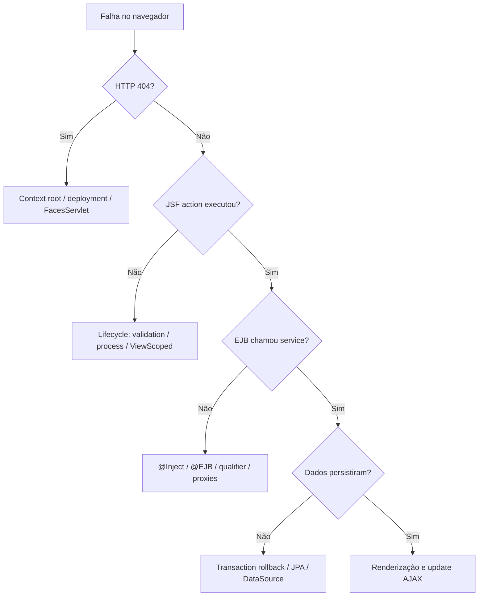

# 08 — Laboratório guiado: leia, execute e diagnostique

[← Índice](README.md) · [← WAR/EAR](07-glassfish-war-ear.md) · [Outras especificações →](09-especificacoes-complementares.md)

## 1. Objetivo desta etapa

Praticar o que foi apresentado, **sem decorar anotações**. O projeto de referência é o [laboratório MVC](../laboratorio/README.md) já versionado no repositório. O projeto foi pensado para estudar **Java 17 + Jakarta EE 10 + GlassFish 7.1 + JSF/PrimeFaces + CDI + EJB + JPA + PostgreSQL**.

O que já existe: cadastro e listagem de clientes, criação de pedidos, façade EJB, exercício de `REQUIRES_NEW`, testes JUnit/JPA e servidor no Docker Compose.

O que precisa de validação adicional: testes automatizados de navegador com dados reais, a execução de todos os atributos transacionais em contêiner e cenários de falha/extremos.

## 2. Subindo servidor e banco

```bash
git clone https://github.com/murilohenzo/java-estudos.git
cd java-estudos/javaee/laboratorio
cp .env.example .env
docker compose up --build
```

Abra `http://localhost:8080/javaee-laboratorio/cliente.xhtml`.

O Dockerfile faz **build em estágio Maven**, usa a imagem GlassFish e deposita o WAR em `/deploy`. O Compose inicia PostgreSQL e GlassFish; o `init.sh` cria `jdbc/EstudosDS`.

**Importante:** o projeto é de estudo e o schema está em `create`, que pode recriar tabelas. Não use dados importantes.

### Sem Docker

Com Java 17/Maven e um GlassFish 7 compatível já configurado com o driver e DataSource:

```bash
cd javaee/laboratorio
mvn clean verify
asadmin deploy --force=true target/javaee-laboratorio.war
```

O build `mvn verify` executa testes; **não configura sozinho o banco/DataSource do servidor externo**.

## 3. Navegação pelo código em uma transação completa

| Passo | Arquivo / papel | O que investigar |
|---|---|---|
| 1 | `src/main/webapp/cliente.xhtml` | Formulário, `value`, `action`, `process`, `update` |
| 2 | `adapters/inbound/web/ClienteBean.java` | Recebe valores e chama interface |
| 3 | `application/port/inbound/ClienteBoundary.java` | Contrato exposto pela fachada |
| 4 | `adapters/inbound/ejb/ClienteFacadeEJB.java` | Transação `REQUIRED` |
| 5 | `application/service/ClienteApplicationService.java` | Validação e regra de cadastro |
| 6 | `application/port/outbound/ClienteRepository.java` | Contrato de persistência |
| 7 | `adapters/outbound/persistence/JpaClienteRepository.java` | Operações EntityManager |
| 8 | `src/main/resources/META-INF/persistence.xml` | JTA e DataSource |
| 9 | `docker/glassfish/init.sh` | Pool JDBC e nome JNDI |
| 10 | PostgreSQL no Compose | Persistência final |

**Exercício:** descreva a diferença entre a **direção da chamada em runtime** (view → serviço → DB) e a **direção da dependência de código** (serviço → interface; adaptação JPA → interface).

## 4. Cinco experiências guiadas

### Experiência A — Ciclo de vida da tela

**Given** nome/e-mail válidos, **when** clicar em Salvar, **then** a action deverá chamar o caso de uso. Explique em qual fase `Update Model Values` os setters participam.

Mude mentalmente para um e-mail inválido: como a validação interrompe o fluxo normal até `Invoke Application`?

### Experiência B — `action` versus `actionListener`

No XHTML, identifique o botão com ambas as expressões; encontre `antesDeSalvar()` e `salvar()`. Explique por que não é obrigatório retornar `String` e por que não declarar action não necessariamente impede um postback.

### Experiência C — CDI e resolução de dependências

Encontre `@Inject` e o serviço que implementa a porta `ClienteUseCase`. Verifique o qualifier usado para eliminar ambiguidade entre serviço CDI e fachada EJB (quando presente na revisão atual). Se o runtime acusar `WELD-001409`, leia os candidatos concretos antes de mudar o código.

### Experiência D — JPA e LEFT JOIN

Crie um cliente sem pedido. Faça consulta usando `LEFT JOIN` e explique por que o cliente continua presente. Compare uma consulta `JOIN FETCH` com a estratégia de DTO para leitura, monitorando quantidade de SQLs.

### Experiência E — EJB com rollback e auditoria

O botão de simulação chama a fachada EJB (`REQUIRED`), que chama auditoria (`REQUIRES_NEW`) e lança exceção. Inspecione no banco qual registro permaneceu após falha. **Não confunda emitir SQL com confirmar transação.**

## 5. Como executar testes

```bash
cd javaee/laboratorio
mvn clean verify
```

- `ClienteApplicationServiceTest`: testes de serviço isolado com mocks.
- `JpaRepositoriesIT`: testes JPA/H2, sem contêiner EJB.
- `ArchitectureTest`: limite de 80 linhas e restrições de dependências.
- Workflow GitHub Actions: build/test + smoke HTTP da view com GlassFish/PostgreSQL.

**O que o smoke garante:** que servidor e WAR podem subir e renderizar a página. **O que não garante:** execução completa dos formulários, acesso concorrente, atomicidade do EJB e comportamento operacional em produção.

## 6. Depuração guiada



```bash
docker compose ps
docker compose logs -f glassfish
docker compose logs -f banco
```

### Exemplo real: compilou, mas não fez deploy

**Sintoma:** HTTP 404 para `/javaee-laboratorio/cliente.xhtml`.

**Diagnóstico real observado anteriormente:** erro `WELD-001409: Ambiguous dependencies for type ClienteUseCase` na injeção do EJB, enquanto a etapa Maven tinha terminado sem erro.

**Causa:** mais de um bean era elegível para o mesmo tipo `@Default`.

**Correção:** qualifier CDI específico na implementação de caso de uso e no ponto de injeção, preservando dependência da fachada por interface.

**Lição:** Maven compilar e testar JPA não valida sozinho a montagem do CDI/EJB no runtime.

## 7. Checklist final

- [ ] Sei explicar **quem recebe HTTP** no JSF e no Spring MVC.
- [ ] Conheço as seis fases JSF e consigo explicar falha de validação.
- [ ] Consigo diferenciar `@Inject`, `@EJB`, `@PersistenceContext`.
- [ ] Sei explicar os seis atributos EJB.
- [ ] Sei diferenciar EntityManager, DataSource, JDBC, JTA.
- [ ] Consigo explicar conteúdo de WAR e quando EAR é útil.
- [ ] Executei Maven/JUnit e verifiquei o comportamento real no GlassFish.
- [ ] Diferencio teste unitário, JPA/H2 e teste de contêiner.

## Fontes

- [README do laboratório](../laboratorio/README.md)
- [Como executar GlassFish](../laboratorio/docs/03-como-executar-glassfish.md)
- [Guia de prova e questões](../GUIA_ESTUDOS.md)
