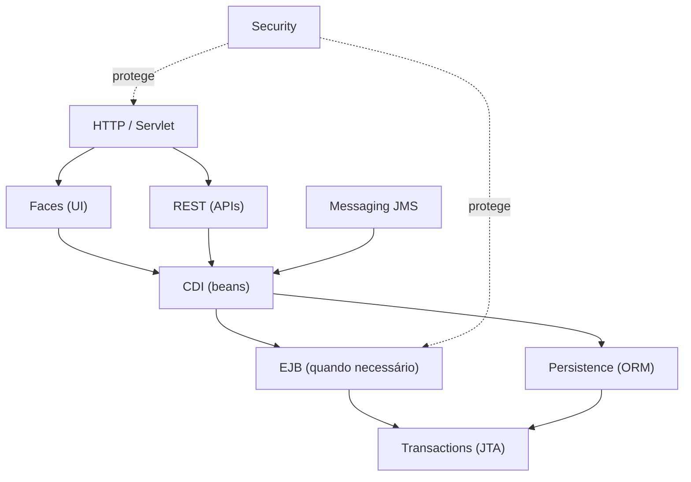

# 09 — Outras especificações Jakarta EE: Servlet, REST, Validation, Security, JMS e mais

[← Índice](README.md) · [← Laboratório](08-laboratorio-troubleshooting.md)

> **Escopo:** essas tecnologias completam o mapa da plataforma. **Elas não estão todas implementadas no laboratório**: cada exemplo é demonstrativo e mostra onde cada especificação entra no sistema.

## 1. Jakarta Servlet — fundação HTTP por trás das interfaces

**Explicação simples:** Servlet é o contrato básico para processar requisições HTTP Java no servidor. JSF e Spring MVC normalmente executam **sobre** a infraestrutura de Servlet.

```java
@WebServlet("/ping")
public class PingServlet extends HttpServlet {
    @Override
    protected void doGet(HttpServletRequest req, HttpServletResponse resp)
            throws IOException {
        resp.setContentType("text/plain");
        resp.getWriter().println("pong");
    }
}
```

Aqui a chamada `GET /ping` chega ao contêiner Servlet e chama `doGet()`. Para aplicações grandes, não é necessário escrever Servlet para cada ação: **FacesServlet** e **DispatcherServlet** são front controllers que usam a Servlet API.

| Recurso | Jakarta EE | Spring |
|---|---|---|
| HTTP subjacente | Jakarta Servlet | Também Jakarta Servlet em Spring MVC |
| Front controller | `FacesServlet` ou Dispatcher próprio de JAX-RS | `DispatcherServlet` |
| Filtros | `Filter` | Servlet Filters / Spring `OncePerRequestFilter` |
| Cookies/sessão | Servlet API | Sessão HTTP + abstrações Spring |
| URL mapping | `web.xml`, anotações | `@RequestMapping`, infraestrutura MVC |

**Cuidado:** Servlet não é sinônimo de EJB. Servlet atende HTTP; EJB fornece serviços de negócio gerenciados pelo contêiner.

## 2. Jakarta REST (JAX-RS) — criar APIs HTTP sem JSF

**Exemplo:** queremos manter a UI JSF e também disponibilizar clientes a uma interface React/Angular.

```java
@ApplicationPath("/api")
public class RestConfig extends Application {}
```

```java
@Path("/clientes")
@Produces(MediaType.APPLICATION_JSON)
public class ClienteResource {
    @Inject ClienteUseCase casos;

    @GET
    public List<ClienteResumo> listar() {
        return casos.listar();
    }
}
```

**Rota resultante (dependendo do context root):** `/javaee-laboratorio/api/clientes`.

Comparação Spring:
```java
@RestController
@RequestMapping("/api/clientes")
class ClienteController {
    private final ClienteUseCase casos;
    ClienteController(ClienteUseCase casos) { this.casos = casos; }

    @GetMapping
    List<ClienteResumo> listar() { return casos.listar(); }
}
```

**Importante:** o exemplo REST é ilustrativo; adicionar a classe ao WAR, configurar serialização JSON e testar o endpoint fazem parte de uma etapa futura. O laboratório atual implementa **JSF**.

## 3. Jakarta Validation — regras declarativas sobre dados

```java
public record NovoCliente(
    @NotBlank String nome,
    @NotBlank @Email String email
) {}
```

```java
public void cadastrar(@Valid NovoCliente entrada) {
    // A validação só ocorrerá automaticamente se a chamada passar
    // pelo ponto de integração/interceptação que suporta @Valid.
}
```

**Princípio:** anotações definem restrições; é o mecanismo de validação que executa as verificações. `@Valid` não valida magicamente qualquer chamada direta a um método Java sem integração com Bean Validation.

Comparativo Spring: `@Valid` com Spring MVC/BindingResult e integração com Jakarta Validation.

**Diferencie:** `required="true"` no XHTML é validação de componente JSF; `@NotBlank` é restrição declarativa de Jakarta Validation. Podem ser complementares.

## 4. Jakarta Security — autenticação e autorização

- **Autenticação:** quem você é?
- **Autorização:** o que você pode acessar?
- **Identidade/roles:** atributos usados nas decisões de acesso.

```java
@Stateless
public class PagamentoEJB {
    @RolesAllowed("OPERADOR")
    public void autorizarPagamento() {
        // lógica de negócio protegida pela autorização do contêiner
    }
}
```

O método pressupõe um ambiente com identidade e papéis configurados. A anotação **não implementa sozinha login, gestão de usuários ou emissão de tokens**.

No Spring, compare com Spring Security e regras como `@PreAuthorize("hasRole('OPERADOR')")`, que dependem de configuração/habilitação próprias.

**Conceitos para sustentar legados:** realms, roles, `Principal`, política de sessão, HTTPS/mTLS, identity store e auditoria. Não gravar credenciais em código-fonte.

## 5. Jakarta Messaging (JMS) — mensageria Java corporativa

**Problema:** enviar mensagens assíncronas para uma fila enquanto outros componentes processam quando disponíveis.

- **Queue:** costuma representar distribuição de trabalho entre consumidores.
- **Topic:** publicação/assinatura para destinatários inscritos.
- **JMSContext:** API de publicação/consumo.
- **Message-Driven Bean (MDB):** bean EJB que recebe mensagens de forma gerenciada.

```java
@MessageDriven(activationConfig = {
    @ActivationConfigProperty(propertyName = "destinationType",
                              propertyValue = "jakarta.jms.Queue")
})
public class PedidoConsumerMDB implements MessageListener {
    @Override
    public void onMessage(Message msg) {
        // processar mensagem recebida no ambiente configurado
    }
}
```

**Não confunda JMS com Kafka.** JMS é uma API de mensagens e depende de provider/destino configurado. Kafka é uma plataforma de log distribuído com modelo próprio de tópicos, partições, offsets e grupos. Integrar ambos requer mapeamento explícito de entrega, retry e semântica transacional.

Na família Spring, `@JmsListener` e `JmsTemplate` são alternativas de integração com providers JMS.

## 6. Jakarta JSON-P e JSON-B

- **JSON-P (JSON Processing):** construir/ler estruturas JSON por API.
- **JSON-B (JSON Binding):** mapear objetos Java ↔ JSON de forma declarativa.

```java
JsonObject objeto = Json.createObjectBuilder()
    .add("id", 10)
    .add("status", "OK")
    .build();
```

```java
String json = JsonbBuilder.create()
    .toJson(new ClienteResumo(10L, "Ana", "ana@exemplo.com"));
```

**Comparativo Spring MVC/Boot:** costuma-se usar Jackson com conversores HTTP; a escolha e o wiring não são iguais. Nem JSON-B nem JSON-P são exigidos para toda tela JSF.

## 7. Jakarta WebSocket — comunicação persistente e bidirecional

```java
@ServerEndpoint("/atualizacoes")
public class AtualizacaoSocket {
    @OnMessage
    public String receber(String texto) {
        return "Recebido: " + texto;
    }
}
```

É útil para atualizações em tempo real (quando a infraestrutura e a operação suportam conexões persistentes). **Não confundir com AJAX JSF**, que é requisição/resposta parcial. Em Spring, existe suporte WebSocket/STOMP com APIs próprias.

## 8. Jakarta Concurrency — tarefas gerenciadas

Servidores Jakarta EE possuem recursos e políticas de execução. Criar `new Thread()` sem considerar o contêiner pode perder contexto, gerenciamento e controle operacional.

```java
@Resource
ManagedExecutorService executor;

public void processar() {
    executor.submit(() -> executarRotina());
}
```

**Conceito:** o contêiner administra o executor para integração com o ambiente. A propagação de contextos e as restrições transacionais dependem da API/configuração; **não presuma que uma tarefa assíncrona herdará a transação JTA ativa**.

Comparativo Spring: `TaskExecutor` e `@Async`, com observações próprias de thread/propagação de contexto.

## 9. Jakarta Batch — processamento em lote

No ecossistema Java Enterprise, Jakarta Batch define processamento orientado a **jobs/steps**, incluindo leitores e escritores (em determinados estilos de step).

```java
@Named
public class LinhaProcessor implements ItemProcessor {
    @Override
    public Object processItem(Object item) {
        return normalizar(item);
    }
}
```

**Comparativo Spring Batch:** ambos possuem conceitos de job/step e chunk, mas sua configuração, ciclo de vida, repositório de jobs e APIs **não são equivalentes**.

Se você for processar migração de bilhões de eventos Kafka, uma decisão de usar Jakarta Batch ou Spring Batch precisa considerar particionamento, throughput, idempotência, banco e semântica de leitura/commit — não apenas a presença de uma anotação de Batch.

## 10. Serviços e especificações não são um único pacote obrigatório



**Arquitetura típica moderna:** uma API Jakarta REST + CDI + JPA + JTA **pode existir sem JSF e sem EJB**. Em aplicações legadas, JSF e EJB aparecem muito porque eram escolhas arquiteturais e tecnológicas do período de construção.

## 11. Perguntas para fixar

1. O que diferencia `FacesServlet` de um Servlet escrito à mão?
2. Como criar endpoint REST sem utilizar `@RestController`?
3. `@NotBlank` valida automaticamente qualquer chamada de método Java?
4. `@RolesAllowed` substitui autenticação?
5. JMS Topic tem as mesmas garantias de Kafka Topic?
6. O que muda entre execução em ManagedExecutorService e `new Thread()`?
7. Por que não é preciso usar todas essas especificações em um único WAR?

## Fontes oficiais

- [Jakarta Servlet](https://jakarta.ee/specifications/servlet/)
- [Jakarta RESTful Web Services](https://jakarta.ee/specifications/restful-ws/)
- [Jakarta Validation](https://jakarta.ee/specifications/bean-validation/)
- [Jakarta Security](https://jakarta.ee/specifications/security/)
- [Jakarta Messaging](https://jakarta.ee/specifications/messaging/)
- [Jakarta JSON Processing](https://jakarta.ee/specifications/jsonp/)
- [Jakarta JSON Binding](https://jakarta.ee/specifications/jsonb/)
- [Jakarta WebSocket](https://jakarta.ee/specifications/websocket/)
- [Jakarta Concurrency](https://jakarta.ee/specifications/concurrency/)
- [Jakarta Batch](https://jakarta.ee/specifications/batch/)
