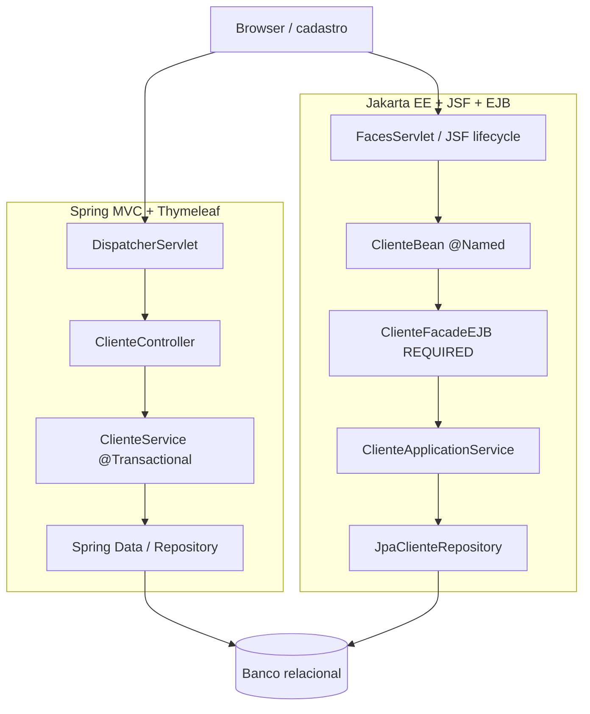

# 10 — Mesmo caso de uso em Spring e Jakarta EE: comparação ponta a ponta

[← Índice](README.md) · [← Especificações](09-especificacoes-complementares.md)

> **Objetivo:** sair das anotações isoladas e entender o mesmo cadastro de clientes nas duas plataformas, identificando o que é responsabilidade do framework, da aplicação e do servidor.

## Antes de comparar: duas arquiteturas Java EE possíveis

Este capítulo mostra a abordagem **EJB CMT na fronteira + service CDI**, porque ela corresponde ao laboratório. Entretanto, uma alternativa mais enxuta é colocar `jakarta.transaction.Transactional(REQUIRED)` no **service CDI** e **não criar uma fachada EJB**. O commit/rollback acontece na fronteira escolhida.

Na comparação Spring, `@Service` também não cria transação por conta própria; é o `@Transactional` do framework (com TransactionManager e chamada interceptada) que define o limite.

Para decidir entre essas opções, consulte [CDI × EJB × JTA](11-cdi-ejb-transacoes-sem-confusao.md).

## 1. Enunciado de negócio

Criar um cadastro de clientes com:
- nome e e-mail obrigatórios;
- persistência em banco relacional;
- validação antes de salvar;
- retorno da lista de clientes;
- transação para efetivar o cadastro;
- possibilidade de substituir a implementação da persistência sem alterar a regra de negócio.

Este exemplo é **didático**: os fragmentos de Spring e Jakarta EE abaixo demonstram responsabilidades equivalentes, não uma segunda aplicação compilável dentro do repositório.

## 2. Mapa MVC e das responsabilidades

| Papel | Spring MVC / Boot | Jakarta EE (laboratório) |
|---|---|---|
| Entrada HTTP | DispatcherServlet | FacesServlet |
| View | Thymeleaf, React/Angular ou outro frontend | Facelets XHTML + PrimeFaces |
| Controller | `@Controller` / `@PostMapping` | `@Named @ViewScoped` bean + `action` |
| DTO | `ClienteForm` / command | `NovoCliente` record |
| Serviço de aplicação | `@Service` | `@ApplicationScoped` CDI bean |
| Fronteira transacional | `@Transactional` Spring | `@Stateless` EJB + `@TransactionAttribute` |
| Abstração de persistência | Repository interface | Repository interface |
| Persistência concreta | Spring Data JPA ou EntityManager | JpaClienteRepository / EntityManager |
| Transação de banco | TransactionManager/JPA | JTA / contêiner EJB |
| Artefato | JAR executável ou WAR | WAR do laboratório |
| Execução usual | `java -jar` (JAR) | GlassFish + deploy WAR |

## 3. Código Spring: controller → serviço → repositório

**Controller** recebe a requisição e não conhece o SQL:

```java
@Controller
@RequestMapping("/clientes")
class ClienteController {
    private final ClienteUseCase casos;

    ClienteController(ClienteUseCase casos) { this.casos = casos; }

    @PostMapping
    String salvar(@Valid @ModelAttribute ClienteForm form, BindingResult erros) {
        if (erros.hasErrors()) return "clientes-form";
        casos.cadastrar(new NovoCliente(form.nome(), form.email()));
        return "redirect:/clientes";
    }
}
```

**Serviço** controla operação de negócio e, neste estilo de Spring, pode ser fronteira transacional:

```java
@Service
public class ClienteService implements ClienteUseCase {
    private final ClienteRepository clientes;
    public ClienteService(ClienteRepository clientes) { this.clientes = clientes; }

    @Transactional
    public Long cadastrar(NovoCliente novo) {
        validar(novo);
        return clientes.salvar(new Cliente(novo.nome(), novo.email())).getId();
    }
}
```

**Repositório** pode ser um contrato Spring Data JPA:
```java
public interface ClienteJpaRepository extends JpaRepository<Cliente, Long> {}
```

**O que o Spring Boot automatiza frequentemente:** bean registration, autoconfiguração do `DataSource`, JPA, transações, servidor HTTP embutido e conversão/validation conforme as dependências escolhidas.

## 4. Código Jakarta EE: View → Controller JSF → EJB → Serviço CDI

**View XHTML** define elementos e ligações com o bean:
```xml
<h:form id="cadastro">
    <h:inputText value="#{clienteBean.nome}" required="true"/>
    <h:commandButton value="Salvar" action="#{clienteBean.salvar}"/>
</h:form>
```

**Controller JSF** delega à interface:
```java
@Named
@ViewScoped
public class ClienteBean implements Serializable {
    @Inject private ClienteBoundary boundary;

    public String salvar() {
        boundary.cadastrar(new NovoCliente(nome, email));
        return null;
    }
    // Propriedades e getters/setters omitidos.
}
```

**Fachada EJB** recebe serviços de transação do GlassFish:
```java
@Stateless
@Local(ClienteBoundary.class)
@TransactionAttribute(TransactionAttributeType.REQUIRED)
public class ClienteFacadeEJB implements ClienteBoundary {
    @Inject private ClienteUseCase casos;
    public ClienteFacadeEJB() {}

    public Long cadastrar(NovoCliente novo) { return casos.cadastrar(novo); }
}
```

**Serviço CDI** utiliza interfaces de persistência:
```java
@ApplicationScoped
public class ClienteApplicationService implements ClienteUseCase {
    private final ClienteRepository clientes;
    protected ClienteApplicationService() { this.clientes = null; } // proxy CDI
    @Inject
    public ClienteApplicationService(ClienteRepository clientes) {
        this.clientes = clientes;
    }
    public Long cadastrar(NovoCliente novo) {
        validar(novo);
        return clientes.salvar(new Cliente(novo.nome(), novo.email())).getId();
    }
}
```

**Adaptador JPA**:
```java
@ApplicationScoped
public class JpaClienteRepository implements ClienteRepository {
    private final EntityManager em;
    protected JpaClienteRepository() { this.em = null; } // proxy CDI
    @Inject
    public JpaClienteRepository(EntityManager em) { this.em = em; }
    public Cliente salvar(Cliente cliente) { em.persist(cliente); return cliente; }
}
```

**Atenção:** os trechos representam as camadas, não classes completas. Existem dependências, getters/setters, métodos e regras de proxy que foram omitidos. No projeto real, use os imports, qualifiers e tipos declarados no repositório. Um caso de uso CDI e um EJB que exponham a mesma superinterface podem causar ambiguidade — é necessário resolver a injeção adequadamente.

## 5. Comparando o fluxo real



A diferença mais marcante aqui não está nas **regras de cadastro**. Está em **como o runtime organiza o ciclo de vida web, a injeção, as transações e o empacotamento**.

## 6. Onde aplicar SRP, DIP e DI?

- **SRP:** controller não faz SQL; repositório não renderiza XHTML; serviço não acessa `FacesContext`.
- **DIP:** serviço depende de `ClienteRepository` e não de `JpaClienteRepository`.
- **Constructor injection:** explicita dependências onde compatível com o tipo de componente; no EJB há restrição de instanciação pelo contêiner.
- **DTO:** contrato de entrada não deve depender do estado de entidade gerenciada no frontend.
- **Transação:** deve estar em uma fronteira de negócio definida, não em um componente de interface simplesmente por conveniência.

## 7. Como investigar uma aplicação Java EE legada vindo de Spring?

1. Procure `web.xml` e `FacesServlet` (compare com `DispatcherServlet`).
2. Procure o XHTML `action="#{...}"` para achar o Managed Bean.
3. Identifique `@Named`, `@ViewScoped`, antigos `@ManagedBean` e diferenças de namespace.
4. Identifique `@EJB`, `@Stateless` e `@TransactionAttribute`.
5. Encontre `@PersistenceContext`, `persistence.xml` e datasource JNDI.
6. Veja se o artefato é WAR ou EAR, e a versão de GlassFish/Java EE.
7. Analise contratos, integração e risco antes de migrar componentes.

**Importante:** converter `javax.*` para `jakarta.*` não equivale a migrar automaticamente um legado para Jakarta EE moderno; verifique suporte do servidor, PrimeFaces, APIs, drivers e dependências de terceiros.

## 8. Testes — o que equivale ao quê?

| Teste | Spring | Jakarta EE / laboratório |
|---|---|---|
| Serviço isolado | JUnit + mocks | JUnit + mocks via construtores |
| Persistência | `@DataJpaTest` e banco de teste | EntityManager/H2, ou integração em contêiner |
| Controller | MockMvc/WebTestClient para fluxos aplicáveis | Teste JSF com contêiner + requisição real/browser |
| Transação gerenciada | Testes com TransactionManager | Teste EJB/JTA no GlassFish |
| Deploy | Inicialização ApplicationContext | Deploy WAR/EAR e inicialização CDI/EJB/JPA |
| E2E | Navegador/HTTP + banco | Navegador/HTTP + GlassFish + banco |

Os testes do laboratório cobrem JUnit, persistência JPA/H2 e smoke de inicialização; **fluxos funcionais de tela e regras transacionais em contêiner devem ser validados à parte**.

## 9. Perguntas de síntese

- Se `@PostMapping` no Spring chama um método, qual elemento desempenha função parecida no JSF? **Action ligada à view + lifecycle FacesServlet**.
- `@Stateless` é obrigatório quando há `@ApplicationScoped`? **Não**.
- Onde encontro a configuração que liga JPA e DataSource no Jakarta EE? **persistence.xml + JNDI no servidor**.
- O que muda de WAR para EAR? **WAR empacota uma aplicação web; EAR agrupa módulos empresariais**.
- Spring e Jakarta EE podem acessar a mesma entidade JPA? **Sim, se usam as APIs/provider e infraestrutura compatíveis; a plataforma não determina o modelo de domínio**.

## Próximos materiais

- [Capítulo WAR e EAR](07-glassfish-war-ear.md)
- [Laboratório existente](../laboratorio/README.md)
- [Guia original de questões e gabarito](../GUIA_ESTUDOS.md)
