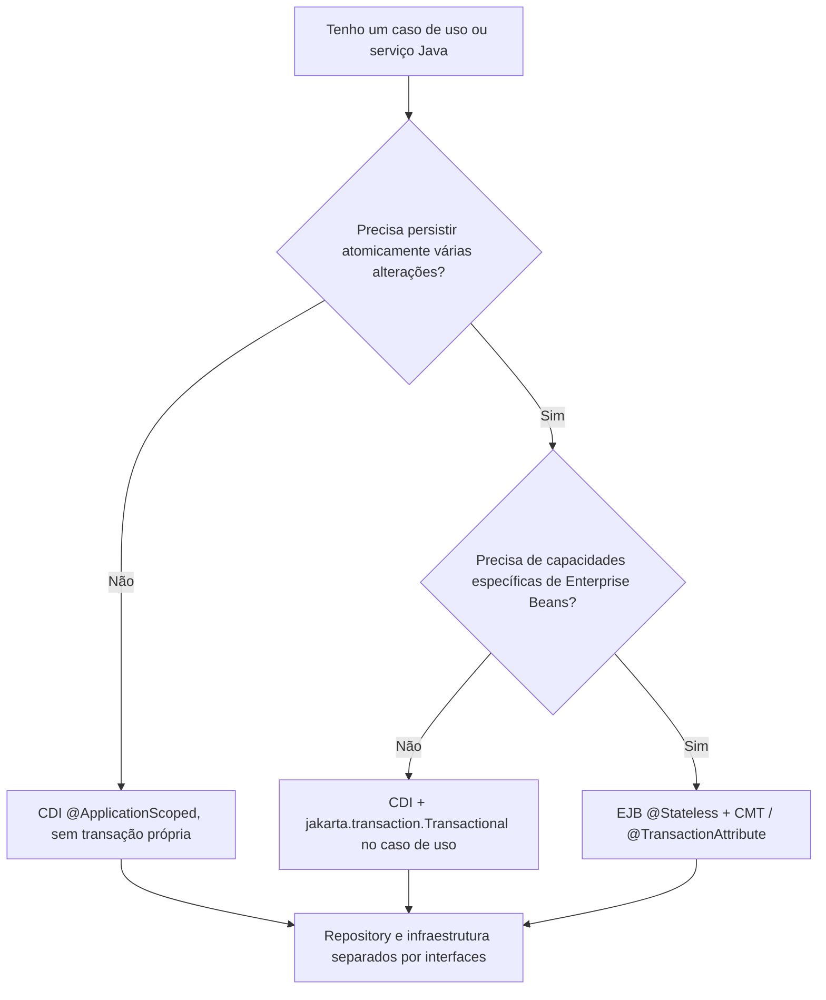
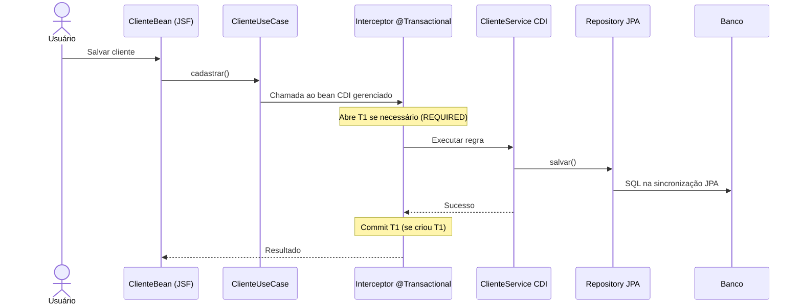

# 11 — CDI, EJB e transações: quando usar cada um e onde colocar as anotações

[← Índice](README.md) · [CDI](04-cdi-injecao.md) · [EJB](05-ejb-transacoes.md) · [Exercícios](08-laboratorio-troubleshooting.md)

> **Este é o capítulo de decisão arquitetural.** Primeiro entenda a responsabilidade de cada peça; depois escolha UMA fronteira transacional para cada caso de uso. Não é necessário usar EJB para que CDI e JPA funcionem juntos.

## 1. Três perguntas diferentes que costumam ser confundidas

| Pergunta | Responsável | Resposta em linguagem simples |
|---|---|---|
| Quem instancia o service e entrega as dependências? | **CDI** | O contêiner cria/obtém beans e resolve `@Inject` |
| Quem oferece recursos de Enterprise Beans? | **EJB** | O contêiner fornece `@Stateless`, `@Stateful`, concorrência, acesso local/remoto, CMT etc. |
| Quem abre, confirma ou reverte a transação? | **JTA**, acionada por um interceptor CDI `@Transactional` **ou** pelo contêiner EJB CMT | Define os limites de commit/rollback; não é sinônimo de CDI |

**Ponto central:** **CDI não é sinônimo de transação**. Você pode ter um bean `@ApplicationScoped` sem qualquer transação. Também pode ter um service **CDI transacional sem EJB**, usando `jakarta.transaction.Transactional`.

**EJB não é um "Repository", nem é obrigatório para todo service.** Ele é uma opção de componente gerenciado para requisitos específicos do contêiner. <https://jakarta.ee/learn/docs/jakartaee-tutorial/current/entbeans/ejb-intro/ejb-intro.html>

### Separando anotações por responsabilidade

| Anotação (imports relevantes) | Responsabilidade | Onde costuma ficar | Cria transação por si? |
|---|---|---|---|
| `@Named` (`jakarta.inject`) | Expor nome do bean à EL do JSF | Controller da View | Não |
| `@ViewScoped` (`jakarta.faces.view`) | Preservar estado dentro da view | Controller JSF | Não |
| `@ApplicationScoped` (`jakarta.enterprise.context`) | Contexto de vida do bean CDI | Service CDI stateless | Não |
| `@Inject` (`jakarta.inject`) | Resolver dependência | Construtor ou ponto de injeção | Não |
| `@Qualifier` (`jakarta.inject`) | Desambiguar implementações CDI | Qualifier de porta/implementação | Não |
| `@Stateless` (`jakarta.ejb`) | Definir session bean stateless | Adaptador/fachada EJB | **Possivelmente, via CMT padrão REQUIRED** |
| `@EJB` (`jakarta.ejb`) | Obter referência ao EJB gerenciado | Outro componente gerenciado | Não, isoladamente |
| `@TransactionAttribute` (`jakarta.ejb`) | Atributo de transação CMT EJB | Métodos/classes EJB | **Sim, quando a chamada é gerenciada** |
| `@Transactional` (`jakarta.transaction`) | Transação declarativa para beans gerenciados elegíveis | Service CDI | **Sim, quando o interceptor é aplicado** |
| `@Transactional` (`org.springframework.transaction.annotation`) | Transação Spring AOP | Service Spring | **Sim, quando Spring intercepta** |
| `@PersistenceContext` (`jakarta.persistence`) | Injetar EntityManager contextual | Adaptador/produtor JPA | **Não** |
| `@Entity` (`jakarta.persistence`) | Mapear objeto persistente | Model/domain | Não |

**Atenção ao `@Stateless` sem `@TransactionAttribute`:** a demarcação padrão de *session beans* é CMT com atributo **REQUIRED**. Isso significa que até um método de leitura do EJB pode participar de transação, caso você não ajuste a política.

## 2. Quando usar CDI apenas, CDI + transação ou EJB?

Regra prática sugerida para o laboratório, não uma exigência universal da especificação.



### Cenários concretos

| Caso | Escolha razoável | Motivo |
|---|---|---|
| Formatar dados ou validar regra sem I/O | Classe Java pura (nem precisa CDI) | Menor acoplamento |
| Serviço reutilizado com dependências e sem escrita | CDI `@ApplicationScoped` | Injeção e lifecycle; transação não obrigatória |
| Cadastrar cliente e seus pedidos no mesmo banco | CDI service com `@Transactional(REQUIRED)` **ou** EJB com CMT REQUIRED | Uma unidade de trabalho |
| Aplicação Java EE existente estruturada em EJB | Manter fronteira EJB e estudar CMT | Evita alterar sem necessidade o contrato e o comportamento existente |
| Expor interface de negócio EJB remota, `@Stateful`, timers/concorrência EJB, MDB | EJB conforme requisito | Recursos próprios de Enterprise Beans |
| REST + CDI + JPA em Jakarta EE moderno | CDI `@Transactional`, sem EJB obrigatório | Menos componentes quando não precisa das capacidades EJB |

**Regra de projeto:** na mesma operação, escolha **uma camada responsável pela transação** e documente seu limite. Não espalhe `@Transactional` em controller, service, repository e fachada por reflexo.

## 3. Caminho A — CDI com transação, sem EJB

Use quando não existe requisito específico de Enterprise Beans. A transação começa **ao atravessar o interceptor** do método `cadastrar`, antes de a lógica rodar, e termina conforme sucesso/exceção e as regras configuradas.



**Exemplo didático com CDI:**

```java
import jakarta.enterprise.context.ApplicationScoped;
import jakarta.inject.Inject;
import jakarta.transaction.Transactional;

@ApplicationScoped
public class ClienteService implements ClienteUseCase {
    private final ClienteRepository clientes;

    protected ClienteService() { this.clientes = null; } // proxy CDI

    @Inject
    public ClienteService(ClienteRepository clientes) { this.clientes = clientes; }

    @Override
    @Transactional(Transactional.TxType.REQUIRED)
    public Long cadastrar(NovoCliente novo) {
        Cliente cliente = clientes.salvar(new Cliente(novo.nome(), novo.email()));
        return cliente.getId();
    }
}
```

- `@ApplicationScoped` **apenas** define escopo e gerenciamento CDI.
- `@Inject` **apenas** recebe a porta.
- `@Transactional(REQUIRED)` aplica a regra de transação via **interceptor Jakarta Transactions**.
- A chamada precisa passar pela **referência gerenciada** ao service (não construir a classe manualmente).
- O retorno de ID com estratégia `IDENTITY` pode depender de como o provider obtém a chave: não use momento do SQL como evidência de commit.

**Spring semelhante:** `@Service` + `org.springframework.transaction.annotation.Transactional` no método público invocado via Spring, com TransactionManager configurado. A anotação tem o mesmo nome mas **outro pacote e mecanismo**.

### Como decidir se a consulta precisa transação?

Um `listarClientes()` simples pode funcionar sem uma nova transação explicitamente criada pelo service, mas **"somente leitura" não garante ausência de transação**. JPA e banco podem precisar de contexto, isolamento ou snapshot consistente. Se você exige uma visão coerente de múltiplas consultas, defina transação e isolamento apropriadamente; não remova transações apenas por uma regra estética.

## 4. Caminho B — EJB/CMT como fronteira transacional

Esse é **o padrão implementado no laboratório atual**. A fachada EJB recebe o pedido e o serviço CDI executa a regra, sem iniciar uma transação independente própria.

```mermaid
sequenceDiagram
 actor U as Usuário
 participant C as ClienteBean JSF
 participant E as ClienteFacadeEJB REQUIRED
 participant S as ClienteApplicationService CDI
 participant R as JpaClienteRepository
 participant DB as PostgreSQL
 U->>C: Salvar
 C->>E: cadastrar()
 Note over E: Contêiner EJB inicia T1 se necessário
 E->>S: cadastrar()
 Note over S: Executa DENTRO de T1 herdada; CDI não abre T2
 S->>R: salvar()
 R->>DB: INSERT no flush/commit
 S-->>E: Resultado
 Note over E: Contêiner conclui T1 se é dono dela
 E-->>C: Resposta
```

**Trecho resumido, com imports:**

```java
import jakarta.ejb.Stateless;
import jakarta.ejb.TransactionAttribute;
import jakarta.ejb.TransactionAttributeType;

@Stateless
@TransactionAttribute(TransactionAttributeType.REQUIRED)
public class ClienteFacadeEJB {
    @Inject @CasoDeUso
    private ClienteUseCase service;
    public ClienteFacadeEJB() {}

    public Long cadastrar(NovoCliente entrada) {
        return service.cadastrar(entrada);
    }
}
```

```java
@CasoDeUso
@ApplicationScoped
public class ClienteApplicationService implements ClienteUseCase {
    // Construtor CDI injeta interfaces de repositórios e notificação.
    // Sem @Transactional próprio: roda dentro da transação de quem o chamou.
}
```

**Anotação importante sobre a branch:** a versão da `main` ainda tem a correção de qualifier de `ClienteUseCase` pendente no [PR #4](https://github.com/murilohenzo/java-estudos/pull/4). O `@CasoDeUso` mostrado acima descreve essa correção; **não está presente na main enquanto o PR não for mesclado**.

**Por que separar EJB facade e service CDI?** É uma escolha de organização do laboratório: separa claramente serviço de contêiner e regra de negócio, facilita testes por construtor e respeita DIP. **Não é arquitetura imposta pelo Java EE**. Em aplicativos menores, a regra pode ficar diretamente no EJB se isso for adequado.

## 5. Onde a transação começa e termina — e o que acontece com dois services?

Considere `CadastrarCliente` chamando `CriarPedido`.

### Caso 1 — Mesma unidade de trabalho

```text
Controller
  -> ServiceA / EJB REQUIRED [abre T1]
       -> RepositoryCliente [T1]
       -> ServiceB / EJB REQUIRED [participa de T1]
            -> RepositoryPedido [T1]
  <- retorno e commit de T1
```

Se uma falha marcar **T1** como rollback-only, todas as gravações **ainda não confirmadas em T1** serão revertidas. **Não se criam duas transações porque existem dois services.** O que determina a transação é a política de propagação e a fronteira gerenciada.

### Caso 2 — Transação nova no meio

```text
ServiceA / EJB REQUIRED [T1]
  -> CadastrarCliente [T1]
  -> ServiceB / EJB REQUIRES_NEW
        [suspende T1, abre T2]
        -> GravarAuditoria [T2]
        [commit T2, retorna e retoma T1]
  -> Falha e rollback T1
```

O commit **T2** não é desfeito automaticamente pelo rollback de **T1**. Útil para auditoria de tentativa, mas cuidado com inconsistência: uma operação comercial em T2 pode ficar gravada apesar de T1 falhar.

**Não existe uma “subtransação aninhada” em `REQUIRES_NEW`.** É outra transação independente.

### Tabela resumida de atributos

| Tipo | Ao entrar com T1 | Ao entrar sem transação |
|---|---|---|
| REQUIRED | Participa T1 | Cria T1 |
| REQUIRES_NEW | Suspende T1, cria T2 | Cria T2 |
| MANDATORY | Participa T1 | Falha |
| SUPPORTS | Participa T1 | Sem transação |
| NOT_SUPPORTED | Suspende T1 | Sem transação |
| NEVER | Falha | Sem transação |

A tabela se aplica aos atributos de **EJB CMT** e aos tipos de propagação correspondentes do `jakarta.transaction.Transactional`, observadas as regras e erros próprios de cada mecanismo. Consulte também o [capítulo EJB](05-ejb-transacoes.md).

## 6. Qual anotação coloca onde? Três arquiteturas completas

### Opção A: REST/JSF + CDI transacional, sem EJB

```text
@ViewScoped @Named ClienteBean  (interface, ciclo web; sem transação)
  -> @ApplicationScoped @Transactional ClienteService  (fronteira T1)
      -> @ApplicationScoped JpaClienteRepository (só persistência)
          -> EntityManager (usa T1)
```

### Opção B: JSF + EJB CMT + CDI Service (laboratório)

```text
@ViewScoped @Named ClienteBean (sem transação)
  -> @Stateless @TransactionAttribute(REQUIRED) ClienteFacadeEJB (fronteira T1)
      -> @ApplicationScoped ClienteApplicationService (somente regra, executa em T1)
          -> JpaClienteRepository / EntityManager (usa T1)
```

### Opção C: Spring MVC/Spring Boot

```text
@Controller ClienteController (sem transação)
  -> @Service @Transactional ClienteService (fronteira T1 Spring)
      -> @Repository JpaClienteRepository (usa T1)
```

**Ponto de atenção:** `@ApplicationScoped` no CDI service não produz um limite transacional; ele pode participar do contexto iniciado por outra camada sem ter anotação transacional. `@Stateless` já traz semântica EJB, incluindo CMT padrão. Não marque ambos os componentes com `REQUIRES_NEW` sem entender que você está separando as unidades de trabalho.

## 7. Quando `@Transactional` pode ter efeito inesperado?

### A) Colocar no controller JSF

```java
@Named
@ViewScoped
public class ClienteBean {
    @Transactional
    public String salvar() { ... }
}
```

Não é o limite preferido: mistura lifecycle da interface com consistência de negócio. A transação pode acabar abrangendo lógica de apresentação e ficar difícil de testar. **Prefira a fronteira no caso de uso ou no EJB**, como nos fluxos anteriores.

### B) Colocar `REQUIRES_NEW` em cada Repository

Cria transações independentes por operação (se a invocação e interceptor forem efetivos). Um cadastro com duas gravações deixa de ser atômico e pode produzir alterações parciais. **Repository não deve escolher sozinho a unidade de negócio de commit** sem necessidade arquitetural justificada.

### C) Capturar exceção dentro do método e continuar

```java
@Transactional
public void cadastrar() {
    try { persistir(); }
    catch (RuntimeException e) { log.warn("Falhou", e); }
}
```

Se a exceção é engolida e a transação **não** foi marcada rollback-only por outra camada, o interceptor pode tentar commit. Entretanto, se um recurso ou serviço interno já marcou rollback-only, capturá-la **não** recupera a transação.

**Regra útil:** propague a exceção apropriada, marque rollback explicitamente quando necessário e teste o resultado no banco.

### D) Invocar método transacional com `this.metodo()`

`@Transactional` depende de interceptação da chamada gerenciada. Em **Spring proxy padrão**, self-invocation não passa pelo proxy, logo não ativa uma nova regra anotada. Em CDI/EJB, também não se deve pressupor reaplicação dos interceptores em chamadas diretas na mesma instância; examine as regras da API e chame por referência gerenciada ao desenhar o limite.

### E) Segurar transação aberta durante HTTP/Kafka

Transação de banco mantida enquanto espera um serviço externo pode prolongar locks, aumentar ocupação de conexões e piorar latência. Um rollback JTA **não desfaz automaticamente** uma chamada HTTP ou mensagem Kafka já confirmada. Para integrações assíncronas, use padrões apropriados (como **outbox**) quando for necessário coordenar persistência e emissão.

## 8. Rollback: CDI vs EJB vs Spring

| Mecanismo | RuntimeException não tratada (padrão) | Exceção checked (padrão) | Como customizar |
|---|---|---|---|
| CDI `jakarta.transaction.Transactional` | Marca rollback | Não marca automaticamente | `rollbackOn` e `dontRollbackOn` |
| EJB CMT | System exception normalmente marca rollback | Application exception normalmente não marca | `@ApplicationException(rollback=true)`, `setRollbackOnly()` |
| Spring `@Transactional` | Rollback padrão | Sem rollback padrão | `rollbackFor`, `noRollbackFor`; configurações globais conforme versão |

**Detalhe:** em EJB, "application exception" é uma categoria da especificação, não exatamente sinônimo de "checked exception" em todos os casos. Leia as regras de `@ApplicationException` e as exceções específicas do bean.

### Exemplo CDI com exceção checked

```java
@ApplicationScoped
public class CadastroService {
    @Transactional(rollbackOn = CadastroInvalidoException.class)
    public void cadastrar(NovoCliente entrada) throws CadastroInvalidoException {
        // Várias operações devem reverter juntas se essa exceção sair do método.
    }
}
```

### Exemplo Spring semelhante (sem equiparar frameworks)

```java
@Service
public class CadastroService {
    @org.springframework.transaction.annotation.Transactional(
        rollbackFor = CadastroInvalidoException.class)
    public void cadastrar(NovoCliente entrada) throws CadastroInvalidoException {
        // ...
    }
}
```

### Observação sobre exceção capturada pelo JSF

Se uma exceção sai do EJB gerenciado e faz o contêiner marcar/realizar rollback, **capturá-la posteriormente no Controller JSF não transforma a transação em sucesso**. É por isso que o exercício do laboratório usa uma falha após a auditoria `REQUIRES_NEW`.

## 9. Impactos práticos na aplicação

| Decisão | Impacto positivo | Risco se usada errado |
|---|---|---|
| CDI sem EJB quando suficiente | Menos componente específico de contêiner | Esquecer `@Transactional` quando o caso de uso exige atomicidade |
| EJB CMT em fronteira única | Integra serviços EJB/transação sem boilerplate | Criar transações em operações onde não eram esperadas |
| REQUIRED cobrindo múltiplos repositories | Uma unidade de commit/rollback | Transações longas e locks |
| REQUIRES_NEW só quando justificado | Isola auditoria ou suboperação | Dados parciais que sobrevivem ao rollback externo |
| Escopo `@ApplicationScoped` para service stateless | Reuso contextual; menor estado por requisição | Estado mutável compartilhado e concorrência |
| Anotação no controller | Aparente praticidade | Mistura web e negócio; limite pouco claro |
| Invocação fora do contêiner (`new`) | Nenhum benefício de gerenciamento | Não há DI/interceptores/serviços de EJB/CDI garantidos |

**Resumo em uma frase:** CDI conecta; EJB é um componente opcional de serviços do contêiner; **JTA + interceptação ou CMT fazem o controle de transação**. Pense na fronteira de negócio antes de escolher a anotação.

## 10. Exercícios com respostas comentadas

**1. Preciso gravar Cliente e Pedido atomicamente; tenho de usar EJB?**  
**Resposta:** Não. CDI com `jakarta.transaction.Transactional(REQUIRED)` no caso de uso pode controlar T1; EJB CMT REQUIRED é alternativa. O requisito é **uma transação gerenciada única**, não o EJB obrigatório.

**2. Um `@ApplicationScoped` sem `@Transactional` realiza commit?**  
**Resposta:** Não por causa do `@ApplicationScoped`. Se for chamado dentro de T1 criada por EJB ou por outro service transacional, sua persistência participa de T1; a anotação CDI de escopo sozinha não cria T1.

**3. O EJB `@Stateless` precisa ter `@TransactionAttribute(REQUIRED)` explícito?**  
**Resposta:** Em CMT, REQUIRED é padrão; explicitar é didático e pode tornar a intenção mais legível.

**4. Dois services anotados `REQUIRED` sempre resultam em duas transações?**  
**Resposta:** Não. Se o segundo recebe T1, ele participa da transação existente.

**5. E se o segundo service for `REQUIRES_NEW`?**  
**Resposta:** O contêiner suspende T1, inicia T2 e depois retoma T1. T2 é independente, podendo confirmar mesmo se T1 for revertida.

**6. `@Inject` abre transação?**  
**Resposta:** Não. Apenas resolve dependência. `@EJB` também não inicia a transação por si; o comportamento transacional depende do método EJB invocado e de sua política CMT/BMT.

**7. Há vantagem em anotar cada Repository com `REQUIRES_NEW`?**  
**Resposta:** Geralmente não para um cadastro atômico: isso fragmenta o commit e favorece persistência parcial. Prefira demarcação na fronteira do caso de uso.

**8. Capturei uma RuntimeException; o commit será executado?**  
**Resposta:** Depende se a transação já foi marcada rollback-only. Se não foi e o interceptor retorna normalmente, ele pode confirmar; por isso é necessário testar rollback efetivo.

**9. Qual a diferença entre `@TransactionAttribute` e `@Transactional`?**  
**Resposta:** `@TransactionAttribute` define a política EJB/CMT; `jakarta.transaction.Transactional` usa interceptor transacional para beans gerenciados elegíveis; a versão Spring pertence a outro pacote e framework.

**10. Onde fica a anotação num MVC bem separado?**  
**Resposta:** View/Controller JSF ficam responsáveis por HTTP, validação e ações; a **fronteira do caso de uso** fica transacional (CDI `@Transactional` **ou** EJB CMT), Repository cuida apenas de persistir.

**11. O CDI cria o EJB?**  
**Resposta:** O ciclo de vida do EJB é administrado pelo **contêiner EJB**; CDI pode injetar referências e integrar com Enterprise Beans. Não trate `@Stateless` como mero alias de `@ApplicationScoped`.

**12. Uma transação JTA protege também HTTP e Kafka?**  
**Resposta:** Não por padrão. É necessário um desenho específico para consistência entre banco e sistemas externos, como outbox e idempotência; uma transação DB não reverte mensagens externas confirmadas.

## 11. Checklist final para o código do laboratório

- Localize a anotação `@Stateless` em `ClienteFacadeEJB` e o `REQUIRED` usado na fachada.
- Confirme que `ClienteApplicationService` é um bean CDI com injeção por construtor, mas **sem anotação própria de transação** (porque o EJB define o limite no fluxo).
- Verifique que `JpaClienteRepository` não precisa decidir o commit de toda a operação.
- Veja `AuditoriaEJB.registrar()` com `REQUIRES_NEW`.
- Explique por que, após o erro proposital na fachada, a auditoria pode sobreviver ao rollback do cadastro.
- Reconheça que a correção de ambiguidade de beans CDI ainda está no PR #4 se não tiver sido integrada.

## Fontes oficiais

- [Jakarta EE — Enterprise Beans](https://jakarta.ee/learn/docs/jakartaee-tutorial/current/entbeans/ejb-intro/ejb-intro.html)
- [Jakarta EE — Container-Managed Transactions](https://jakarta.ee/learn/docs/jakartaee-tutorial/current/supporttechs/transactions/transactions.html)
- [Jakarta Transactions 2.0 — `@Transactional`](https://jakarta.ee/specifications/transactions/2.0/jakarta-transactions-spec-2.0.html)
- [Jakarta Transactions — API](https://jakarta.ee/specifications/platform/10/apidocs/jakarta/transaction/transactional)
- [Spring — Declarative Transaction Management](https://docs.spring.io/spring-framework/reference/data-access/transaction/declarative.html)
- [Spring — `@Transactional` e self-invocation](https://docs.spring.io/spring-framework/reference/data-access/transaction/declarative/annotations.html)
