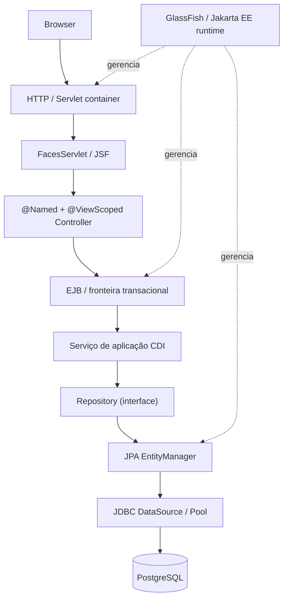

# Trilha de estudos — Java EE / Jakarta EE com comparativos Spring

> **Objetivo:** entender a plataforma Java Enterprise partindo de um repertório Spring Boot/Spring MVC, sem confundir especificações, implementações e servidores. Todo capítulo contém **conceito simples → conceito técnico → analogia com Spring → exemplo → exercício**.

## Ordem para estudar

| Etapa | Documento | O que você será capaz de explicar |
|---|---|---|
| 1 | [Plataforma e comparação com Spring](01-fundamentos-spring-jakarta.md) | O que é especificação, implementação, framework, contêiner e servidor |
| 2 | [MVC e requisição de ponta a ponta](02-mvc-fluxo-requisicao.md) | Quem atende HTTP, valida, chama serviço e devolve HTML/JSON |
| 3 | [JSF / PrimeFaces](03-jsf-primefaces.md) | XHTML, FacesServlet, Managed Bean, lifecycle, view state, action e AJAX |
| 4 | [CDI e gerenciamento de beans](04-cdi-injecao.md) | IoC, DI por construtor, qualifiers, producers, escopos e proxies |
| 5 | [EJB e transações](05-ejb-transacoes.md) | Stateless/Stateful, CMT/BMT, REQUIRED, REQUIRES_NEW e rollback |
| 6 | [JPA, Hibernate, EclipseLink, JDBC e SQL](06-persistencia-jpa-jdbc.md) | EntityManager, ID, relacionamentos, N+1, DataSource e JTA |
| 7 | [Servidor de aplicação, WAR, JAR e EAR](07-glassfish-war-ear.md) | Como o Maven empacota, o GlassFish implanta e o contêiner inicializa os componentes |
| 8 | [Laboratório: localização do código e exercícios](08-laboratorio-troubleshooting.md) | Seguir um fluxo real no repositório, reproduzir e investigar falhas |
| 9 | [Especificações complementares](09-especificacoes-complementares.md) | Servlet, REST, Validation, Security, JMS, JSON-B/P, WebSocket, Concurrency e Batch |
| 10 | [Mesma feature: Spring e Jakarta EE](10-mesma-feature-spring-jakarta.md) | Comparação lado a lado de MVC, CDI, EJB, transação e persistência |

## Mapa da tecnologia

Esse é **o fluxo escolhido para o laboratório**, não uma imposição da plataforma: Jakarta EE também permite aplicações REST sem JSF, serviços CDI sem EJB e outros estilos de arquitetura.

## Material já existente e preservado

- [Guia original / simulado de Portugal](../GUIA_ESTUDOS.md): material extenso com anotações da prova relatada, questões reconstruídas e gabarito.
- [Laboratório MVC executável](../laboratorio/README.md): Java 17, Jakarta EE 10, GlassFish 7.1, PrimeFaces e PostgreSQL via Docker Compose.
- [Plano prático](../PLANO_PRATICO.md): objetivos, testes e critérios de aceite.
- [Treinamento introdutório anterior](../laboratorio/docs/01-glossario-jakarta-ee-dummy.md): abordagem por analogias.

> **Limites dos exemplos:** exemplos curtos neste guia são didáticos e nem todos são classes incluídas no laboratório. Caminhos de arquivo indicam quando o código **já existe** no repositório. As questões de prova foram reconstruídas a partir de anotações, não são transcrições oficiais.

## Método de estudo de cada capítulo

1. Leia a analogia e descreva a tecnologia em uma frase.
2. Localize a classe ou configuração correspondente no laboratório.
3. Compare a implementação Jakarta EE com a alternativa Spring.
4. Siga o fluxo real de execução e identifique os recursos gerenciados pelo contêiner.
5. Responda à pergunta de verificação sem consultar o texto.
6. Consulte as **fontes oficiais ao final de cada capítulo** quando houver detalhe de versão.

**Recorte de versões:** o laboratório usa Jakarta EE 10 (`jakarta.*`) / GlassFish 7.1. Sistemas Java EE 6/7/8 frequentemente usam `javax.*`. Exemplos de Spring usam o estilo Spring MVC/Spring Boot moderno, mas as correspondências são **conceituais, não idênticas**.
