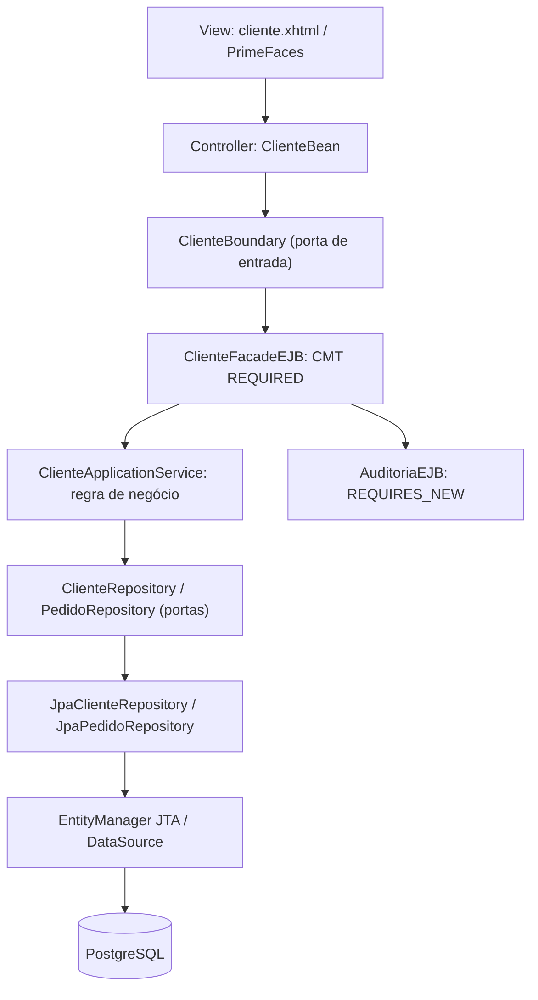

# Laboratório Java EE / Jakarta EE — MVC

Implementação didática de **cadastro de clientes e pedidos** usando **Jakarta EE 10, JSF/PrimeFaces, CDI, EJB, JPA e GlassFish 7**. O laboratório é independente dos projetos existentes no repositório.

## Arquitetura



**MVC:** View = XHTML; Controller = `ClienteBean`; Model = entidades, serviços e contratos de aplicação. **DIP:** o serviço depende das interfaces `ClienteRepository`, `PedidoRepository` e `Notificador`, nunca de implementações JPA. **SRP:** cada classe é responsável por um conceito. Todas as classes Java têm **até 80 linhas**, com teste arquitetural de proteção.

## Injeção de dependências: exceções necessárias

- **Classes de aplicação e repositórios:** injeção explícita pelo **construtor `@Inject`**, com dependências `final`. O construtor protegido sem argumentos existe apenas para compatibilidade CDI/JPA com proxies e instanciação.
- **EJBs:** `@Stateless` exige construtor público sem argumentos; a injeção na borda usa `@Inject`/`@EJB` em campos. O código de negócio efetivo é delegado a objetos com injeção por construtor.
- **JPA:** `@PersistenceContext` é recurso gerenciado pelo servidor, exposto por um produtor CDI para injeção por construtor nos repositórios.
- **Entidades JPA:** possuem construtores sem argumentos por exigência da especificação.

Essas exceções são limitações explícitas do modelo de contêiner, e **não foram escondidas para simular 100% de injeção por construtor**.

## Requisitos

- Java **17+**, Maven **3.9+**, GlassFish **7.0.x** (Jakarta EE 10).
- PostgreSQL (exemplo: localhost:5432, database `estudos_javaee`).
- Driver PostgreSQL JDBC instalado na instância GlassFish.

> O `persistence.xml` usa `schema-generation.database.action=create`: **somente em banco descartável de desenvolvimento**. Não utilizar em produção.

## Preparar banco e GlassFish

Crie um usuário/banco local de estudos no PostgreSQL e ajuste a URL/senha:

```bash
createdb estudos_javaee

# Executar após instalar o driver JDBC PostgreSQL em GlassFish e reiniciar o domínio.
asadmin start-domain domain1
asadmin create-jdbc-connection-pool \
  --datasourceclassname org.postgresql.ds.PGSimpleDataSource \
  --restype javax.sql.DataSource \
  --property user=postgres:password=postgres:databaseName=estudos_javaee:serverName=localhost:portNumber=5432 \
  EstudosPool
asadmin create-jdbc-resource --connectionpoolid EstudosPool jdbc/EstudosDS
asadmin ping-connection-pool EstudosPool
```

No caso de senha contendo caracteres especiais, consulte a sintaxe de escape de propriedades do `asadmin`. Não armazene credenciais reais em scripts versionados.

## Build, testes e deploy

```bash
cd javaee/laboratorio
mvn clean verify
asadmin deploy --force=true target/javaee-laboratorio.war
```

Depois, abra `http://localhost:8080/javaee-laboratorio/cliente.xhtml`.

O teste de integração `JpaRepositoriesIT` é executado pelo **Failsafe** na fase `verify`, em H2 (RESOURCE_LOCAL). Testes unitários e o limite de 80 linhas rodam pelo **Surefire** na fase `test`.

> Não é possível afirmar que o WAR esteja validado em servidor real sem executar o Maven, disponibilizar um GlassFish e efetuar deploy. Os testes de JPA local não substituem os testes de contêiner EJB/CDI/JSF.

## Funcionalidades já implementadas

| Função | Como estudar |
|---|---|
| Cadastrar/listar clientes | `<h:form>`, `action`, `actionListener`, DTO de leitura |
| Criar/listar pedidos | `@OneToMany`, `@ManyToOne`, JPA e consultas |
| Simular falha | `REQUIRED` com rollback e auditoria `REQUIRES_NEW` |
| Explorar CDI | `@Qualifier` em dois `Notificador` |
| Explorar FIELD/PROPERTY | `Cliente` versus `ClienteExterno` |
| Explorar atributos CMT | `TransacaoProbeEJB` (seis opções) |
| Verificar regras | `ArchitectureTest` e testes Given/When/Then |

## Roteiro manual E2E

1. Abrir formulário e tentar salvar com e-mail inválido: deve bloquear antes da action.
2. Salvar cliente válido e conferir tabela: JSF → EJB → service → JPA.
3. Criar pedido para ID existente; conferir pedidos.
4. Usar a ação de rollback: a aplicação simula exceção; auditoria independente deve persistir, enquanto o cliente temporário não deve aparecer na tabela.
5. Consultar logs de SQL/JTA do GlassFish e registros da tabela `registros_auditoria`.
6. Inspecionar o `TransacaoProbeEJB` através de invocações gerenciadas, alterando o contexto transacional (não chamar diretamente `new`).

## O que ainda depende de ambiente externo

- Configuração e testes reais de GlassFish + PostgreSQL.
- Suite automatizada de contêiner para os seis atributos transacionais.
- Teste web E2E com navegador.
- Load testing/pool, análise de SQL N+1 e batch fetch, a serem adicionados em exercícios posteriores.

Veja também [plano original](../PLANO_PRATICO.md) e [guia teórico](../GUIA_ESTUDOS_PROVA_PORTUGAL.md).
