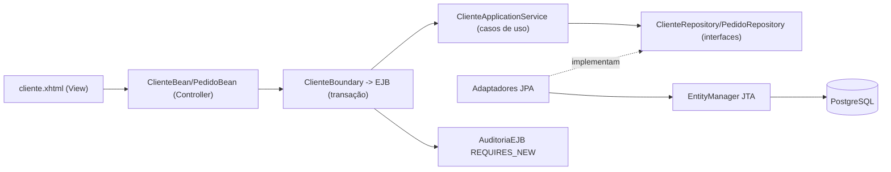

# Laboratório Java EE / Jakarta EE — MVC com GlassFish

Projeto de estudos completo para compreender **JSF/PrimeFaces, CDI, EJB, JPA/JDBC e transações** com exemplos simples de cadastro de clientes e pedidos.

**Stack de laboratório:** Java 17, Jakarta EE 10, GlassFish 7.1, PrimeFaces 14, Maven, PostgreSQL 16, JUnit 5, Mockito, Hibernate/H2 nos testes.

> Esta seção contém código de estudo, não uma aplicação pronta para produção. O objetivo é enxergar exatamente o papel de cada componente do servidor.

## Comece aqui: trilha bem explicada

| Ordem | Documento | Você vai aprender |
|---|---|---|
| 1 | [Glossário explicado do zero](docs/01-glossario-jakarta-ee-dummy.md) | O que é cada tecnologia, como interage e quando usar |
| 2 | [Arquitetura MVC, SRP e DIP](docs/02-arquitetura-mvc-srp-dip.md) | Por que cada pacote existe e como funcionam as dependências |
| 3 | [Executando GlassFish com Docker](docs/03-como-executar-glassfish.md) | Subir servidor, banco, driver, DataSource e WAR |
| 4 | [Exercícios, testes e troubleshooting](docs/04-exercicios-e-troubleshooting.md) | Praticar fluxo real, transações e investigação de erros |
| 5 | [Guia completo da prova Portugal](../GUIA_ESTUDOS_PROVA_PORTUGAL.md) | 11 perguntas relatadas, revisão teórica e simulado |

## Execute o laboratório com um comando

Requer **Docker + Compose v2**:

```bash
cd javaee/laboratorio
cp .env.example .env
docker compose up --build
```

O Dockerfile compila o WAR e usa a **imagem oficial do Eclipse GlassFish 7.1.0**. A inicialização configura o driver JDBC e o recurso JNDI **`jdbc/EstudosDS`**, aguardando o banco PostgreSQL.

**Interface web:** http://localhost:8080/javaee-laboratorio/cliente.xhtml

**Console GlassFish:** https://localhost:4848 (somente loopback; senha de desenvolvimento conforme imagem).

Para parar: `docker compose down`. Para apagar o volume do banco: `docker compose down -v` — apaga dados.

**Atenção:** o schema JPA está no modo de geração `create`: **o deploy pode recriar tabelas**. Não execute com dados importantes.

## Arquitetura em uma figura



### Estrutura dos pacotes

```text
br/com/murilo/javaee/
├── domain/model/               # Cliente, Pedido, RegistroAuditoria, ClienteExterno
├── application/
│   ├── dto/                    # Transporte entre camadas (records)
│   ├── port/inbound/           # Contratos invocados pela interface
│   ├── port/outbound/          # Contratos de persistência e notificação
│   └── service/                # Implementação das regras de cadastro
├── adapters/
│   ├── inbound/web/           # Controllers JSF
│   ├── inbound/ejb/           # Fachada transacional e auditoria
│   ├── outbound/persistence/  # Implementações JPA das portas
│   └── outbound/notification/ # Implementações de Notificador
└── infrastructure/config/     # Producer do EntityManager
```

**SRP:** cada controller cuida apenas de sua tela; repositórios cuidam da persistência; serviço cuida dos casos de uso. **DIP:** serviço depende de contratos de porta, não de implementações JPA. **DI por construtor:** aplicada no serviço, repositórios e controllers; limites de instanciação do contêiner em EJB/JPA estão documentados.

**Todas as classes Java até 80 linhas**, protegidas por `ArchitectureTest`.

## Testes automatizados

Com Maven e JDK 17 instalados localmente:

```bash
cd javaee/laboratorio
mvn clean verify
```

| Teste | Propósito |
|---|---|
| `ClienteApplicationServiceTest` | Regras de cadastro e dependências mockadas |
| `JpaRepositoriesIT` | Integração JPA/SQL com H2 e Hibernate |
| `ArchitectureTest` | Máximo 80 linhas e isolamento dos serviços |

Os testes H2/Hibernate **não substituem uma validação de deploy** no GlassFish/EclipseLink. Para exercitar EJBs e JSF, execute o Compose e siga o roteiro manual no documento 04.

## Funcionalidades para experimentar

- Formulário `<h:form>` com validações e Action/ActionListener.
- Duas interfaces de controller (`ClienteBean` e `PedidoBean`) na mesma página XHTML.
- Cadastro/listagem de clientes; cadastro/consulta de pedidos com `@ManyToOne`.
- Duas implementações do notificador diferenciadas por Qualifier CDI.
- Demonstração `@Id` no getter e identificador não gerado (`ClienteExterno`).
- Demonstração `REQUIRED` e `REQUIRES_NEW` no fluxo com erro.
- `TransacaoProbeEJB` expõe os seis atributos transacionais para estudos futuros de integração com contêiner.

## Critérios de qualidade

- MVC, SRP e DIP descritos com exemplos e nomes reais de classes.
- Infraestrutura containerizada separada dos casos de uso.
- Injeção por construtor onde compatível com o modelo de vida do componente.
- Arquivos Java de no máximo 80 linhas.
- Nenhum segredo real no repositório: `.env` ignorado.
- Separação explícita entre testes de negócio, JPA e testes de contêiner ainda pendentes.

## Limitações de validação

A implementação foi preparada para `mvn verify` e `docker compose up --build`, mas ainda **não foi testada em um runtime Docker/GlassFish real nesta sessão**. Caso o deploy falhe, consulte [troubleshooting](docs/04-exercicios-e-troubleshooting.md) e atualize a configuração conforme o log real. Não confundir configuração versionada com funcionamento verificado.
