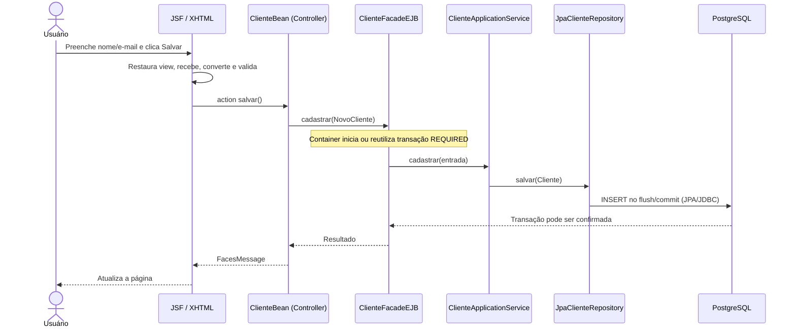

# 01 — Jakarta EE do zero: um guia "dummy"

> Aqui o objetivo não é decorar anotações. É responder: **quem cria cada objeto, quem o chama, quem controla a transação e quem grava no banco?** Os exemplos abaixo apontam para classes reais deste laboratório.

## 1. Por que existe Jakarta EE?

**Java SE** é a linguagem e suas bibliotecas básicas: classes, coleções, threads, I/O e JDBC. **Jakarta EE** acrescenta **especificações** para aplicações corporativas: interface web, injeção, persistência, componentes de negócio e transações. Uma especificação descreve **o contrato**; servidores e bibliotecas executam **a implementação**.

Analogia: **Jakarta EE é o regulamento de uma cozinha profissional; GlassFish é a cozinha equipada que realmente executa o trabalho**. Seu projeto traz os cozinheiros e as receitas (classes Java).

Java EE era o nome anterior da plataforma. Em aplicações Java EE 8, muitos imports começam com `javax.*`; em Jakarta EE 9+ começam com `jakarta.*`. Isso é particularmente importante ao manter legados. **Java EE 8 não é a mesma versão que Jakarta EE 10**.

| Elemento | Significado prático | Onde aparece neste projeto |
|---|---|---|
| JDK 17 | Compilador e ferramentas para produzir bytecode | Dockerfile/POM |
| Maven | Lê o `pom.xml`, baixa bibliotecas, compila, testa e gera WAR | `pom.xml` |
| WAR | Pacote da aplicação web, contendo classes, dependências e XHTML | `target/javaee-laboratorio.war` |
| GlassFish 7.1 | Processo servidor que implementa Jakarta EE 10 | Serviço `glassfish` |
| PostgreSQL | Guarda os registros em tabelas | Serviço `banco` |
| JDBC | API Java de acesso ao banco | Driver JDBC no GlassFish |
| DataSource | Objeto do servidor que entrega conexões | `jdbc/EstudosDS` |
| JNDI | Catálogo de nomes para localizar recursos | Nome do DataSource |
| JTA | Contrato para coordenar transações | Transações EJB |
| CDI | Descobre, cria e injeta beans, respeitando seus escopos | `@Inject` |
| EJB | Componente de negócio gerenciado pelo servidor | `ClienteFacadeEJB` |
| JPA | Padrão objeto-relacional para entidades e persistência | `@Entity`, `EntityManager` |
| JSF / Faces | Interface web baseada em árvore de componentes | `cliente.xhtml` |
| PrimeFaces | Biblioteca de componentes visuais JSF | `<p:commandButton>` |

## 2. O que acontece quando clico em Salvar?



**Atenção:** `persist()` não significa `INSERT` imediato. Dependendo da estratégia de identificação, flush e provider, o SQL é emitido em momentos diferentes. **Commit** é a confirmação da transação, e **flush** é sincronização.

## 3. O que é MVC?

- **Model:** estado e regras da aplicação. Ex.: `Cliente`, `Pedido`, `ClienteApplicationService` e os contratos de repositório.
- **View:** o que o usuário vê e preenche. Aqui, `cliente.xhtml` com Facelets e PrimeFaces.
- **Controller:** recebe intenções da interface e pede operações ao modelo. Aqui, `ClienteBean` e `PedidoBean`.

JSF controla parte significativa do fluxo HTTP automaticamente. O Managed Bean **não substitui todo o FacesServlet**: é o controlador das ações específicas da tela.

## 4. JSF (Jakarta Faces): o que são as seis fases?

Imagine preencher uma ficha. O JSF precisa primeiro reconstruir a ficha, ler os campos, validá-los, entregar os dados à aplicação e desenhar a resposta.

1. **Restore View:** recupera a árvore de componentes JSF.
2. **Apply Request Values:** componentes recebem os valores enviados pelo navegador.
3. **Process Validations:** conversores e validações são aplicados.
4. **Update Model Values:** propriedades dos beans são atualizadas.
5. **Invoke Application:** ações de negócio e navegação são executadas.
6. **Render Response:** constrói o HTML final para o navegador.

Se o campo `required` estiver vazio, a action normalmente **não chega ao serviço**, porque o ciclo pode ir diretamente para Render Response.

### Action e ActionListener

```xml
<p:commandButton action="#{clienteBean.salvar}"
                 actionListener="#{clienteBean.antesDeSalvar}" />
```

- **Action:** representa uma operação da aplicação e **pode** retornar um resultado de navegação ou `void`.
- **ActionListener:** escuta o evento do componente. Não substitui a action para decidir o fluxo de navegação.
- **Botão sem action:** ainda pode gerar postback e processar componentes; não significa exceção automática.
- **`<h:form>`:** é necessário para submissões convencionais de componentes JSF. Não confundir com o elemento HTML nativo isolado.

### Escopos de Managed Beans

| Escopo | Analogia | Quando usar |
|---|---|---|
| `@RequestScoped` | Uma folha de papel descartada ao fim de cada pedido | Operação pontual |
| `@ViewScoped` | A ficha mantida enquanto você está naquela tela | Formularios com AJAX |
| `@SessionScoped` | Pasta daquele usuário durante a sessão | Estado conversacional do usuário |
| `@ApplicationScoped` | Quadro compartilhado por todos os usuários | Serviços/configuração sem estado mutável de usuário |

Neste laboratório, os controllers usam **ViewScoped**. A action atua após validação e atualização do modelo no fluxo usual.

### PrimeFaces: process vs update

`process` escolhe os componentes usados na requisição parcial. `update` escolhe o que será redesenhado. **Processar não é o mesmo que atualizar visualmente**.

## 5. CDI: o que é injeção de dependências?

Sem CDI, um serviço poderia fazer `new JpaClienteRepository()`. Isso faria a regra de negócio conhecer e construir infraestrutura concreta.

Com CDI, a classe declara uma **interface** e recebe a implementação de fora:

```java
@Inject
public ClienteApplicationService(ClienteRepository clientes,
                                 PedidoRepository pedidos,
                                 @Operacional Notificador notificador) {
    this.clientes = clientes;
    this.pedidos = pedidos;
    this.notificador = notificador;
}
```

A anotação `@Inject` pede ao contêiner que encontre os beans adequados. `@Operacional` é um **Qualifier** que diferencia a implementação real do notificador de uma implementação simulada.

**IoC (Inversion of Control)** é o princípio de delegar a criação e ligação dos componentes; **DI** é uma forma concreta de aplicá-lo; **CDI** é uma especificação da plataforma que implementa esse mecanismo e seus contextos.

`@ApplicationScoped` **não é exatamente o padrão de projeto Singleton**: o contêiner mantém uma instância contextual compartilhada, frequentemente acessada por proxy, com regras próprias de ciclo de vida.

## 6. EJB: por que usar se já existe um Service?

O EJB serve como **fronteira de serviços do contêiner**. Ele permite delegar transações, segurança e ciclo de vida ao servidor. O `ClienteFacadeEJB` é o adaptador que inicia/participa de transação e delega a regra ao `ClienteApplicationService`.

- `@Stateless`: o contêiner não promete guardar o estado conversacional de cada cliente entre chamadas.
- `@Stateful`: pode preservar estado conversacional associado a cliente.
- `@Local`: interface de negócio local.
- `@Remote`: interface de negócio para acesso remoto de acordo com o protocolo e o servidor.
- `@EJB`: injeta referência gerenciada para um Enterprise Bean.
- `@TransactionAttribute`: escolhe comportamento transacional nas chamadas gerenciadas.

### Todos os seis atributos de transação

| Tipo | Se já existe transação | Se não existe |
|---|---|---|
| REQUIRED | Usa a atual | Cria uma |
| REQUIRES_NEW | Suspende a atual e cria outra | Cria uma |
| MANDATORY | Usa a atual | Lança erro |
| SUPPORTS | Usa a atual | Sem transação |
| NOT_SUPPORTED | Suspende a atual | Sem transação |
| NEVER | Lança erro | Sem transação |

**CMT** significa *Container-Managed Transactions*: o contêiner controla a demarcação. **BMT** significa *Bean-Managed Transactions*: o código gerencia explicitamente a demarcação, dentro das restrições da especificação.

### O exercício de rollback e auditoria

```mermaid
sequenceDiagram
    participant F as ClienteFacadeEJB (REQUIRED)
    participant A as AuditoriaEJB (REQUIRES_NEW)
    participant DB as Banco
    F->>DB: Cadastrar cliente em T1
    F->>A: registrar() 
    Note over F,A: Suspende T1; abre T2
    A->>DB: Gravar auditoria e confirmar T2
    A-->>F: Retorna; retoma T1
    F--x F: Lança erro não tratado
    Note over F,DB: T1 sofre rollback, mas T2 já confirmou
```

A chamada precisa passar pelo **proxy gerenciado** do EJB. Invocar um método com `new AuditoriaEJB()` não é equivalente e não aplica as garantias do contêiner.

## 7. JPA e Hibernate: quem faz o SQL?

**JPA / Jakarta Persistence** é a especificação de mapeamento e ciclo de vida das entidades. **Hibernate e EclipseLink** são implementações diferentes. No GlassFish, normalmente se usa EclipseLink integrado ao servidor; os testes do projeto usam Hibernate + H2. Logo, o comportamento específico do provider deve ser verificado.

| Conceito | Explicação simples |
|---|---|
| `@Entity` | Objeto cujo estado pode corresponder a uma linha da tabela |
| `@Id` | Campo/propriedade que identifica o registro |
| `@GeneratedValue` | Pedido para gerar ID — não é obrigatório para toda PK |
| `@Column` | Configuração da coluna |
| `@OneToMany` | Um cliente pode possuir vários pedidos |
| `@ManyToOne` | Cada pedido aponta para um cliente |
| `EntityManager` | Gerencia entidades e seu contexto de persistência |
| `persist` | Torna a entidade nova gerenciada e agenda inserção |
| `find` | Busca por chave primária |
| `merge` | Copia estado para uma instância gerenciada, retornando-a |
| `remove` | Marca entidade gerenciada para exclusão |
| `flush` | Sincroniza operações pendentes com o banco |
| `commit` | Confirma a transação |

**FIELD versus PROPERTY:** `@Column` no getter pode ser correto se o mapeamento usa acesso por propriedade. Veja `ClienteExterno`, que coloca `@Id` no getter e não utiliza `@GeneratedValue`.

**LAZY versus EAGER:** controla estratégias de obtenção dos relacionamentos, não promete a quantidade exata de SQLs. N+1 significa uma consulta inicial seguida de várias consultas adicionais para carregar relações; investigue com SQL logs, DTO projection, `JOIN FETCH`, `EntityGraph` e batch loading.

## 8. JDBC, DataSource e Pool

**JDBC** é o conjunto de APIs Java para conversar com banco relacional. O PostgreSQL precisa de um **driver JDBC**. O GlassFish cria um **pool**, e o JPA obtém conexões por um **DataSource JNDI**.

```text
JPA EntityManager
     ↓
DataSource jdbc/EstudosDS (GlassFish)
     ↓
EstudosPool (conexões reutilizáveis)
     ↓
Driver PostgreSQL (JDBC)
     ↓
PostgreSQL
```

Com pool, `connection.close()` normalmente **devolve a conexão ao pool**, em vez de encerrar necessariamente a conexão física. `PreparedStatement` usa parâmetros vinculados, evitando concatenar dados de usuário em SQL e mitigando SQL injection.

## 9. Como ler o projeto sem se perder

Siga uma requisição nesta ordem: `cliente.xhtml` → `ClienteBean` → `ClienteBoundary` → `ClienteFacadeEJB` → `ClienteApplicationService` → `ClienteRepository` → `JpaClienteRepository` → `EntityManager` → PostgreSQL.

Depois faça o caminho inverso para entender o resultado.

## 10. Exercícios de compreensão

1. Por que o botão sem `action` pode produzir postback?
2. Quem cria a implementação real de `ClienteRepository`?
3. Onde começa a transação REQUIRED?
4. Por que `@Column` em getter pode ser válido?
5. O que acontece se a auditoria em REQUIRES_NEW confirmar e o cadastro em REQUIRED falhar?
6. Qual a diferença entre servidor GlassFish e a biblioteca PrimeFaces?
7. Por que `@ApplicationScoped` não deve guardar o nome da pessoa atualmente logada?

**Gabarito comentado e questões adicionais:** [Guia completo da prova](../../GUIA_ESTUDOS_PROVA_PORTUGAL.md).

## Referências oficiais

- [Jakarta EE Tutorial](https://jakarta.ee/learn/docs/jakartaee-tutorial/current/)
- [Jakarta Faces](https://jakarta.ee/specifications/faces/)
- [Jakarta CDI](https://jakarta.ee/specifications/cdi/)
- [Enterprise Beans](https://jakarta.ee/specifications/enterprise-beans/)
- [Jakarta Persistence](https://jakarta.ee/specifications/persistence/)
- [Eclipse GlassFish](https://glassfish.org/)
