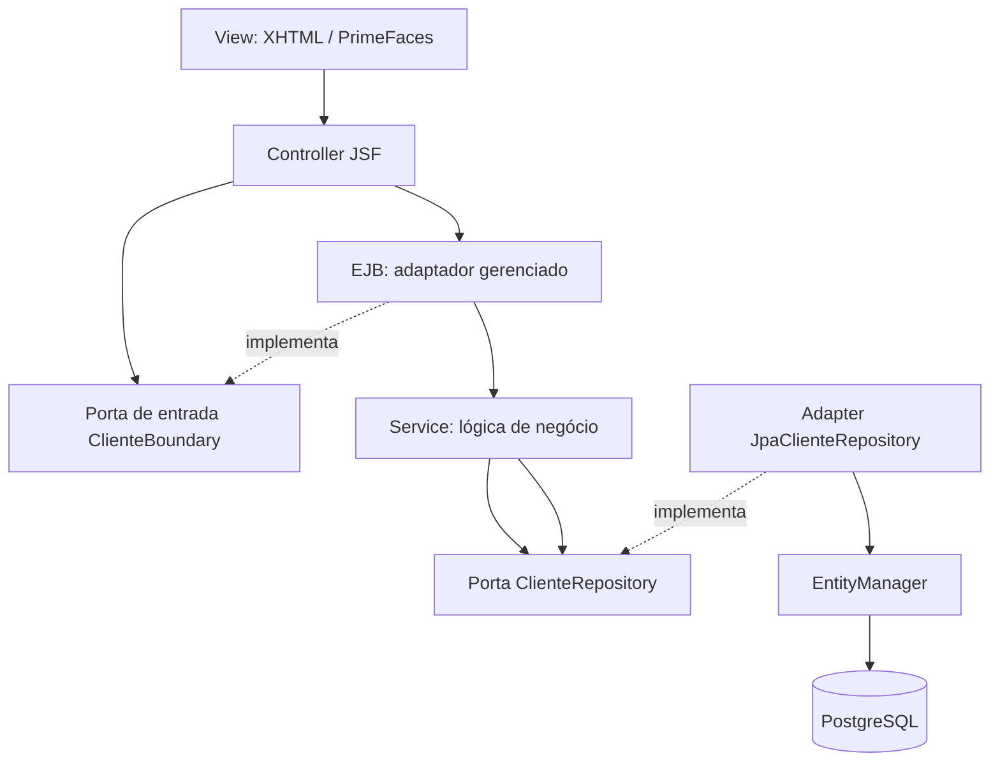
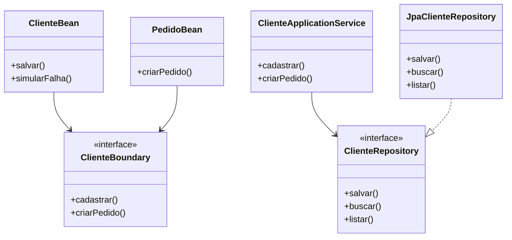

# 02 — Arquitetura do laboratório: MVC + SRP + DIP

> **Objetivo:** entender **por que cada classe existe** e conseguir trocar a implementação do banco ou da interface sem alterar as regras de negócio.

## A regra principal

**Código de regra de negócio não deve conhecer classes concretas de banco de dados nem componentes visuais JSF.**

- **SRP (Single Responsibility Principle):** cada classe tem um motivo principal para mudar.
- **DIP (Dependency Inversion Principle):** classes de alto nível dependem de abstrações, não de detalhes técnicos.
- **DI (Dependency Injection):** alguém externo entrega as dependências para uma classe.
- **MVC:** separa estado/regras, interação do usuário e visualização.

## Estrutura de pacotes

```text
src/main/java/br/com/murilo/javaee/
├── domain/
│   └── model/                       # Entidades JPA: Cliente, Pedido e Auditoria
├── application/
│   ├── dto/                         # NovoCliente, ClienteResumo, PedidoResumo
│   ├── port/
│   │   ├── inbound/                 # Contratos de entrada: ClienteBoundary, ClienteUseCase
│   │   └── outbound/                # Contratos externos: Repository, Notificador, Qualifiers
│   └── service/                     # Caso de uso: ClienteApplicationService
├── adapters/
│   ├── inbound/
│   │   ├── web/                     # Controllers JSF: ClienteBean, PedidoBean
│   │   └── ejb/                     # Fachada transacional e exemplos de EJB
│   └── outbound/
│       ├── persistence/             # Adaptadores Jpa*Repository
│       └── notification/            # Implementações de Notificador
└── infrastructure/
    └── config/                      # Resource producers para EntityManager
```

Essa organização combina **MVC na interface** com **Ports & Adapters nas dependências**. É compatível com o estudo de arquitetura hexagonal que já existe no repositório, sem chamar o JSF de tecnologia hexagonal.

## Mapa das responsabilidades

| Pacote | O que pode fazer | O que NÃO deve fazer |
|---|---|---|
| `domain.model` | Representar Cliente/Pedido e seus relacionamentos | Chamar FacesContext ou serviços HTTP |
| `application.dto` | Transferir dados pela fronteira do caso de uso | Abrir transações ou usar JSF |
| `application.port.inbound` | Definir operações do sistema | Importar repositório concreto |
| `application.port.outbound` | Declarar contratos de saída | Usar `EntityManager` |
| `application.service` | Validar e coordenar regras de negócio | Executar SQL e renderizar telas |
| `adapters.inbound.web` | Receber e apresentar dados de interface | Regras de persistência |
| `adapters.inbound.ejb` | Aplicar transações e serviços do contêiner | SQL específico de fornecedor |
| `adapters.outbound.persistence` | Implementar acesso a dados via JPA | Renderizar XHTML |
| `infrastructure.config` | Produzir recursos gerenciados | Regras de cadastro |

## Fluxo de dependências e chamadas



*Setas de chamadas de execução nem sempre representam a direção de dependência de código; a implementação de uma interface está voltada ao contrato, não o contrário.*

## Por que usamos construtor com interfaces?

```java
@Inject
public ClienteApplicationService(ClienteRepository clientes,
                                 PedidoRepository pedidos,
                                 @Operacional Notificador notificador) {
    this.clientes = clientes;
    this.pedidos = pedidos;
    this.notificador = notificador;
}
```

Quem usa o serviço sabe **o que** consegue fazer com os repositórios; não sabe **como** PostgreSQL é acessado.

Em testes, é possível trocar `ClienteRepository` por mock/fake **sem mudar a classe de negócio**.

`@Operacional` e `@Simulado` ficam junto dos contratos da porta de notificação: o serviço não precisa importar o pacote de implementação de infraestrutura.

## Limitações reais da injeção por construtor em Jakarta EE

- **Service e repositórios CDI:** usam `@Inject` em construtores e dependências `final`.
- **Beans CDI normais (`@ApplicationScoped`, `@ViewScoped`):** precisam respeitar a proxyabilidade; construtores auxiliares sem argumentos podem existir para o proxy, enquanto o contêiner escolhe o construtor anotado `@Inject` para a instância contextual.
- **Entidades JPA:** exigem construtor sem argumentos público ou protegido e não são construídas pelo CDI normalmente.
- **EJB `@Stateless`:** requer construtor público sem argumentos. A injeção `@EJB`/`@Inject` ocorre em fronteira gerenciada, e o EJB delega ao caso de uso construído pelo CDI.
- **`EntityManager @PersistenceContext`:** é um recurso gerenciado pelo servidor, exposto por produtor CDI para que repositórios recebam por construtor.

**Não é correto prometer injeção por construtor em 100% das classes** ignorando as regras de JPA e EJB. Aqui o padrão se aplica ao núcleo testável; exceções técnicas são explícitas.

## Diagrama MVC por responsabilidade



## O que acontece se mudarmos de banco?

A entidade, DTO, contratos de porta, controllers e regras do caso de uso podem continuar iguais. O adaptador de persistência e a configuração do servidor são os principais pontos que precisam de revisão.

Isso é **redução de acoplamento por inversão de dependências**, não ausência absoluta de mudanças: diferenças SQL, transacionais e de provider ainda podem exigir alterações.

## Checklist de revisão de classe

1. Consegue explicar a responsabilidade em **uma frase**?
2. O serviço importa JSF, GlassFish ou implementação concreta de JPA? **Não deveria**.
3. Onde entra uma nova implementação de repositório? **Em adapter outbound**.
4. A classe tem **no máximo 80 linhas**?
5. Recebe dependências por **construtor**, exceto bordas exigidas pelo contêiner?
6. Existe um teste demonstrando seu comportamento?
7. Há falhas e validações documentadas?

## Evolução possível

Para projetos maiores, `ClienteBoundary` pode ser dividido em portas de cadastro/consulta e portas de pedidos. Neste **laboratório pequeno**, a fachada única mantém menos infraestrutura EJB para estudar o fluxo, enquanto **ClienteBean e PedidoBean já separam as responsabilidades de interface**.
