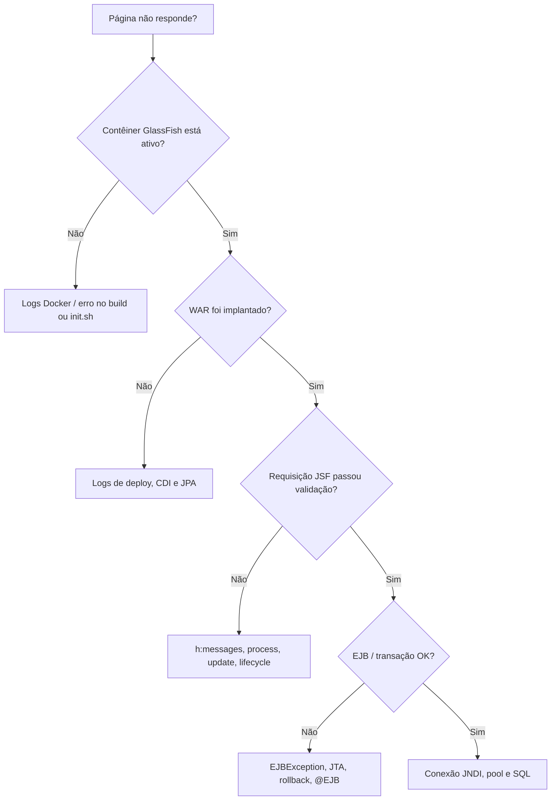

# 04 — Exercícios guiados + troubleshooting

## Entenda o que deve funcionar

1. **Cadastro de clientes:** o formulário entrega nome e e-mail ao `ClienteBean`, que chama o EJB. O `EntityManager` persiste o cliente.
2. **Cadastro de pedidos:** `PedidoBean` seleciona um cliente existente e cria um `Pedido`.
3. **Validação JSF:** os valores inválidos não seguem para a action na sequência normal.
4. **Rollback:** a transação `REQUIRED` é revertida após erro, mas a auditoria em `REQUIRES_NEW` deve continuar registrada.
5. **Qualifiers:** o container escolhe o notificador `@Operacional` entre duas implementações.
6. **Mapeamento por propriedade:** `ClienteExterno` usa `@Id` no getter e ID preenchido pela aplicação.

## Exercício 1: clique em Salvar

- **Given:** o formulário JSF com nome e e-mail preenchidos.
- **When:** clicar em Salvar.
- **Then:** a tabela de clientes é atualizada; a action e o listener participam das fases apropriadas.

**Conceitos:** `<h:form>`, Restore View, Apply Request Values, Process Validations, Update Model Values, Invoke Application e Render Response.

## Exercício 2: e-mail inválido

- **Given:** um e-mail sem formato válido.
- **When:** clicar em Salvar.
- **Then:** o JSF informa a falha e não deve executar o cadastro.

**Dica:** diferenciar valores submetidos ao componente e valores já aplicados no bean.

## Exercício 3: sem action

- **Given:** um botão JSF sem a propriedade `action`.
- **When:** clicar.
- **Then:** ainda pode ocorrer submissão/processamento parcial, sem necessariamente executar um método de negócio.

**Cuidado:** o botão demonstrativo usa `process="@this"` e `immediate="true"`, o que modifica o processamento esperado.

## Exercício 4: JPA e SQL

- **Given:** um cliente cadastrado sem pedidos.
- **When:** executar uma consulta com LEFT JOIN.
- **Then:** o cliente ainda deve estar na resposta, mesmo sem pedido relacionado.

**Dica:** um filtro em `WHERE` sobre colunas da tabela à direita pode eliminar linhas com valores `NULL`.

## Exercício 5: rollback EJB

- **Given:** cadastro de cliente em EJB `REQUIRED`.
- **When:** o código chama auditoria `REQUIRES_NEW` e depois lança uma exceção não tratada.
- **Then:** o cadastro deve sofrer rollback; a auditoria pode permanecer gravada na sua própria transação.

**Verificação:** consultar as tabelas `clientes` e `registros_auditoria` no PostgreSQL. Não conclua que houve commit apenas por aparecer o SQL de INSERT em logs.

## Exercício 6: diagnóstico do servidor

- **Given:** GlassFish e PostgreSQL em contêineres.
- **When:** reiniciar o GlassFish, tentar cadastrar e observar logs.
- **Then:** identificar claramente o DataSource JNDI, o pool JDBC e os logs de deployment.

```bash
cd javaee/laboratorio
docker compose ps
docker compose logs -f glassfish
docker compose logs -f banco
```

## Troubleshooting: do mais externo para o mais interno



### Diagnósticos rápidos

| Problema | O que investigar primeiro |
|---|---|
| `ClassNotFoundException` do driver JDBC | JAR PostgreSQL no domínio GlassFish |
| `NameNotFoundException jdbc/EstudosDS` | Inicialização do recurso via `init.sh` |
| Falha de CDI/deployment | Beans ambíguos, proxies, construtores e Qualifiers (ex.: WELD-001409) |
| `MethodNotFoundException` do JSF | Nome do bean e expressão EL na action |
| Botão não chama método | `h:form`, validações, `process`, escopo |
| Entidade não encontrada | Mapeamento PK/JPA, transação e esquema |
| Auditoria sumiu | `REQUIRES_NEW` invocado pelo proxy? commit T2? |
| Tabelas sumiram após deploy | Ação de geração de schema `create` |
| Pool esgotado | Conexões, consultas lentas, limites do pool e banco |

## Para estudo após a primeira execução

1. Criar testes automáticos de contêiner para os seis atributos transacionais.
2. Criar teste de integração JSF E2E com navegador.
3. Instrumentar N+1, comparar `JOIN FETCH` e consultas DTO.
4. Criar uma API REST paralela à tela JSF para estudar convivência brownfield.
5. Remover a geração `create` e introduzir migrações versionadas antes de tentar preservar dados.

> **Validação:** os cenários de Docker/JSF/EJB acima são roteiros planejados; dependem de execução real para serem marcados como aprovados.
